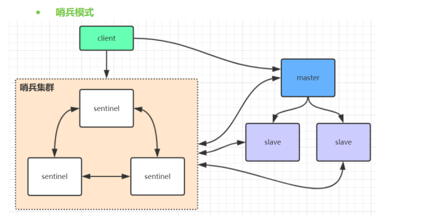
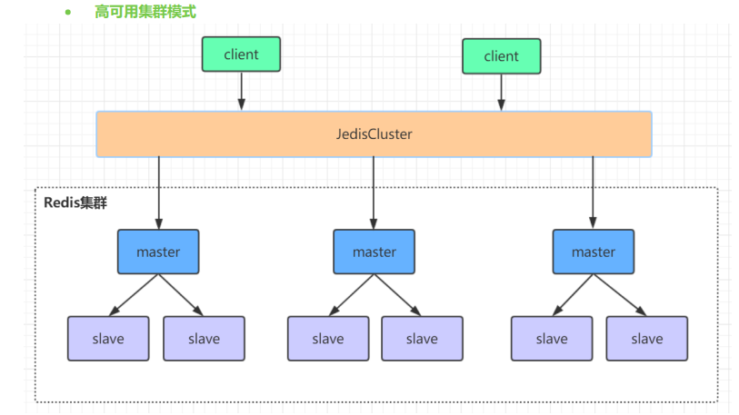
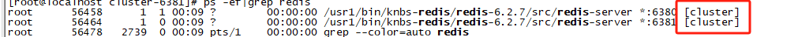
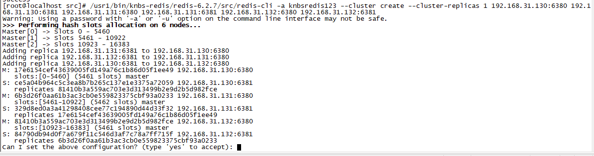
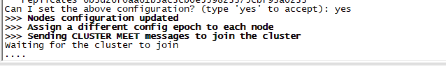
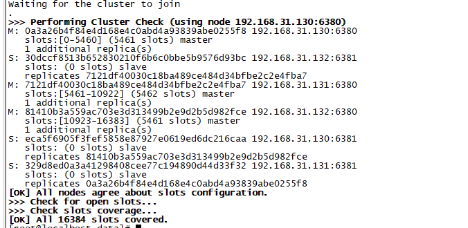
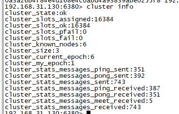
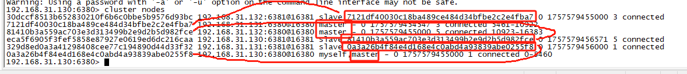

## 安装

```sh
下载地址：http://redis.io/download
安装步骤：
# 安装gcc
yum install gcc

# 把下载好的redis‐5.0.3.tar.gz放在/usr/local文件夹下，并解压
wget http://download.redis.io/releases/redis‐5.0.3.tar.gz
tar xzf redis‐5.0.3.tar.gz
cd redis‐5.0.3

 # 进入到解压好的redis‐5.0.3目录下，进行编译与安装
 make

 # 修改配置
 daemonize yes #后台启动
 protected‐mode no #关闭保护模式，开启的话，只有本机才可以访问redis
 # 需要注释掉bind
 #bind 127.0.0.1（bind绑定的是自己机器网卡的ip，如果有多块网卡可以配多个ip，代表允许客户端通过机器的哪些网卡ip去访问，内网一般可以不配置bind，注释掉即可）

 # 启动服务
 src/redis‐server redis.conf

 # 验证启动是否成功
 ps ‐ef | grep redis

 # 进入redis客户端
 src/redis‐cli

 # 退出客户端
 quit

 # 退出redis服务：
 （1）pkill redis‐server
 （2）kill 进程号
 （3）src/redis‐cli shutdown
```


## 指南

### Redis的单线程和高性能

#### Redis是单线程吗？

Redis 的单线程主要是指 Redis 的网络 IO 和键值对读写是由一个线程来完成的，这也是 Redis 对外
提供键值存储服务的主要流程。但 Redis 的其他功能，比如持久化、异步删除、集群数据同步等，其
实是由额外的线程执行的。

#### Redis 单线程为什么还能这么快？

因为它所有的数据都在内存中，所有的运算都是内存级别的运算，而且单线程避免了多线程的切换性
能损耗问题。正因为 Redis 是单线程，所以要小心使用 Redis 指令，对于那些耗时的指令(比如
keys)，一定要谨慎使用，一不小心就可能会导致 Redis 卡顿。

#### Redis 单线程如何处理那么多的并发客户端连接？

Redis的IO多路复用：redis利用epoll来实现IO多路复用，将连接信息和事件放到队列中，依次放到
文件事件分派器，事件分派器将事件分发给事件处理器。


### 最大连接数

2 127.0.0.1:6379> CONFIG GET maxclients
3 ##1) "maxclients"
4 ##2) "10000

### Info

查看redis服务运行信息，分为 9 大块，每个块都有非常多的参数，这 9 个块分别是:
| 模块               | 说明                      |
| ------------------ | ------------------------- |
|Server |服务器运行的环境参数|
|Clients |客户端相关信息|
|Memory| 服务器运行内存统计数据|
|Persistence |持久化信息|
|Stats |通用统计数据|
|Replication |主从复制相关信息|
|CPU |CPU 使用情况|
|Cluster |集群信息|
|KeySpace| 键值对统计数量信息|

```
connected_clients:2 # 正在连接的客户端数量
instantaneous_ops_per_sec:789 # 每秒执行多少次指令
used_memory:929864 # Redis分配的内存总量(byte)，包含redis进程内部的开销和数据占用的内存
used_memory_human:908.07K # Redis分配的内存总量(Kb，human会展示出单位)
used_memory_rss_human:2.28M # 向操作系统申请的内存大小(Mb)（这个值一般是大于used_memory的，因为Redis的内存分配策略会产生内存碎片）
used_memory_peak:929864 # redis的内存消耗峰值(byte)
used_memory_peak_human:908.07K # redis的内存消耗峰值(KB)
maxmemory:0 # 配置中设置的最大可使用内存值(byte),默认0,不限制
maxmemory_human:0B # 配置中设置的最大可使用内存值
maxmemory_policy:noeviction # 当达到maxmemory时的淘汰策略
```


```sh
# Server
redis_version:6.2.7
redis_git_sha1:00000000
redis_git_dirty:0
redis_build_id:c40438b84f79f7f4
redis_mode:standalone
os:Linux 3.10.0-1160.el7.x86_64 x86_64
arch_bits:64
monotonic_clock:POSIX clock_gettime
multiplexing_api:epoll
atomicvar_api:atomic-builtin
gcc_version:4.8.5
process_id:12444
process_supervised:no
run_id:74d488a497efd982abfd0a62ce96f75243ffaaf4
tcp_port:6379
server_time_usec:1757060130775863
uptime_in_seconds:6639
uptime_in_days:0
hz:10
configured_hz:10
lru_clock:12229666
executable:/usr1/bin/knbs-redis/redis-6.2.7/src/redis-server
config_file:/usr1/bin/knbs-redis/redis-6.2.7/redis.conf
io_threads_active:0

# Clients
connected_clients:2
cluster_connections:0
maxclients:9999
client_recent_max_input_buffer:24
client_recent_max_output_buffer:0
blocked_clients:0
tracking_clients:0
clients_in_timeout_table:0

# Memory
used_memory:897192
used_memory_human:876.16K
used_memory_rss:3502080
used_memory_rss_human:3.34M
used_memory_peak:3951344
used_memory_peak_human:3.77M
used_memory_peak_perc:22.71%
used_memory_overhead:853344
used_memory_startup:812144
used_memory_dataset:43848
used_memory_dataset_perc:51.56%
allocator_allocated:1369504
allocator_active:1761280
allocator_resident:4009984
total_system_memory:1019572224
total_system_memory_human:972.34M
used_memory_lua:32768
used_memory_lua_human:32.00K
used_memory_scripts:0
used_memory_scripts_human:0B
number_of_cached_scripts:0
maxmemory:0
maxmemory_human:0B
maxmemory_policy:noeviction
allocator_frag_ratio:1.29
allocator_frag_bytes:391776
allocator_rss_ratio:2.28
allocator_rss_bytes:2248704
rss_overhead_ratio:0.87
rss_overhead_bytes:-507904
mem_fragmentation_ratio:4.10
mem_fragmentation_bytes:2647656
mem_not_counted_for_evict:124
mem_replication_backlog:0
mem_clients_slaves:0
mem_clients_normal:41000
mem_aof_buffer:128
mem_allocator:jemalloc-5.1.0
active_defrag_running:0
lazyfree_pending_objects:0
lazyfreed_objects:0

# Persistence
loading:0
current_cow_size:0
current_cow_size_age:0
current_fork_perc:0.00
current_save_keys_processed:0
current_save_keys_total:0
rdb_changes_since_last_save:1
rdb_bgsave_in_progress:0
rdb_last_save_time:1757057092
rdb_last_bgsave_status:ok
rdb_last_bgsave_time_sec:0
rdb_current_bgsave_time_sec:-1
rdb_last_cow_size:184320
aof_enabled:1
aof_rewrite_in_progress:0
aof_rewrite_scheduled:0
aof_last_rewrite_time_sec:-1
aof_current_rewrite_time_sec:-1
aof_last_bgrewrite_status:ok
aof_last_write_status:ok
aof_last_cow_size:0
module_fork_in_progress:0
module_fork_last_cow_size:0
aof_current_size:403
aof_base_size:0
aof_pending_rewrite:0
aof_buffer_length:0
aof_rewrite_buffer_length:0
aof_pending_bio_fsync:0
aof_delayed_fsync:0

# Stats
total_connections_received:113
total_commands_processed:100277
instantaneous_ops_per_sec:0
total_net_input_bytes:3609765
total_net_output_bytes:530760
instantaneous_input_kbps:0.00
instantaneous_output_kbps:0.00
rejected_connections:0
sync_full:0
sync_partial_ok:0
sync_partial_err:0
expired_keys:0
expired_stale_perc:0.00
expired_time_cap_reached_count:0
expire_cycle_cpu_milliseconds:120
evicted_keys:0
keyspace_hits:18
keyspace_misses:100001
pubsub_channels:0
pubsub_patterns:0
latest_fork_usec:3103
total_forks:1
migrate_cached_sockets:0
slave_expires_tracked_keys:0
active_defrag_hits:0
active_defrag_misses:0
active_defrag_key_hits:0
active_defrag_key_misses:0
tracking_total_keys:0
tracking_total_items:0
tracking_total_prefixes:0
unexpected_error_replies:0
total_error_replies:78
dump_payload_sanitizations:0
total_reads_processed:100342
total_writes_processed:100230
io_threaded_reads_processed:0
io_threaded_writes_processed:0

# Replication
role:master
connected_slaves:0
master_failover_state:no-failover
master_replid:eddbbc410866a607d39e2c615d8d8514818f9c54
master_replid2:0000000000000000000000000000000000000000
master_repl_offset:0
second_repl_offset:-1
repl_backlog_active:0
repl_backlog_size:1048576
repl_backlog_first_byte_offset:0
repl_backlog_histlen:0

# CPU
used_cpu_sys:11.696592
used_cpu_user:5.793802
used_cpu_sys_children:0.004031
used_cpu_user_children:0.000000
used_cpu_sys_main_thread:11.683419
used_cpu_user_main_thread:5.793011

# Modules

# Errorstats
errorstat_ERR:count=72
errorstat_NOAUTH:count=5
errorstat_WRONGTYPE:count=1

# Cluster
cluster_enabled:0

# Keyspace
db0:keys=1,expires=0,avg_ttl=0
```


## 基础知识

### 查看命令帮助

链接redis后 输入 help @string @list @set @sorted_set

[官网文档](https://redis.ac.cn/docs/latest/commands/)

### 数据结构

字符串string  

哈希 hash 

列表list 

集合set 

有序集合zset


#### 字符串

##### 命令

| 命令                            | 说明                                                         | 返回值                                                    |
| ------------------------------- | ------------------------------------------------------------ | --------------------------------------------------------- |
| append key value                | 如果 key 已经存在并且是一个字符串， APPEND 命令将指定的 value 追加到该 key 原来值（value）的末尾。如果可以不存在，则会新创建一个key-value | value 的长度                                              |
| decr key                        | 若key存在，将 key 中储存的数字值减一。若key不存在，则设置新key，且从0开始减一； | 递减后的value                                             |
| decrby key decrement            | 若key存在，将key 所储存的值减去给定的减量值（decrement） 。若不存在，则设置新key，且从0开始减去给定的减量值（decrement）； | 递减后的value                                             |
| get key                         | 获取指定 key 的值。                                          | value                                                     |
| getbit key offset               | 对 key 所储存的字符串值，获取指定偏移量上的位(bit)。         | 指定偏移量上的位                                          |
| getdel key                      | 返回value 并删除key                                          |                                                           |
| getex                           | GETEX key [EX seconds \| PX milliseconds \| EXAT unix-time-seconds \|   PXAT unix-time-milliseconds \| PERSIST]                                                                                                                     `EX` *seconds* -- 设置指定的过期时间，单位为秒。 `PX` *milliseconds* -- 设置指定的过期时间，单位为毫秒。 `EXAT` *timestamp-seconds* -- 设置键将过期的指定 Unix 时间（单位为秒）。 `PXAT` *timestamp-milliseconds* -- 设置键将过期的指定 Unix 时间（单位为毫秒）。 [`PERSIST`](https://redis.ac.cn/docs/latest/commands/persist/) -- 移除与键相关联的生存时间。 |                                                           |
| getrange key start end          | 返回 key 中字符串值的子字符                                  |                                                           |
| getset key value                | 将给定 key 的值设为 value ，并返回 key 的旧值(old value)。   | 返回 key 的旧值(old value)                                |
| incr key                        | 将 key 中储存的数字值增一。                                  |                                                           |
| incrby key increment            | 将 key 所储存的值加上给定的增量值（increment） 。            | new value                                                 |
| incrbyfloat key increment       | 将 key 所储存的值加上给定的浮点增量值（increment） 。        | new value                                                 |
| lcs                             |                                                              |                                                           |
| mget key1 [key2...]             | 获取所有(一个或多个)给定 key 的值。                          | 多个key对应的value                                        |
| mset key value [key value...]   | 同时设置一个或多个 key-value 对。                            | 成功 ok                                                   |
| msetnx key value [key value...] | 同时设置一个或多个 key-value 对，当且仅当所有给定 key 都不存在。 |                                                           |
| psetex key milliseconds value   | 这个命令和 SETEX 命令相似，但它以毫秒为单位设置 key 的生存时间，而不是像 SETEX 命令那样，以秒为单位。 | 成功 ok                                                   |
| set key                         | 设置指定 key 的值。                                          | 成功 ok 失败                                              |
| setbit key offset value         | 对 key 所储存的字符串值，设置或清除指定偏移量上的位(bit)。   | value                                                     |
| setex key seconds value         | 将值 value 关联到 key ，并将 key 的过期时间设为 seconds (以秒为单位)。                     Redis Setex 命令为指定的 key 设置值及其过期时间。如果 key 已经存在， SETEX 命令将会替换旧的值。 | 设置成功时返回 OK                                         |
| setnx key value                 | 只有在 key 不存在时设置 key 的值。Setnx（**SET** if **N**ot e**X**ists） 命令在指定的 key 不存在时，为 key 设置指定的值。 | 设置成功时返回 true ，失败返回false。                     |
| setrange key offset value       | 用 value 参数覆写给定 key 所储存的字符串值，从偏移量 offset 开始。 | value 长度                                                |
| strlen key                      | 返回 key 所储存的字符串值的长度。                            | 返回 key 所储存的字符串值的长度。                         |
| SUBSTR key start end            | 获取子字符串，下标从0开始                                    | Returns the substring of the string value stored at `key` |


#### 哈希

##### 命令

|命令|说明||
|-|-|-|
|**HDEL** key field [field ...]|从存储在 `key` 的哈希中移除指定的字段。忽略哈希中不存在的指定字段。如果哈希中没有剩余字段，则删除该哈希。如果 `key` 不存在，则将其视为空哈希，此命令返回 `0`。||
|**HEXISTS** key field|返回 `field` 是否是存储在 `key` 的哈希中的现有字段。|不包含，或者键不存在，返回 `0`。如果哈希包含该字段，返回 `1`|
|**HEXPIRE** key seconds [NX \| XX \| GT \| LT] FIELDS numfields field   [field ...]|为给定哈希键的一个或多个字段设置过期时间（TTL 或生存时间）。您必须至少指定一个字段。字段的 TTL 到期时将自动从哈希键中删除。`NX` -- 对于每个指定字段，仅当字段没有过期时间时设置过期时间。 `XX` -- 对于每个指定字段，仅当字段已存在过期时间时设置过期时间。 `GT` -- 对于每个指定字段，仅当新的过期时间大于当前过期时间时设置过期时间。 `LT` -- 对于每个指定字段，仅当新的过期时间小于当前过期时间时设置过期时间。|HEXPIRE mykey 10 FIELDS 3 field1 field2 field3|
|**HEXPIREAT** key unix-time-seconds [NX \| XX \| GT \| LT] FIELDS numfields   field [field ...]|`HEXPIREAT` 的效果和语义与 [`HEXPIRE`](https://redis.ac.cn/docs/latest/commands/hexpire/) 相同，但它不是指定 TTL（生存时间）的秒数，而是采用自 Unix 纪元以来的绝对 [Unix 时间戳](http://en.wikipedia.org/wiki/Unix_time)（以秒为单位）。过去的时间戳将立即删除该字段。||
|**HEXPIRETIME** key FIELDS numfields field [field ...]|返回给定键的字段将过期的绝对 Unix 时间戳（以秒为单位）。||
|HGET key field|返回存储在 `key` 中的哈希表内与 `field` 关联的值。||
|HGETALL key|返回存储在 `key` 处的哈希的所有字段和值。在返回的值中，每个字段名称后面跟着其值，因此回复的长度是哈希大小的两倍。||
|BLMOVE source destination <LEFT \| RIGHT> <LEFT \| RIGHT> timeout|||
||||
||||
||||
||||
||||
||||
||||
|**HSET** key field value | 存储一个哈希表 key 的键值| |
|**HSETNX** key field value | 存储一个不存在的哈希表 key 的键值| |
|**HMSET** key field value [field value ...] | 在一个哈希表 key 中存储多个键值对| |
|**HGET** key field | 获取哈希表 key 对应的 field 键值| |
|**HMGET** key field [field ...] | 批量获取哈希表 key 中多个 field 键值| |
|**HDEL** key field [field ...] | 删除哈希表 key 中的 field 键值| |
|**HLEN** key | 返回哈希表 key 中 field 的数量| |
|**HGETALL** key | 返回哈希表 key 中所有的键值| |
|**HINCRBY** key field increment | 为哈希表 key 中 field 键的值加上增量 increment |  |

##### 应用场景：电商购物车

用户ID为key，商品id为field,商品数量为：value

| 操作               | 命令                      |                                  |
| ------------------ | ------------------------- | -------------------------------- |
| 添加商品           | hset cart:1001 10088 1    | cart:1001 用户 10088 商品 1 数量 |
| 增加数量           | hincrby cart:1001 10088 1 |                                  |
| 商品总数           | hlen cart:1001            |                                  |
| 删除商品           | hdel cart:1001 10088      |                                  |
| 获取购物车所有商品 | hgetall cart:1001         |                                  |

#### 列表list

##### 命令
| 操作               | 命令                      |
| ------------------ | ------------------------- |
|LPUSH key value [value ...] |将一个或多个值 value 插入到 key 列表的表头 ( 最左边 )|
|RPUSH key value [value ...] |将一个或多个值 value 插入到 key 列表的表尾 ( 最右边 )|
|LPOP key |移除并返回 key 列表的头元素|
|RPOP key |移除并返回 key 列表的尾元素|
|LRANGE key start stop |返回列表 key 中指定区间内的元素，区间以偏移量 start 和 stop 指定|
|BLPOP key [key ...] timeout |从 key 列表表头弹出一个元素，若列表中没有元素，阻塞等待timeout 秒 , 如果 timeout=0, 一直阻塞等待|
|BRPOP key [key ...] timeout |从 key 列表表尾弹出一个元素，若列表中没有元素，阻塞等待timeout 秒 , 如果 timeout=0, 一直阻塞等待|

##### 常用数据结构

Stack( 栈 ) = LPUSH + LPOP
Queue( 队列） = LPUSH + RPOP
Blocking MQ( 阻塞队列） = LPUSH + BRPOP

##### 应用场景：微博

```
用户user关注了博主 A ，B等大 V
1 ） A发微博，消息 ID 为 10018
LPUSH msg:{ user-ID} 10018
2 ）B发微博，消息 ID 为 10086
LPUSH msg:{user-ID} 10086
3 ）查看最新微博消息
LRANGE msg:{ user -ID} 0 4
```


#### 集合SET

##### Set 常用操作

| 命令                             | 解释                                                       |
| -------------------------------- | ---------------------------------------------------------- |
| **SADD** key member [member ...] | 往集合 key 中存入元素，元素存在则忽略，若 key 不存在则新建 |
| **SREM** key member [member ...] | 从集合 key 中删除元素                                      |
| **SMEMBERS** key                 | 获取集合 key 中所有元素                                    |
| **SCARD** key                    | 获取集合 key 的元素个数                                    |
| **SISMEMBER** key member         | 判断 member 元素是否存在于集合 key 中                      |
| **SRANDMEMBER** key [count]      | 从集合 key 中选出 count 个元素，元素不从 key 中删除        |
| **SPOP** key [count]             | 从集合 key 中选出 count 个元素，元素从 key 中删除          |

##### Set 运算操作

| 命令                                      | 解释                                     |
| ----------------------------------------- | ---------------------------------------- |
| **SINTER** key [key ...]                  | 交集运算                                 |
| **SINTERSTORE** destination key [key ..]  | 将交集结果存入新集合 destination 中      |
| **SUNION** key [key ..]                   | 并集运算                                 |
| **SUNIONSTORE** destination key [key ...] | 将并集结果存入新集合 destination 中      |
| **SDIFF** key [key ...]                   | 差集运算（第一个集合减去后面集合的并集） |
| **SDIFFSTORE** destination key [key ...]  | 将差集结果存入新集合 destination 中      |

##### 应用场景

###### 抽奖小程序

```
微信抽奖小程序
1 ）点击参与抽奖加入集合
SADD key {userlD}
2 ）查看参与抽奖所有用户
SMEMBERS key
3 ）抽取 count 名中奖者
SRANDMEMBER key [count] / SPOP key [count]
```

###### 朋友圈

```
微信微博点赞，收藏，标签
1) 点赞
SADD like:{ 消息 ID} { 用户 ID}
2) 取消点赞
SREM like:{ 消息 ID} { 用户 ID}
3) 检查用户是否点过赞
SISMEMBER like:{ 消息 ID} { 用户 ID}
4) 获取点赞的用户列表
SMEMBERS like:{ 消息 ID}
5) 获取点赞用户数
SCARD like:{ 消息 ID}
```

###### 关注模型

```
集合操作实现微博微信关注模型
1) 诸葛老师关注的人 :
zhugeSet-> {guojia, xushu}
2) 杨过老师关注的人 :
yangguoSet--> {zhuge, baiqi, guojia, xushu}
3) 郭嘉老师关注的人 :
guojiaSet-> {zhuge, yangguo, baiqi, xushu, xunyu)
4) 我和杨过老师共同关注 :
SINTER zhugeSet yangguoSet--> {guojia, xushu}
5) 我关注的人也关注他 ( 杨过老师 ):共同关注
SISMEMBER guojiaSet yangguo
SISMEMBER xushuSet yangguo
6) 我可能认识的人 
SDIFF yangguoSet zhugeSet->(zhuge, baiqi}
```

###### 电商商品筛选

```
SADD brand:huawei P40
SADD brand:xiaomi mi-10
SADD brand:iPhone iphone12
SADD os:android P40 mi-10
SADD cpu:brand:intel P40 mi-10
SADD ram:8G P40 mi-10 iphone12
SINTER os:android cpu:brand:intel ram:8G  {P40 ， mi-10}

```

#### ZSET

命令

 ZSet 常用操作

|命令|说明|
|-|-|
|ZADD key score member [[score member]…] | 往有序集合 key 中加入带分值元素|
|ZREM key member [member …] | 从有序集合 key 中删除元素|
|ZSCORE key member | 返回有序集合 key 中元素 member 的分值|
|ZINCRBY key increment member | 为有序集合 key 中元素 member 的分值加上 increment|
|ZCARD key | 返回有序集合 key 中元素个数|
|ZRANGE key start stop [WITHSCORES] | 正序获取有序集合 key 从 start 下标到 stop 下标的元素|
|ZREVRANGE key start stop [WITHSCORES]| 倒序获取有序集合 key 从 start 下标到 stop 下标的元素|
|• Zset 集合操作||
|ZUNIONSTORE destkey numkeys key [key ...] // 并集计算||
|ZINTERSTORE destkey numkeys key [key …] // 交集计算||

### 高阶段命令

#### 查找所有key

keys *


#### scan

scan：渐进式遍历键
SCAN cursor [MATCH pattern] [COUNT count]
scan 参数提供了三个参数，

第一个是 cursor 整数值(hash桶的索引值)，
第二个是 key 的正则模式，
第三个是一次遍历的key的数量(参考值，底层遍历的数量不一定)，并不是符合条件的结果数量。第
一次遍历时，cursor 值为 0，然后将返回结果中第一个整数值作为下一次遍历的 cursor。一直遍历
到返回的 cursor 值为 0 时结束。

注意：但是scan并非完美无瑕， 如果在scan的过程中如果有键的变化（增加、 删除、 修改） ，那
么遍历效果可能会碰到如下问题： 新增的键可能没有遍历到， 遍历出了重复的键等情况， 也就是说
scan并不能保证完整的遍历出来所有的键， 这些是我们在开发时需要考虑的。


### 压测工具

查看help ： **./redis-benchmark -h**

压测命令

```
 ./redis-benchmark -t get -a knbsredis123
```

```
====== GET ======                                                   
  100000 requests completed in 1.55 seconds
  50 parallel clients
  3 bytes payload
  keep alive: 1
  host configuration "save": 3600 1 300 100 60 10000
  host configuration "appendonly": yes
  multi-thread: no

Latency by percentile distribution:
0.000% <= 0.231 milliseconds (cumulative count 9)
50.000% <= 0.527 milliseconds (cumulative count 50722)
75.000% <= 0.663 milliseconds (cumulative count 75461)
87.500% <= 0.799 milliseconds (cumulative count 87724)
93.750% <= 0.935 milliseconds (cumulative count 93793)
96.875% <= 1.087 milliseconds (cumulative count 96948)
98.438% <= 1.279 milliseconds (cumulative count 98464)
99.219% <= 1.463 milliseconds (cumulative count 99231)
99.609% <= 1.695 milliseconds (cumulative count 99619)
99.805% <= 1.911 milliseconds (cumulative count 99812)
99.902% <= 2.127 milliseconds (cumulative count 99905)
99.951% <= 2.511 milliseconds (cumulative count 99952)
99.976% <= 2.935 milliseconds (cumulative count 99976)
99.988% <= 3.127 milliseconds (cumulative count 99988)
99.994% <= 3.215 milliseconds (cumulative count 99994)
99.997% <= 3.255 milliseconds (cumulative count 99997)
99.998% <= 3.287 milliseconds (cumulative count 99999)
99.999% <= 3.311 milliseconds (cumulative count 100000)
100.000% <= 3.311 milliseconds (cumulative count 100000)

Cumulative distribution of latencies:
0.000% <= 0.103 milliseconds (cumulative count 0)
5.045% <= 0.303 milliseconds (cumulative count 5045)
22.795% <= 0.407 milliseconds (cumulative count 22795)
45.146% <= 0.503 milliseconds (cumulative count 45146)
66.741% <= 0.607 milliseconds (cumulative count 66741)
80.203% <= 0.703 milliseconds (cumulative count 80203)
88.199% <= 0.807 milliseconds (cumulative count 88199)
92.684% <= 0.903 milliseconds (cumulative count 92684)
95.699% <= 1.007 milliseconds (cumulative count 95699)
97.138% <= 1.103 milliseconds (cumulative count 97138)
98.064% <= 1.207 milliseconds (cumulative count 98064)
98.585% <= 1.303 milliseconds (cumulative count 98585)
99.020% <= 1.407 milliseconds (cumulative count 99020)
99.335% <= 1.503 milliseconds (cumulative count 99335)
99.523% <= 1.607 milliseconds (cumulative count 99523)
99.626% <= 1.703 milliseconds (cumulative count 99626)
99.718% <= 1.807 milliseconds (cumulative count 99718)
99.804% <= 1.903 milliseconds (cumulative count 99804)
99.868% <= 2.007 milliseconds (cumulative count 99868)
99.898% <= 2.103 milliseconds (cumulative count 99898)
99.986% <= 3.103 milliseconds (cumulative count 99986)
100.000% <= 4.103 milliseconds (cumulative count 100000)

Summary:
  # QPS 
  throughput summary: 64683.05 requests per second 
  latency summary (msec):
          avg       min       p50       p95       p99       max
        0.570     0.224     0.527     0.983     1.407     3.311
```

### 持久化

#### RDB快照（snapshot）

在默认情况下， Redis 将内存数据库快照保存在名字为 dump.rdb 的二进制文件中。
你可以对 Redis 进行设置， 让它在“ N 秒内数据集至少有 M 个改动”这一条件被满足时， 自动保存一次
数据集。
比如说， 以下设置会让 Redis 在满足“ 60 秒内有至少有 1000 个键被改动”这一条件时， 自动保存一次
数据集：

```
save 60 1000 //关闭RDB只需要将所有的save保存策略注释掉即可
```

还可以手动执行命令生成RDB快照，进入redis客户端执行命令**save**或**bgsave**可以生成dump.rdb文件，每次命令执行都会将所有redis内存快照到一个新的rdb文件里，并覆盖原有rdb快照文件。

bgsave的写时复制(COW)机制

Redis 借助操作系统提供的写时复制技术（Copy-On-Write, COW），在生成快照的同时，依然可以正常处理写命令。简单来说，bgsave 子进程是由主线程 fork 生成的，可以共享主线程的所有内存数据。bgsave 子进程运行后，开始读取主线程的内存数据，并把它们写入 RDB 文件。此时，如果主线程对这些数据也都是读操作，那么，主线程和 bgsave 子进程相互不影响。但是，如果主线程要修改一块数据，那么，这块数据就会被复制一份，生成该数据的副本。然后，bgsave 子进程会把这个副本数据写入 RDB 文
件，而在这个过程中，主线程仍然可以直接修改原来的数据。

##### save与bgsave对比

| 命令                  | save             | bgsave                                         |
| --------------------- | ---------------- | ---------------------------------------------- |
| IO类型                | 同步             | 异步                                           |
| 是否阻塞redis其它命令 | 是               | 否(在生成子进程执行调用fork函数时会有短暂阻塞) |
| 复杂度                | O(n)             | O(n)                                           |
| 优点                  | 不会消耗额外内存 | 不阻塞客户端命令                               |
| 缺点                  | 阻塞客户端命令   | 需要fork子进程，消耗内存                       |

配置自动生成rdb文件后台使用的是bgsave方式。

#### AOF（append-only file）

快照功能并不是非常耐久（durable）： 如果 Redis 因为某些原因而造成故障停机， 那么服务器将丢失
最近写入、且仍未保存到快照中的那些数据。从 1.1 版本开始， Redis 增加了一种完全耐久的持久化方
式： AOF 持久化，将修改的每一条指令记录进文件appendonly.aof中(先写入os cache，每隔一段时间
fsync到磁盘)

比如执行命令“set zhuge 666”，aof文件里会记录如下数据
1 *3
2 $3
3 set
4 $5
5 zhuge
6 $3
7 666
这是一种resp协议格式数据，星号后面的数字代表命令有多少个参数，$号后面的数字代表这个参数有几
个字符
注意，如果执行带过期时间的set命令，aof文件里记录的是并不是执行的原始命令，而是记录key过期的
时间戳
比如执行“set tuling 888 ex 1000”，对应aof文件里记录如下
1 *3
2 $3
3 set
4 $6
5 tuling
6 $3
7 888
8 *3
9 $9
10 PEXPIREAT
11 $6
12 tuling
13 $13
14 1604249786301

你可以通过修改配置文件来打开 AOF 功能：

1 # appendonly yes

从现在开始， 每当 Redis 执行一个改变数据集的命令时（比如 SET）， 这个命令就会被追加到 AOF 文
件的末尾。
这样的话， 当 Redis 重新启动时， 程序就可以通过重新执行 AOF 文件中的命令来达到重建数据集的目
的。

你可以配置 Redis 多久才将数据 fsync 到磁盘一次。

有三个选项：

1 appendfsync always：每次有新命令追加到 AOF 文件时就执行一次 fsync ，非常慢，也非常安全。
2 appendfsync everysec：每秒 fsync 一次，足够快，并且在故障时只会丢失 1 秒钟的数据。
3 appendfsync no：从不 fsync ，将数据交给操作系统来处理。更快，也更不安全的选择。
推荐（并且也是默认）的措施为每秒 fsync 一次， 这种 fsync 策略可以兼顾速度和安全性。

##### AOF重写

AOF文件里可能有太多没用指令，所以AOF会定期根据内存的最新数据生成aof文件
例如，执行了如下几条命令：

```
1 127.0.0.1:6379> incr readcount
2 (integer) 1
3 127.0.0.1:6379> incr readcount
4 (integer) 2
5 127.0.0.1:6379> incr readcount
6 (integer) 3
7 127.0.0.1:6379> incr readcount
8 (integer) 4
9 127.0.0.1:6379> incr readcount
10 (integer) 5
```

重写后AOF文件里变成

```
1 *3
2 $3
3 SET
4 $2
5 readcount
6 $1
7 5
```

如下两个配置可以控制AOF自动重写频率

```
1 # auto‐aof‐rewrite‐min‐size 64mb //aof文件至少要达到64M才会自动重写，文件太小恢复速度本来就很快，重写的意义不大
2 # auto‐aof‐rewrite‐percentage 100 //aof文件自上一次重写后文件大小增长了100%则再次触发重写
```

当然AOF还可以手动重写，进入redis客户端执行命令**bgrewriteaof**重写AOF

**注意，AOF重写redis会fork出一个子进程去做(与bgsave命令类似)，不会对redis正常命令处理有太多影响**


#### RDB 和 AOF ，我应该用哪一个？

| 命令       | RDB        | AOF          |
| ---------- | ---------- | ------------ |
| 启动优先级 | 低         | 高           |
| 体积       | 小         | 大           |
| 恢复速度   | 快         | 慢           |
| 数据安全性 | 容易丢数据 | 根据策略决定 |

生产环境可以都启用，redis启动时如果既有rdb文件又有aof文件则优先选择aof文件恢复数据，因为aof
一般来说数据更全一点。


## 部署


### 主从

### 哨兵



### redis cluster

官方：最多支持1W个，实际中不要超过1K个




#### 部署步骤

##### 环境：

| 机器地址       | 路径                         | node                      |
| -------------- | ---------------------------- | ------------------------- |
| 192.168.31.130 | /usr1/bin/knbs-redis/cluster | cluster-6380 cluster-6381 |
| 192.168.31.132 | /usr1/bin/knbs-redis/cluster | cluster-6380 cluster-6381 |
| 192.168.31.132 | /usr1/bin/knbs-redis/cluster | cluster-6380 cluster-6381 |

##### 准备


##### 创建文件夹

```
mkdir -p /usr1/bin/knbs-redis/cluster/cluster-6380
mkdir -p /usr1/bin/knbs-redis/cluster/cluster-6380/data
mkdir -p /usr1/bin/knbs-redis/cluster/cluster-6381
mkdir -p /usr1/bin/knbs-redis/cluster/cluster-6381/data
```

##### 创建配置文件

```
将解压文件中的redis.config 复制到第一步的路径下
```

##### 更改配置文件

```

6 （1）daemonize yes
7 （2）port 8001（分别对每个机器的端口号进行设置）
8 （3）pidfile /var/run/redis_8001.pid # 把pid进程号写入pidfile配置的文件
9 （4）dir /usr/local/redis‐cluster/8001/（指定数据文件存放位置，必须要指定不同的目录位置，不然会
丢失数据）
10 （5）cluster‐enabled yes（启动集群模式）
11 （6）cluster‐config‐file nodes‐8001.conf（集群节点信息文件，这里800x最好和port对应上）
12 （7）cluster‐node‐timeout 10000
13 (8)# bind 127.0.0.1（bind绑定的是自己机器网卡的ip，如果有多块网卡可以配多个ip，代表允许客户端通
过机器的哪些网卡ip去访问，内网一般可以不配置bind，注释掉即可）
14 (9)protected‐mode no （关闭保护模式）
15 (10)appendonly yes
16 如果要设置密码需要增加如下配置：
17 (11)requirepass zhuge (设置redis访问密码)
18 (12)masterauth zhuge (设置集群节点间访问密码，跟上面一致)
```

集群节点配置

 [redis-6380.conf](redis.assets\redis-6380.conf) 

 [redis-6381.conf](redis.assets\redis-6381.conf) 

自启动配置

 [startclusternodes.sh](redis.assets\startclusternodes.sh) 

 [knbsredisclusternodes.service](C:\Users\zhanglipengLZ\Desktop\knbsredisclusternodes.service) 

##### 复制配置文件

给所有节点都复制该配置文件，注意更改端口号，以及与端口号相关的配置

##### 启动所有节点

```
/usr1/bin/knbs-redis/redis-6.2.7/src/redis-server /usr1/bin/knbs-redis/cluster/cluster-6380/redis-6380.conf
/usr1/bin/knbs-redis/redis-6.2.7/src/redis-server /usr1/bin/knbs-redis/cluster/cluster-6381/redis-6381.conf
```

##### 检查是否启动成功

```
ps -ef|grep redis
```



##### 放开防火墙

因为集群需要互相连通，每台机器的防火墙都要放开

需要打开redis服务端口和集群节点gossip通信端口16379(默认是在redis端口号上加1W)  

```
firewall-cmd --add-port=6380/tcp --permanent
firewall-cmd --add-port=6381/tcp --permanent
firewall-cmd --add-port=16380/tcp --permanent
firewall-cmd --add-port=16381/tcp --permanent
firewall-cmd --reload
```


##### 配置集群

```
注意：下面这条创建集群的命令大家不要直接复制，里面的空格编码可能有问题导致创建集群不成功
# -a redis节点密码    -- cluster-replicas 1   这个1 表示每台主机有一个备机
/usr1/bin/knbs-redis/redis-6.2.7/src/redis-cli -a knbsredis123 --cluster create --cluster-replicas 1 192.168.31.130:6380 192.168.31.130:6381 192.168.31.131:6380 192.168.31.131:6381 192.168.31.132:6380 192.168.31.132:6381
```

提示将要按照该配置创建集群是否接受？



输入yes，开始按照该配置创建集群。等待……



创建成功



##### 验证

```sh
/usr1/bin/knbs-redis/redis-6.2.7/src/redis-cli -a knbsredis123 -c -h 192.168.31.130 -p 6380
输入cluster info（查看集群信息） cluster nodes(查看节点信息)
```

集群信息如下：



节点信息如下：



##### 关闭集群

需要逐个进行关闭，使用命令：

```
/usr1/bin/knbs-redis/redis-6.2.7/src/redis-cli -a knbsredis123 -c -h 192.168.31.130 -p 6380 shutdown
```

##### 重启

不需要再执行 create 命令

只需要启动所有nodes节点即可


##### 重新部署

重新部署需要删掉 对应的配置文件以及 持久化数据，


```

1.停止所有节点 
ps -ef|grep redis

2.删除所有节点下的data 文件夹，文件中数据为cluster运行时数据，包括node节点信息以及持久化数据
cd /usr1/bin/knbs-redis/cluster/cluster-6380
 rm -rf data
 mkdir data
 cd /usr1/bin/knbs-redis/cluster/cluster-6381
 rm -rf data
 mkdir data
3. 然后重新启动，从新创建集群
```


## 高可用

单机内存 不超过10G；

