## 选择器

### 基本选择器

#### 分类：

##### 元素选择器

通过元素的名字进行定位，它会获取页面上所有这个元素，无论藏的多深都可以获取到

```
 元素名字{
    css样式;
 }
```

##### 类选择器

不同类型的标签使用相同的类型

```
.class的名字{
	css样式;	
}
```

##### id选择器

可以定位唯一的一个元素，不同的标签确实可以使用相同的id，但是一般我们会进行人为的控制，让id是可以唯一定位到一个元素。

```css
#id名字{
	css样式;
}
```

#### 优先级别

id选择器>class选择器>元素选择器

#### 示例

```html
<!DOCTYPE html>
<html>
        <head>
                <meta charset="UTF-8">
                <title></title>
                <style type="text/css">
                        /*
                         【1】基本选择器：元素选择器：
                         通过元素的名字进行定位，它会获取页面上所有这个元素，无论藏的多深都可以获取到
                         格式：
                         元素名字{
                         	css样式;
                         }
                         * */
                        h1{
                                color: red;
                        }
                        i{
                                color: blue;
                        }
                        /*
                         【2】基本选择器：类选择器
                         应用场合：不同类型的标签使用相同的类型
                         格式：
                         .class的名字{
                         	css样式;
                         }
                         */
                        .mycls{
                                color: green;
                        }
                        
                        /*
                         【3】基本选择器：id选择器：
                         应用场合：可以定位唯一的一个元素
                         不同的标签确实可以使用相同的id，但是一般我们会进行人为的控制，让id是可以唯一定位到一个元素。
                         格式：
                         #id名字{
                         	css样式;
                         }
                         */
                        
                        #myid{
                                color: yellow;
                        }
                </style>
        </head>
        <body>
                <h1>我是<i>一个</i>标题</h1>
                <h1>我是一个标题</h1>
                <h1 class="mycls">我是一个标题</h1>
                <h1>我是一个标题</h1>
                <h2 class="mycls">我是h2标题</h2>
                <h2>我是h2标题</h2>
                <h2 id="myid">我是h2标题</h2>
        </body>
</html>
```

### 关系选择器

#### 分类

##### 后代选择器

只要是这个元素的后代，样式都会发生变化

```css
/** div下面的所有h1标签样式都会改变**/
div h1{
        color: red;
}
```

##### 子代选择器

只改变子标签的样式

```css
div>h1{
        color: royalblue;
}
span>h1{
        color: yellow;
}
```

#### 示例

```html
<!DOCTYPE html>
<html>
        <head>
                <meta charset="UTF-8">
                <title></title>
                <style type="text/css">
                        /*关系选择器:
                         * 后代选择器：只要是这个元素的后代，样式都会发生变化
                         * div下面的所有h1标签样式都会改变
                         */
                        /*div h1{
                                color: red;
                        }*/
                        /*关系选择器：子代选择器
                         只改变子标签的样式*/
                        div>h1{
                                color: royalblue;
                        }
                        span>h1{
                                color: yellow;
                        }
                </style>
        </head>
        <body>
                <div>
                        <h1>这是标题</h1>
                        <h1>这是标题</h1>
                        <h1>这是标题</h1>
                        <h1>这是标题</h1>
                        <h1>这是标题</h1>
                        <span>
                                <h1>这是标题</h1>
                                <h1>这是标题</h1>
                                <h1>这是标题</h1>
                                <h1>这是标题</h1>
                                <h1>这是标题</h1>
                        </span>
                </div>
                        
        </body>
</html>
```

### 属性选择器

#### 示例

```html
<!DOCTYPE html>
<html>
        <head>
                <meta charset="UTF-8">
                <title></title>
                <style type="text/css">
                        /*属性选择器*/
                        input[type="password"]{
                                background-color: red;
                        }
                        input[type="text"][value="zhaoss1"]{
                                background-color: yellow;
                        }
                        
                </style>
        </head>
        <body>
                <form>
                        用户名：<input type="text" value="zhaoss1" />
                        用户名2：<input type="text" value="zhaoss2" />
                        密码：<input type="password" value="123123" />
                        <input type="submit" value="登录" />
                </form>
        </body>
</html>
```

### 伪类选择器

向某些选择器添加特殊效果

#### 示例

```html
<!DOCTYPE html>
<html>
        <head>
                <meta charset="UTF-8">
                <title></title>
                <style type="text/css">
                        .mycls:hover{
                                color: red;
                        }
                </style>
        </head>
        <body>
                <h1 class="mycls">我是标题</h1>
        </body>
</html>
```

一般伪类选择器都用在超链接上

```html
<!DOCTYPE html>
<html>
        <head>
                <meta charset="UTF-8">
                <title></title>
                <style type="text/css">
                        /*设置静止状态*/
                        a:link{
                                color: yellow;
                        }
                        /*设置鼠标悬浮状态*/
                        a:hover{
                                color: red;
                        }
                        /*设置触发状态*/
                        a:active{
                                color: blue;
                        }
                        
                        /*设置完成状态*/
                        a:visited{
                                color: green;
                        }
                </style>
        </head>
        <body>
                <a href="index.html">超链接</a>
        </body>
</html>
```

## 浮动(float)

浮动设计的初衷为了解决文字环绕图片问题，浮动后一定不会将文字挡住，这是设计初衷，不能违背的。
CSS 的 Float（浮动）使元素脱离文档流，按照指定的方向（左或右发生移动），直到它的外边缘碰到包含框或另一个浮动框的边框为止。
说到脱离文档流要说一下什么是文档流，文档流是是文档中可显示对象在排列时所占用的位置/空间，而脱离文档流就是在页面中不占位置了。


```html
<!DOCTYPE html>
<html>
        <head>
                <meta charset="UTF-8">
                <title></title>
                <style type="text/css">
                        img{
                                float: left;
                        }
                </style>
        </head>
        <body>
                
                浮动设计的初衷为了解决文字环绕图片问题，浮动后一定不会将文字挡住，这是设计初衷，不能违背的。浮动设计的初衷为了解决文字环绕图片问题，浮动后一定不会将文字挡住，这是设计初衷，不能违背的。浮动设计的初衷为了解决文字环绕图片问题，浮动后一定不会将文字挡住，这是设计初衷，不能违背的。浮动设计的初衷为了解决文字环绕图片问题，浮动后一定不会将文字挡住，这是设计初衷，不能违背的。浮动设计的初衷为了解决文字环绕图片问题，浮动后一定不会将文字挡住，这是设计初衷，不能违背的。浮动设计的初衷为了解决文字环绕图片问题，浮动后一定不会将文字挡住，这是设计初衷，不能违背的。浮动设计的初衷为了解决文字环绕图片问题，浮动后一定不会将文字挡住，这是设计初衷，不能违背的。浮动设计的初衷为了解决文字环绕图片问题，浮动后一定不会将文字挡住，这是设计初衷，不能违背的。浮动设计的初衷为了解决文字环绕图片问题，浮动后一定不会将文字挡住，这是设计初衷，不能违背的。浮动设计的初衷为了解决文字环绕图片问题，浮动后一定不会将文字挡住，这是设计初衷，不能违背的。浮动设计的初衷为了解决文字环绕图片问题，浮动后一定不会将文字挡住，这是设计初衷，不能违背的。浮动设计的初衷为了解决文字环绕图片问题，浮动后一定不会将文字挡住，这是设计初衷，不能违背的。
            
        </body>
</html>
```

### 浮动原理

当把框 1 向右浮动时，它脱离文档流并且向右移动，直到它的右边缘碰到包含框的右边缘：


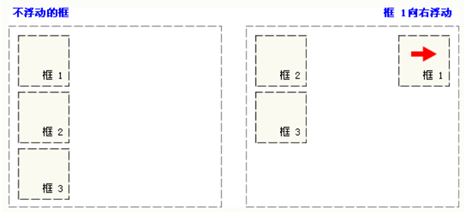

当框 1 向左浮动时，它脱离文档流并且向左移动，直到它的左边缘碰到包含框的左边缘。因为它不再处于文档流中，所以它不占据空间，实际上覆盖住了框 2，使框 2 从视图中消失。
如果把所有三个框都向左移动，那么框 1 向左浮动直到碰到包含框，另外两个框向左浮动直到碰到前一个浮动框。

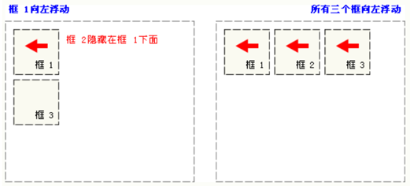

如果包含框太窄，无法容纳水平排列的三个浮动元素，那么其它浮动块向下移动，直到有足够的空间。如果浮动元素的高度不同，那么当它们向下移动时可能被其它浮动元素“卡住”：

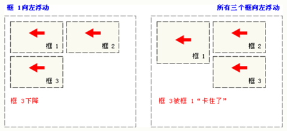


#### 示例一（没有任何浮动）

效果：（没有任何浮动）

```html
<!DOCTYPE html>
<html>
        <head>
                <meta charset="UTF-8">
                <title></title>
        </head>
        <body>
                <!--外层div-->
                <div style="background-color: pink;">
                        <div style="width: 100px;height: 100px;background-color: chartreuse;">11</div>
                        <div style="width: 200px;height: 200px;background-color: coral;">22</div>
                        <div style="width: 300px;height: 300px;background-color: yellow">33</div>
                </div>
        </body>
</html>
```

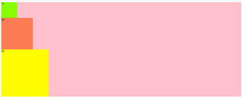

#### 示例二（绿色div加上浮动）

然后先给绿色div加上浮动：

浮动不会遮挡任何文字

```html
<!DOCTYPE html>
<html>
        <head>
                <meta charset="UTF-8">
                <title></title>
        </head>
        <body>
                <!--外层div-->
                <div style="background-color: pink;">
                        <div id="div01" style="width: 100px;height: 100px;background-color: chartreuse;float: left;">11</div>
                        <div id="div02" style="width: 200px;height: 200px;background-color: coral;">22</div>
                        <div id="div03" style="width: 300px;height: 300px;background-color: yellow">33</div>
                </div>
        </body>
</html>
```

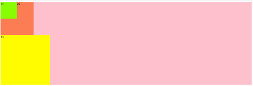

#### 示例三（给橙色div添加浮动）

再给橙色div添加浮动：

```html
<!DOCTYPE html>
<html>
        <head>
                <meta charset="UTF-8">
                <title></title>
        </head>
        <body>
                <!--外层div-->
                <div style="background-color: pink;">
                        <div id="div01" style="width: 100px;height: 100px;background-color: chartreuse;float: left;">11</div>
                        <div id="div02" style="width: 200px;height: 200px;background-color: coral;float: left;">22</div>
                        <div id="div03" style="width: 300px;height: 300px;background-color: yellow">33</div>
                </div>
        </body>
</html>
```


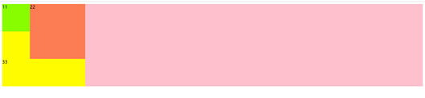

#### 示例四（给黄色div设置浮动）

再给黄色div设置浮动：

```html
<!DOCTYPE html>
<html>
        <head>
                <meta charset="UTF-8">
                <title></title>
        </head>
        <body>
                <!--外层div-->
                <div style="background-color: pink;">
                        <div id="div01" style="width: 100px;height: 100px;background-color: chartreuse;float: left;">11</div>
                        <div id="div02" style="width: 200px;height: 200px;background-color: coral;float: left;">22</div>
                        <div id="div03" style="width: 300px;height: 300px;background-color: yellow;float: left;">33</div>
                </div>
        </body>
</html>
```

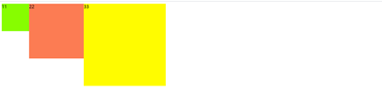


### 消除浮动影响

用浮动要考虑影响，看看是否对其他的元素有影响。

#### 方式一（overflow:hidden）

给浮动的父节点加入一个属性overflow:hidden

#### 方式二（父节点加高度）

给父节点加一个高度，让粉色div“撑起来”

#### 示例一（影响）

在三个div下面再加上一个紫色div：

```html
<!DOCTYPE html>
<html>
        <head>
                <meta charset="UTF-8">
                <title></title>
        </head>
        <body>
                <!--外层div-->
                <div style="background-color: pink;">
                        <div id="div01" style="width: 100px;height: 100px;background-color: chartreuse;float: left;">11</div>
                        <div id="div02" style="width: 200px;height: 200px;background-color: coral;float: left;">22</div>
                        <div id="div03" style="width: 300px;height: 300px;background-color: yellow;float: left;">33</div>
                </div>
                <div style="width: 500px;height: 500px;background-color: blueviolet;"></div>
        </body>
</html>
```

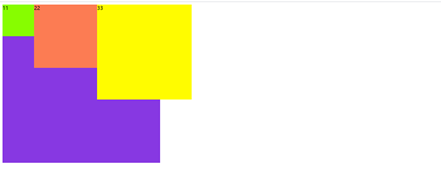

#### 示例二（方式一消除影响）

```html
<!DOCTYPE html>
<html>
        <head>
                <meta charset="UTF-8">
                <title></title>
        </head>
        <body>
                <!--外层div-->
                <div style="background-color: pink; overflow:hidden;">
                        <div id="div01" style="width: 100px;height: 100px;background-color: chartreuse;float: left;">11</div>
                        <div id="div02" style="width: 200px;height: 200px;background-color: coral;float: left;">22</div>
                        <div id="div03" style="width: 300px;height: 300px;background-color: yellow;float: left;">33</div>
                </div>
                <div style="width: 500px;height: 500px;background-color: blueviolet;"></div>
        </body>
</html>
```

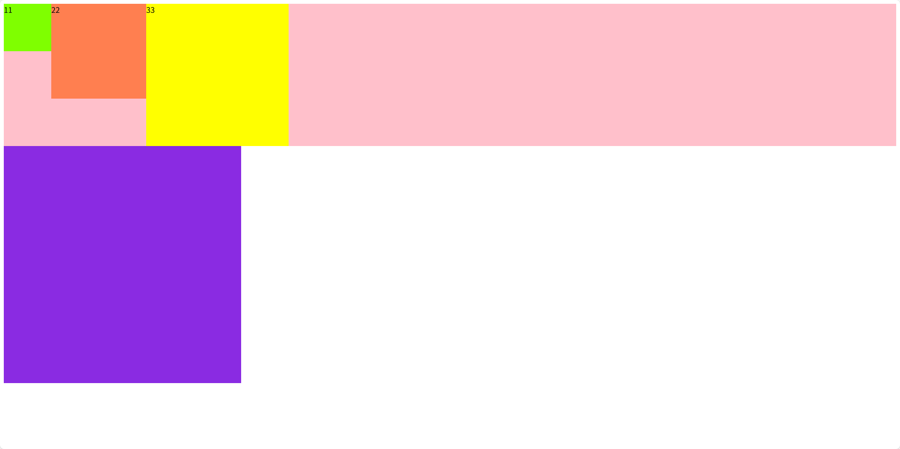

#### 示例三（方式二消除影响）

```html
<!DOCTYPE html>
<html>
        <head>
                <meta charset="UTF-8">
                <title></title>
        </head>
        <body>
                <!--外层div-->
                <div style="background-color: pink;height:600px;">
                        <div id="div01" style="width: 100px;height: 100px;background-color: chartreuse;float: left;">11</div>
                        <div id="div02" style="width: 200px;height: 200px;background-color: coral;float: left;">22</div>
                        <div id="div03" style="width: 300px;height: 300px;background-color: yellow;float: left;">33</div>
                </div>
                <div style="width: 500px;height: 500px;background-color: blueviolet;"></div>
        </body>
</html>
```

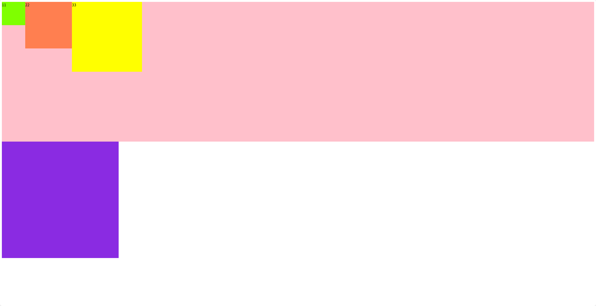

## 定位(position)

| 取值     | 说明                                                         |
| -------- | ------------------------------------------------------------ |
| absolute | 生成`绝对定位`的元素，相对于static定位以外的第一个父元素进行定位。元素的位置通过 "left" "top" "right"以及 "bootom"属性进行规定。 |
| fixed    | `固定定位`，生成绝对定位的元素，相对于浏览器窗口进行定位。元素的位置通过 "left" "top" "right"以及 "bootom"属性进行规定。 |
| relative | 生成`相对定位`的元素，相对与其正常位置进行定位 left:20,会向元素的left位置添加20像素 |
| static   | 默认值，`没有定位`，元素出现在正常的流中（忽略"top","bottom","left","right"或者"z-index"声明） |

### 静态定位(sttic)

如果我们不写position属性的话，相当于默认效果就是静态定位。
静态效果：就是元素出现在它本该出现的位置。一般使用静态定位可以直接省略不写。

### 相对定位(relative)

​	相对元素自身所在的原来的位置进行定位。 可以设置 left,right,top,bottom四个属性
​	效果：在进行相对定位以后，元素原来所在的位置被保留了，被占用了--》保留站位其他元素的位置不会发生移动
​	 一般情况下，left和right不会同时使用  ,选择一个方向即可.top和bottom不会同时使用,选择一个方向即可
若同时设置了，那么存在优先级：左上>右下

#### 示例

```html
<!DOCTYPE html>
<html>
        <head>
                <meta charset="UTF-8">
                <title></title>
        </head>
        <body>
                <!--相对定位：
                        相对元素自身所在的原来的位置进行定位。
                        可以设置 left,right,top,bottom四个属性
                        效果：在进行相对定位以后，元素原来所在的位置被保留了，被占用了--》保留站位其他元素的位置不会发生移动
                        一般情况下，left和right不会同时使用  ,选择一个方向即可.top和bottom不会同时使用,选择一个方向即可
                        优先级：左上>右下
                -->
                <div style="width: 500px;height: 500px;background-color: pink;">
                        <div style="width: 100px;height: 100px;background-color: bisque;"></div>
                        <div style="width: 100px;height: 100px;background-color: yellow;position: relative;bottom: 10px;right: 20px;"></div>
                        <div style="width: 100px;height: 100px;background-color: green;"></div>
                </div>
        </body>
</html>
```

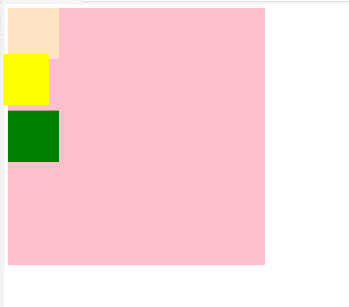


#### 应用场合

（1）元素在小范围移动的时候
（2）结合绝对定位使用

#### z-index

设置堆叠顺序，设置元素谁在上谁在下。
注意：z-index属性要设置在定位的元素上

```html
<!DOCTYPE html>
<html>
        <head>
                <meta charset="UTF-8">
                <title></title>
        </head>
        <body>
                <!--相对定位：
                        相对元素自身所在的原来的位置进行定位。
                        可以设置 left,right,top,bottom四个属性
                        效果：在进行相对定位以后，元素原来所在的位置被保留了，被占用了--》保留站位其他元素的位置不会发生移动
                        一般情况下，left和right不会同时使用  ,选择一个方向即可.top和bottom不会同时使用,选择一个方向即可
                        优先级：左上>右下
                -->
                <div style="width: 500px;height: 500px;background-color: pink;">
                        <div style="width: 100px;height: 100px;background-color: bisque;position: relative;left: 10px;z-index: -10;"></div>
                        <div style="width: 100px;height: 100px;background-color: yellow;position: relative;bottom: 10px;right: 20px;z-index: 90;"></div>
                        <div style="width: 100px;height: 100px;background-color: green;"></div>
                </div>
        </body>
</html>
```

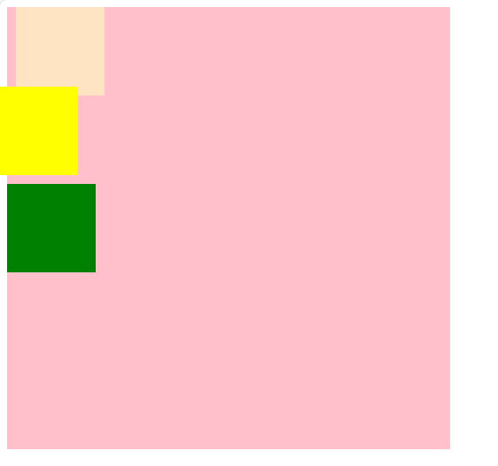

### 绝对定位（absolute）

#### 示例一

蓝色div相对body产生的位移，相对body进行位置的改变，然后蓝色div发生位移以后，原位置得到了释放。橙色div移动上去了！

```html
<!DOCTYPE html>
<html>
        <head>
                <meta charset="UTF-8">
                <title></title>
                <style type="text/css">
                        #outer{
                                width: 500px;
                                height: 500px;
                                background-color: pink;
                                margin-left:300px;
                        }
                        #div01{
                                width: 100px;
                                height: 100px;
                                background-color: cornflowerblue;
                                position: absolute;
                                left: 30px;
                                top: 50px;
                        }
                        #div02{
                                width: 100px;
                                height: 100px;
                                background-color: coral;
                        }
                </style>
        </head>
        <body>
                <div id="outer">
                        <div id="div01">111</div>
                        <div id="div02">222</div>
                </div>
        </body>
</html>
```


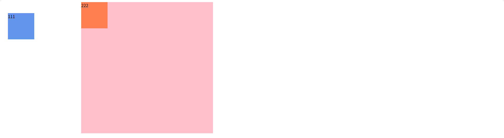

#### 示例二

实际开发中，我们往往让蓝色div在粉色div中发生位移效果：
配合定位来使用：建议使用：父级节点relative定位，子级节点使用绝对定位。

```html
<!DOCTYPE html>
<html>
        <head>
                <meta charset="UTF-8">
                <title></title>
                <style type="text/css">
                        #outer{
                                width: 500px;
                                height: 500px;
                                background-color: pink;
                                margin-left:300px;
                                position: relative;/*直接设置一个相对定位*/
                        }
                        #div01{
                                width: 100px;
                                height: 100px;
                                background-color: cornflowerblue;
                                position: absolute;
                                left: 30px;
                                top: 50px;
                        }
                        #div02{
                                width: 100px;
                                height: 100px;
                                background-color: coral;
                        }
                </style>
        </head>
        <body>
                <div id="outer">
                        <div id="div01">111</div>
                        <div id="div02">222</div>
                </div>
        </body>
</html>
```


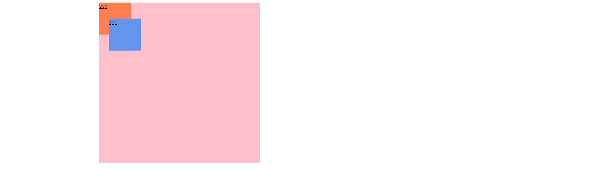


#### 总结

当给一个元素设置了绝对定位的时候，它相对谁变化呢？

它会向上一层一层的找父级节点是否有定位，如果直到找到body了也没有定位，那么就相对body进行变化，如果父级节点有定位（绝对定位，相对定位，固定定位），但是一般我们会配合使用父级为相对定位，当前元素为绝对定位，这样这个元素就会相对父级位置产生变化。无论是上面的哪一种，都会释放原来的位置，然后其他元素会占用那个位置。

### 固定定位(fixed)

#### 示例一

```html
<!DOCTYPE html>
<html>
        <head>
                <meta charset="UTF-8">
                <title></title>
                <style type="text/css">
                        #mydiv{
                                width: 50px;
                                height: 400px;
                                background-color: cadetblue;
                                /*固定定位*/
                                position: fixed;
                                right: 0px;
                                top: 300px;
                        }
                </style>
        </head>
        <body>
                <div id="mydiv"></div>
                <p>你好</p>
                <p>你好</p>
                <p>你好</p>
                <p>你好</p>
                <p>你好</p>
                <p>你好</p>
                <p>你好</p>
                <p>你好</p>
                <p>你好</p>
                <p>你好</p>
                <p>你好</p>
                <p>你好</p>
                <p>你好</p>
                <p>你好</p>
                <p>你好</p>
                <p>你好</p>
                <p>你好</p>
                <p>你好</p>
                <p>你好</p>
                <p>你好</p>
                <p>你好</p>
                <p>你好</p>
                <p>你好</p>
                <p>你好</p>
                <p>你好</p>
                <p>你好</p>
                <p>你好</p>
                <p>你好</p>
                <p>你好</p>
                <p>你好</p>
                <p>你好</p>
                <p>你好</p>
                <p>你好</p>
                <p>你好</p>
                <p>你好</p>
                <p>你好</p>
                <p>你好</p>
                <p>你好</p>
                <p>你好</p>
                <p>你好</p>
                <p>你好</p>
                <p>你好</p>
                <p>你好</p>
                <p>你好</p>
                <p>你好</p>
                <p>你好</p>
                <p>你好</p>
                <p>你好</p>
                <p>你好</p>
                <p>你好</p>
                <p>你好</p>
                <p>你好</p>
                <p>你好</p>
                <p>你好</p>
                <p>你好</p>
                <p>你好</p>
                <p>你好</p>
                <p>你好</p>
                <p>你好</p>
                <p>你好</p>
                <p>你好</p>
                <p>你好</p>
                <p>你好</p>
                <p>你好</p>
                <p>你好</p>
                <p>你好</p>
                <p>你好</p>
                <p>你好</p>
                <p>你好</p>
                <p>你好</p>
                <p>你好</p>
                <p>你好</p>
                <p>你好</p>
                <p>你好</p>
                <p>你好</p>
                <p>你好</p>
                <p>你好</p>
                <p>你好</p>
        </body>
</html>
```

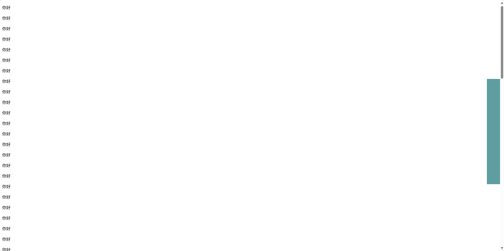

#### 应用场合

在页面过长的时候，将某个元素固定在浏览器的某个位置上，当拉动滚动条的时候，这个元素位置不动。

## 盒子模型


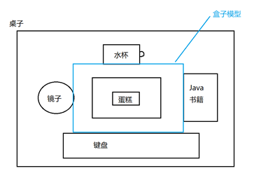

### 盒子模型

页面上也有很多元素，元素之间的布局/设计 依靠 盒子模型：
所有HTML元素可以看作盒子，在CSS中，"box model"这一术语是用来设计和布局时使用。
CSS盒模型本质上是一个盒子，封装周围的HTML元素，它包括：边距，边框，填充，和实际内容。
盒模型允许我们在其它元素和周围元素边框之间的空间放置元素。

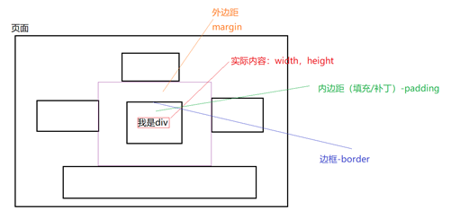

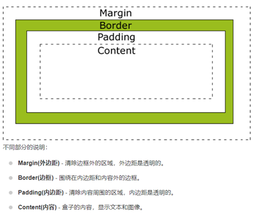


### 示例

```html
<!DOCTYPE html>
<html>
        <head>
                <meta charset="UTF-8">
                <title></title>
                <style type="text/css">
                /*将所有元素的样式：外边距，边框，内边距全部设置为0*/
                        *{
                                margin: 0px;
                                border: 0px;
                                padding: 0px;
                        }
                        #outer{
                                width: 440px;
                                height: 450px;
                                background-color: lightskyblue;
                                margin-left: 100px;
                                margin-top: 100px;
                                padding-top: 50px;
                                padding-left: 60px;
                        }
                        #mydiv{
                                width: 170px;
                                height: 150px;
                                background-color: pink;
                                padding-top: 50px;
                                padding-left: 30px;
                        }
                </style>
        </head>
        <body>
                <div id="outer">
                        <div id="mydiv">我是div</div>
                </div>
        </body>
</html>
```

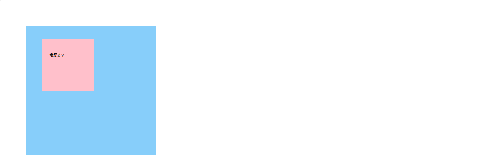


## 属性说明

### ul

| 属性            | 取值                          |      |
| --------------- | ----------------------------- | ---- |
| list-style-type | none:将无序列表前面的图标取消 |      |

### a

去掉下划线

| 属性            | 取值            |      |
| --------------- | --------------- | ---- |
| text-decoration | none:去掉下划线 |      |

