# grid


网格布局（`Grid`）是最强大的 CSS 布局方案。

它将网页划分成一个个**网格**，可以任意组合不同的网格，做出各种各样的布局。以前，只能通过复杂的 CSS 框架达到的效果，现在浏览器内置了。

`Grid` 布局与 `Flex` 布局有一定的相似性，都可以指定容器内部多个项目的位置。但是，它们也存在重大**区别**。

**Flex 布局**是**轴线布局**，只能指定"项目"针对轴线的位置，可以看作是**一维布局**。**Grid 布局**则是将容器划分成"行"和"列"，产生**单元格**，然后指定"项目所在"的单元格，可以看作是**二维布局**，意味着**可以同时处理行和列**。Grid 布局远比 Flex 布局强大。

**注意**：设为网格布局以后，容器子元素（项目）的`float`、`display: inline-block`、`display: table-cell`、`vertical-align`和`column-*`等设置都将失效。

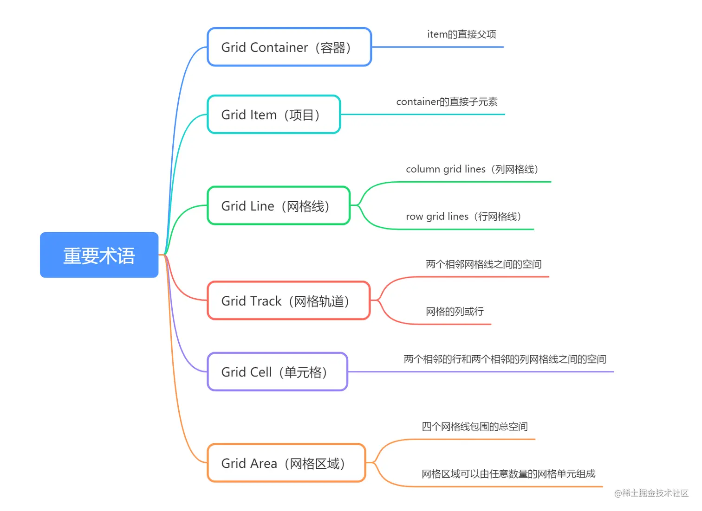

## 2.1 容器和项目

采用网格布局的区域，称为"容器"（`container`）。容器内部采用网格定位的子元素，称为"项目"（`item`）。

```html
<div>
  <div><p>1</p></div>
  <div><p>2</p></div>
  <div><p>3</p></div>
</div>
```

上面代码中，最外层的`<div>`元素就是容器，内层的三个`<div>`元素就是项目。

**注意**：项目只能是容器的**顶层子元素**，不包含项目的子元素，比如上面代码的`<p>`元素就不是项目。Grid 布局***只对项目生效***。

## 2.2 行和列

容器里面的水平区域称为"行"（row），垂直区域称为"列"（column）。

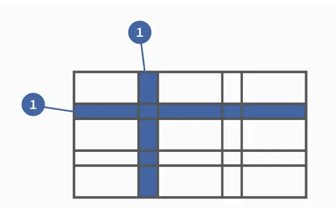

## 2.3 单元格

行和列的交叉区域，称为"单元格"（cell）。

正常情况下，n行和m列会产生n x m个单元格。比如，3行3列会产生9个单元格。

## 2.4 网格线

划分网格的线，称为"网格线"（grid line）。水平网格线划分出行，垂直网格线划分出列。

正常情况下，n行有n + 1根水平网格线，m列有m + 1根垂直网格线，比如三行就有四根水平网格线。

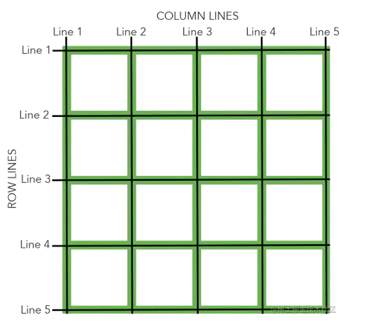

# 3.容器属性

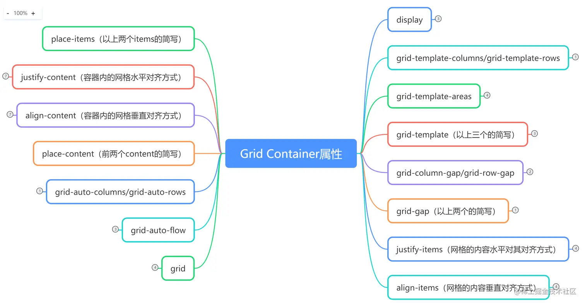

## 3.1 display属性

`display: grid`指定一个容器采用网格布局。

默认情况下，容器元素都是块级元素，但也可以设成行内元素。

```css
div {
  display: inline-grid;
}
```

上面代码指定`div`是一个行内元素，该元素内部采用网格布局。

## 3.2 grid-template-columns 属性，grid-template-rows 属性

`grid-template-columns`属性定义每一列的列宽，

`grid-template-rows`属性定义每一行的行高。

```css
.container {
  display: grid;
  /*指定了一个三行三列的网格，列宽和行高都是100px*/
  grid-template-columns: 100px 100px 100px;
  grid-template-rows: 100px 100px 100px;
}
/*除了使用绝对单位，也可以使用百分比。*/
.container {
  display: grid;
  grid-template-columns: 33.33% 33.33% 33.33%;
  grid-template-rows: 33.33% 33.33% 33.33%;
}
```

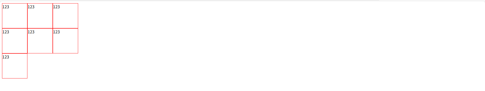

### 3.2.1 repeat()

重复写同样的值非常麻烦，尤其网格很多时。这时，可以使用`repeat()`函数，简化重复的值。 
`repeat()`接受**两个参数**，第一个参数是重复的次数（上例是3），第二个参数是所要重复的值。 上面的代码用`repeat()`改写如下

```
.container {
  display: grid;
  grid-template-columns: repeat(3, 33.33%);
  grid-template-rows: repeat(3, 33.33%);
}
```

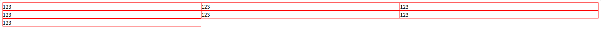

repeat()**重复**某种**模式**也是可以的。

```css
grid-template-columns: repeat(2, 100px 80px 180px);
/*定义了6列，第一列和第四列的宽度为100px，第二列和第五列为20px，第三列和第六列为80px。*/
```

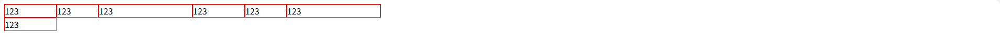

### 3.2.2 auto-fill 关键字

有时，单元格的大小是固定的，但是容器的大小不确定。如果希望每一行（或每一列）容纳尽可能多的单元格，这时可以使用`auto-fill`关键字表示**自动填充**。

```css
.container {
  display: grid;
  grid-template-columns: repeat(auto-fill, 100px);
}
/*表示每列宽度100px，然后自动填充，直到容器不能放置更多的列。*/
```

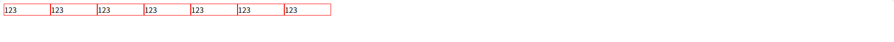

### 3.2.3 fr 关键字

为了方便表示比例关系，网格布局提供了`fr`关键字（`fraction` 的缩写，意为"片段"）。如果两列的宽度分别为1fr和2fr，就表示后者是前者的两倍。

```css
css 体验AI代码助手 代码解读复制代码.container {
  display: grid;
  grid-template-columns: 1fr 1fr;
}
/*表示两个相同宽度的列*/
```

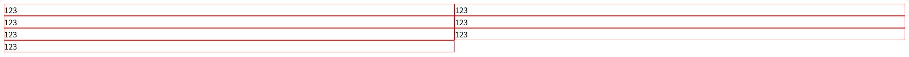

`fr`可以与**绝对长度**的单位结合使用，这时会非常方便。

```css
.container {
  display: grid;
  grid-template-columns: 150px 1fr 2fr;
}
/*表示第一列宽度为150px，第二列宽度是第三列的一半*/
```

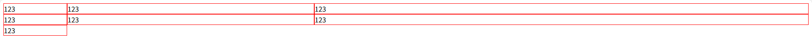

### 3.2.4 minmax()

`minmax()`函数产生一个长度范围，表示长度就在这个范围之中。它接受两个参数，分别为最小值和最大值。

```css
grid-template-columns: 1fr 1fr minmax(100px, 1fr);
/*minmax(100px, 1fr)表示列宽不小于100px，不大于1fr，即闭合区间。*/
```

### 3.2.5 auto 关键字

`auto`关键字表示由浏览器自己决定长度。 行/列的大小由容器的大小和列中网格元素内容的大小决定。

```css
grid-template-columns: 100px auto 100px;
/*第二列的宽度，基本上等于该列单元格的最大宽度，除非单元格内容设置了min-width，且这个值大于最大宽度。*/
```

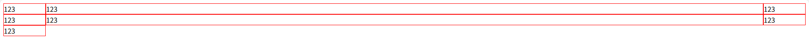

### 3.2.6 网格线的名称

`grid-template-columns`属性和`grid-template-rows`属性里面，还可以使用方括号，指定每一根网格线的名字，方便以后的引用。

```css
.container {
  display: grid;
  grid-template-columns: [c1] 100px [c2] 100px [c3] auto [c4];
  grid-template-rows: [r1] 100px [r2] 100px [r3] auto [r4];
}
/*指定网格布局为3行 x 3列，因此有4根垂直网格线和4根水平网格线。方括号里面依次是这八根线的名字。*/
```

网格布局允许同一根线有多个名字，比如[fifth-line row-5]。

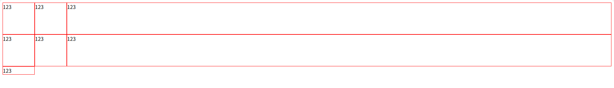

### 3.2.7 布局实例

`grid-template-columns`属性对于网页布局非常有用。**两栏式布局**只需要一行代码。

```css
.wrapper {
  display: grid;
  grid-template-columns: 70% 30%;
}
/*将左边栏设为70%，右边栏设为30%*/
```

传统的十二网格布局

```css
grid-template-columns: repeat(12, 1fr);
```

## 3.3 grid-row-gap 属性，grid-column-gap 属性，grid-gap 属性

`grid-row-gap`属性设置行与行的间隔（行间距），`grid-column-gap`属性设置列与列的间隔（列间距）。

```css
.container {
  grid-row-gap: 20px;
  grid-column-gap: 20px;
}
```

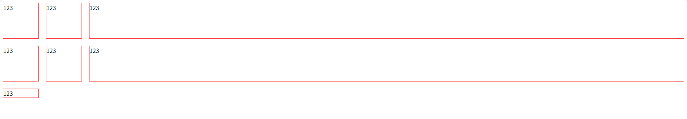

`grid-gap`属性是`grid-column-gap`和`grid-row-gap`的合并简写形式，语法如下。如果grid-gap**省略**了第二个值，浏览器认为第二个值**等于**第一个值。

```css
grid-gap: <grid-row-gap> <grid-column-gap>;
/*上面的代码等价于以下*/
.container {
  grid-gap: 20px 20px;
  /*或者是*/
  grid-gap: 20px;
}
```

根据最新标准，上面三个属性名的grid-前缀已经删除，`grid-column-gap`和`grid-row-gap`写成`column-gap`和`row-gap`，`grid-gap`写成`gap`。

## 3.4 grid-template-areas 属性

网格布局允许指定"区域"（area），一个区域由单个或多个单元格组成。grid-template-areas属性用于定义区域。

```css
.container {
  display: grid;
  grid-template-columns: 100px 100px 100px;
  grid-template-rows: 100px 100px 100px;
  grid-template-areas: 'a b c'
                       'd e f'
                       'g h i';
}
```

上面代码先划分出9个单元格，然后将其定名为a到i的九个区域，分别对应这九个单元格。 多个单元格合并成一个区域的写法如下。

```css
grid-template-areas: 'a a a'
                     'b b b'
                     'c c c';
```

上面代码将9个单元格分成a、b、c三个区域。

下面是一个布局实例。

```css
grid-template-areas: "header header header"
                     "main main sidebar"
                     "footer footer footer";
/*顶部是页眉区域header，底部是页脚区域footer，中间部分则为main和sidebar。*/
```

如果某些区域不需要利用，则使用"点"（.）表示，点号代表一个空网格单元。

```css
grid-template-areas: 'a . c'
                     'd . f'
                     'g . i';
```

上面代码中，中间一列为点，表示没有用到该单元格，或者该单元格不属于任何区域。

> 注意，区域的命名会影响到网格线。每个区域的起始网格线，会自动命名为区域名-start，终止网格线自动命名为区域名-end。
> 比如，区域名为header，则起始位置的水平网格线和垂直网格线叫做header-start，终止位置的水平网格线和垂直网格线叫做header-end。

## 3.5 grid-auto-flow 属性

划分网格以后，容器的子元素会按照顺序，自动放置在每一个网格。默认的放置顺序是"**先行后列**"，即先填满第一行，再开始放入第二行，即下图数字的顺序。

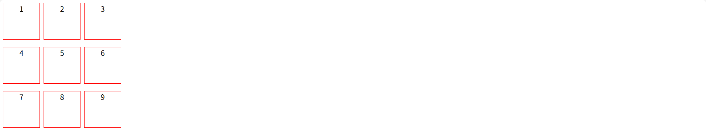

这个顺序由`grid-auto-flow`属性决定，默认值是row，即"先行后列"。也可以将它设成column，变成"先列后行"。

```css
grid-auto-flow: column;
```

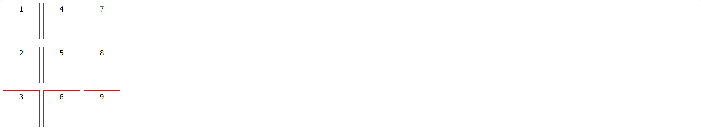

grid-auto-flow属性除了设置成`row`和`column`，还可以设成`row dense`和`column dense`。这两个值主要用于，某些项目指定位置以后，剩下的项目怎么自动放置。

```css
grid-auto-flow: row dense;
/*表示"先行后列"，并且尽可能紧密填满，尽量不出现空格*/
```

让1号项目和2号项目各占据两个单元格，然后在默认的grid-auto-flow: row情况下，会产生下面这样的布局。


上图中，1号项目后面的位置是空的，这是因为3号项目默认跟着2号项目，所以会排在2号项目后面。

现在修改设置，设为`row dense`，表示"先行后列"，并且尽可能紧密填满，尽量不出现空格。


上图会先填满第一行，再填满第二行，所以3号项目就会紧跟在1号项目的后面。8号项目和9号项目就会排到第四行。 如果将设置改为`column dense`，表示"先列后行"，并且尽量填满空格。


上图会先填满第一列，再填满第2列，所以3号项目在第一列，4号项目在第二列。8号项目和9号项目被挤到了第四列。

## 3.6 justify-items 属性，align-items 属性，place-items 属性

`justify-items`属性设置单元格内容的**水平**位置（左中右），`align-items`属性设置单元格内容的**垂直**位置（上中下）。

```css
.container {
  justify-items: start | end | center | stretch;
  align-items: start | end | center | stretch;
}
```

这两个属性的写法完全相同，都可以取下面这些值。

- start：对齐单元格的起始边缘。
- end：对齐单元格的结束边缘。
- center：单元格内部居中。
- stretch：拉伸，占满单元格的整个宽度（默认值）。

```css
.container {
  justify-items: start;
}
```


```css
.container {
  align-items: start;
}
```


`place-items`属性是`align-items`属性和`justify-items`属性的**合并简写**形式。如果省略第二个值，则浏览器认为与第一个值相等。

```css
place-items: <align-items> <justify-items>;
/*举个栗子*/
place-items: start end;
```

## 3.7 justify-content 属性，align-content 属性，place-content 属性

`justify-content`属性是整个内容区域在容器里面的水平位置（左中右），`align-content`属性是整个内容区域的垂直位置（上中下）。

```css
.container {
  justify-content: start | end | center | stretch | space-around | space-between | space-evenly;
  align-content: start | end | center | stretch | space-around | space-between | space-evenly;  
}
```


`space-evenly` - 项目与项目的间隔相等，项目与容器边框之间也是同样长度的间隔。


`place-content`属性是`align-content`属性和`justify-content`属性的合并简写形式。

## 3.8 grid-auto-columns 属性，grid-auto-rows 属性

`grid-auto-columns`属性和`grid-auto-rows`属性用来设置，浏览器自动创建的多余网格的列宽和行高。它们的写法与grid-template-columns和grid-template-rows完全相同。如果不指定这两个属性，浏览器完全根据单元格内容的大小，决定新增网格的列宽和行高。

## 3.9 grid-template 属性，grid 属性

`grid-template`属性是grid-template-columns、grid-template-rows和grid-template-areas这三个属性的合并简写形式。

`grid`属性是grid-template-rows、grid-template-columns、grid-template-areas、 grid-auto-rows、grid-auto-columns、grid-auto-flow这六个属性的合并简写形式。

# 4.项目属性

下面这些属性定义在项目上面。


## 4.1 grid-column-start 属性，grid-column-end 属性，grid-row-start 属性，grid-row-end 属性

项目的位置是可以指定的，具体方法就是指定项目的四个边框，分别定位在哪根网格线。

- `grid-column-start`属性：左边框所在的垂直网格线
- `grid-column-end`属性：右边框所在的垂直网格线
- `grid-row-start`属性：上边框所在的水平网格线
- `grid-row-end`属性：下边框所在的水平网格线 【注意】使用这四个属性，如果产生了项目的重叠，则使用z-index属性指定项目的重叠顺序。

```css
.item-1 {
  grid-column-start: 2;
  grid-column-end: 4;
}
/* 1号项目的左边框是第二根垂直网格线，右边框是第四根垂直网格线*/
```

```html
<div class="container">
    <div class="grid item-1"><p>11</p></div>
    <div class="grid">22</div>
    <div class="grid">33</div>

    <div class="grid">4</div>
    <div class="grid">5</div>
    <div class="grid">6</div>

    <div class="grid">7</div>
    <div class="grid">8</div>
    <div class="grid">9</div>
</div>
```

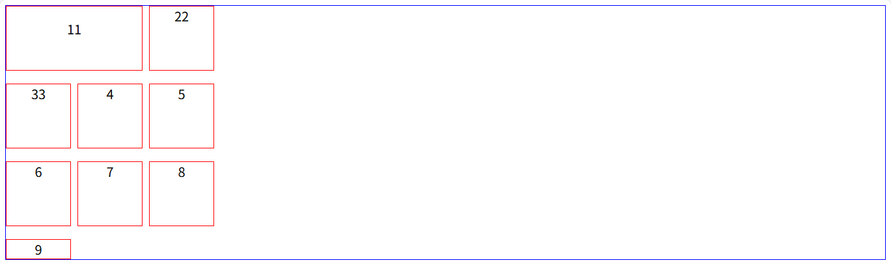

上图中，只指定了1号项目的左右边框，没有指定上下边框，所以会采用默认位置，即上边框是第一根水平网格线，下边框是第二根水平网格线。

### 4.1.1 `span`关键字

这四个属性的值还可以使用span关键字，表示"跨越"，即左右边框（上下边框）之间跨越多少个网格。

```css
css 体验AI代码助手 代码解读复制代码.item-1 {
  grid-column-start: span 2;
}
/*1号项目的左边框距离右边框跨越2个网格。*/
.item-1 {
  grid-column-end: span 2;/*与上面效果相同*/
}
```


## 4.2 grid-column 属性，grid-row 属性

grid-column属性是grid-column-start和grid-column-end的合并简写形式，grid-row属性是grid-row-start属性和grid-row-end的合并简写形式。

```css
.item {
  grid-column: <start-line> / <end-line>;
  grid-row: <start-line> / <end-line>;
}
.item-1 {
  grid-column: 1 / 3;
  grid-row: 1 / 2;
}
/* 等同于 */
.item-1 {
  grid-column-start: 1;
  grid-column-end: 3;
  grid-row-start: 1;
  grid-row-end: 2;
}
/*项目`item-1`占据第一行，从第一根列线到第三根列线*/
```

这两个属性之中，也可以使用`span`关键字，表示跨越多少个网格。

```css
css 体验AI代码助手 代码解读复制代码.item-1 {
  background: #b03532;
  grid-column: 1 / 3;
  grid-row: 1 / 3;
}
/* 等同于 */
.item-1 {
  background: #b03532;
  grid-column: 1 / span 2;
  grid-row: 1 / span 2;
}
```

项目item-1占据的区域，包括第一行 + 第二行、第一列 + 第二列。


斜杠以及后面的部分可以省略，默认跨越一个网格。

```css
css 体验AI代码助手 代码解读复制代码.item-1 {
  grid-column: 1;
  grid-row: 1;
}
/*项目`item-1`占据左上角第一个网格*/
```

## 4.3 grid-area 属性

grid-area属性指定项目放在哪一个区域。

```css
.item-1 {
  grid-area: e;
}
```

1号项目位于e区域，效果如下图


grid-area属性还可用作`grid-row-start`、`grid-column-start`、`grid-row-end`、`grid-column-end`的合并简写形式，直接指定项目的位置

```css
.item {
  grid-area: <row-start> / <column-start> / <row-end> / <column-end>;
}
css 体验AI代码助手 代码解读复制代码.item-1 {
  grid-area: 1 / 1 / 3 / 3;
}
```

## 4.4 justify-self 属性，align-self 属性，place-self 属性

- `justify-self`属性设置单元格内容的水平位置（左中右），跟`justify-items`属性的用法完全一致，但只作用于单个项目。
- `align-self`属性设置单元格内容的垂直位置（上中下），跟`align-items`属性的用法完全一致，也是只作用于单个项目。
- `place-self`属性是`align-self`属性和`justify-self`属性的合并简写形式。【注意】如果省略第二个值，place-self属性会认为这两个值相等。

```css
.item {
  justify-self: start | end | center | stretch;
  align-self: start | end | center | stretch;
  place-self: <align-self> <justify-self>;
}
```

- start：对齐单元格的起始边缘。
- end：对齐单元格的结束边缘。
- center：单元格内部居中。
- stretch：拉伸，占满单元格的整个宽度（默认值）。

```css
place-self: center center;
```

参考博客：

```
链接：https://juejin.cn/post/7031432455357743140
```