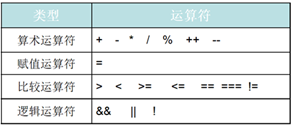
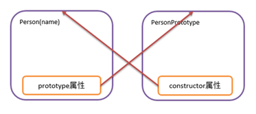
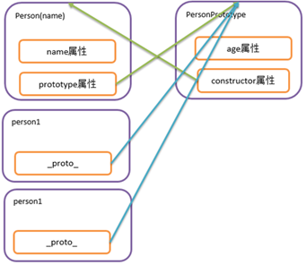
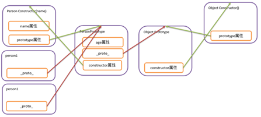

# javascript

## 介绍

Javascript是一种由Netscape(网景)的LiveScript发展而来的原型化继承的面向对象的动态类型的区分大小写的客户端脚本语言，主要目的是为了解决服务器端语言，比如Perl，遗留的速度问题，为客户提供更流畅的浏览效果。当时服务端需要对数据进行验证，由于网络速度相当缓慢,只有28.8kbps，验证步骤浪费的时间太多。于是Netscape的浏览器Navigator加入了Javascript，提供了数据验证的基本功能。JavaScript 的正式名称是 "ECMAScript"。这个标准由 ECMA 组织发展和维护。


ECMA-262 是正式的 JavaScript 标准。这个标准基于 JavaScript (Netscape) 和 JScript (Microsoft)。Netscape (Navigator 2.0) 的 Brendan Eich 发明了这门语言，从 1996 年开始，已经出现在所有的 Netscape 和 Microsoft 浏览器中。ECMA-262 的开发始于 1996 年，在 1997 年 7 月，ECMA 会员大会采纳了它的首个版本。

### 组成

JavaScript的组成包含ECMAScript、DOM、BOM。JS是一种运行于浏览器端上的小脚本语句,可以实现网页如文本内容动,数据动态变化和动画特效等


#### ECMAScript

是一种由欧洲计算机制造商协会（ECMA）通过ECMA-262标准化的脚本程序语言,简单点说，ECMAScript描述了语法、类型、语句、关键字、保留字、运算符和对象。它就是定义了脚本语言的所有属性、方法和对象。

#### DOM

把整个页面规划成由节点层构成的文档，它不与浏览器、平台、语言相关，为web开发者提供一个标准可以访问站点中的数据、脚本和表现层对象.DOM编程可以实现网页内容校验和动态变化的效果

#### BOM

是浏览器的一种特性，它可以对浏览器窗口进行访问和操作，例如移动、关闭窗口，调整窗口的大小，支持cookie等。BOM编程可以实现动态控制浏览器本身行为的效果


也有人这么说:


`ECMAScript`可以理解为JS的基础语法部分

`DOM`可以简单理解为,使用document对象操作文档内容的编程

`BOM`可以理解为,使用window对象操作浏览器行为的编程

### 使用场合

数据的校验

页面内容动态处理DOM

页面动画的处理

控制浏览器的行为BOM

### 特点

JS是运行在浏览器上的一种脚本语言

#### 1.脚本语言 

脚本语言是一种简单的程序，规模小,不需要编译,运行快,是由一些ASCII字符构成，可以使用任何一种文本编辑器编写。脚本语言是指在web浏览器内有解释器解释执行的编程语言，每次运行程序的时候，解释器会把程序代码翻译成可执行的格式。一些程序语言（如C、C++、Java等）都必须经过编译，将源代码编译成二进制的可执行文件之后才能运行，而脚本语言不需要事先编译，只要有一个与其相适应的解释器就可以执行。

#### 2.基于对象的语言  

面向对象有三大特点（封装，继承，多态）缺一不可。通常"基于对象"是使用对象，但是无法利用现有的对象模板产生新的对象类型，也就是说"基于对象"没有继承的特点。没有了继承的概念也就无从谈论"多态"

#### 3.事件驱动：

在网页中执行了某种操作的动作，被称为"事件"(Event)，比如按下鼠标、移动窗口、选择菜单等都可以视为事件。当事件发生后，可能会引起相应的事件响应。

#### 4.简单性

变量类型是采用弱类型，并未使用严格的数据类型。var a,b,c;  a=123;  b="abc"; a=b; 

#### 5.安全性

JavaScript不能访问本地的硬盘，不能将数据存入到服务器上，不能对网络文档进行修改和删除，只能通过浏览器实现信息浏览或动态交互

#### 6.跨平台性

JavaScript依赖于浏览器本身，与操作平台无关， 只要计算机安装了支持JavaScript的浏览器（装有JavaScript解释器），JavaScript程序就可以正确执行。

### 缺点

各种浏览器支持JavaScript的程度是不一样的，支持和不完全支持JavaScript的 浏览器在浏览同一个带有JavaScript脚本的网页时，效果会有一定的差距，有时甚至会显示不出来。


### JS 和java的区别

#### 区别1：公司不同，前身不同

JavaScript是Netscape公司的产品，是为了扩展Netscape Navigator功能而开发的一种可以嵌入Web页面中的基于对象和事件驱动的解释性语言，它的前身是Live Script；Java是SUN公司推出的新一代面向对象的程序设计语言，特别适合于Internet应用程序开发； Java的前身是Oak语言。

 

#### 区别2：基于对象和面向对象

JavaScript是脚本语言，是一种基于对象的语言。本身提供了非常丰富的内部对象供设计人员使用，但不支持继承和多态。Java是面向对象的，是一种真正的面向对象的语言，支持封装、继承和多态。

 

#### 区别3：变量类型强弱不同

Java采用强类型变量检查，即所有变量在编译之前必须声明为某一指定类型。如: int  x=1234;JavaScript中是弱类型变量。统一采用var声明，可赋各种数据类型值。

#### 区别4: 运行的位置不同

Java运行与服务器端的,大型编程语言, JS运行于客户端(浏览器)一种小规模脚本语言


### HTML和CSS和JS这之间的关系

HTML和CSS和JS都是前端的主要技术,三者各有分工.HTML可以用于制作网页的主体结构,CSS用于给网页做美化,JS用于在网页上添加动态效果

### 引入方式

#### 内嵌式引入

在head标签中,用一对script标签,嵌入JS代码
type属性可以省略不写

```html
<!DOCTYPE html>
<html>
        <head>
                <meta charset="utf-8" />
                <title></title>
                <!--内嵌式引入方式
                        1在head标签中,用一对script标签,嵌入JS代码
                        2type属性可以省略不写
                -->
                <script type="text/javascript">
                        
                        /*定义一个函数(方法)*/
                        function fun1(){
                                /*弹窗提示一点信息 */
                                alert("你好")
                        }
                        
                        
                </script>
        </head>
        <body>
                
                <input type="button" value="点我呀" onclick="fun1()" />
                
        </body>
</html>

```

##### 缺点

1我们定义的JS代码只能在当前一个网页中使用,代码复用度低,可维护性低

2 JS代码和HTML代码混合在一个文件中,可阅读性差


#### 链接式引用

```html
 <script type="text/javascript" src="js/myjs.js"></script>
```

提高的代码复用度， 降低了代码维护的难度

1. 一个页面可以同时引入多个不同的JS文件
2.  script标签一点用于引入外部JS文件,就不能在中间定义内嵌式代码
3.  一个页面上可以用多个script标签  位置也不是非得放到head标签中不可
4. src属性可以指向一个网络路径,就是第三种引入方式


```html
<!DOCTYPE html>
<html>
        <head>
                <meta charset="UTF-8">
                <title></title>
                <script type="text/javascript" src="js/myjs.js"></script>
                <script type="text/javascript" src="js/myjs2.js"></script>
                <!--<script type="text/javascript" src="URL网络路径"></script>
        </head>
        <body>
                <input type="button" value="点我呀" onclick="fun1()" />
                <input type="button" value="点我呀2" onclick="fun2()" />
                <input type="button" value="点我呀3" onclick="fun3()" />
                <script >
                        function fun3(){
                                alert("总能见到你")
                        }
                </script>
        </body>
</html>
```

#### 优点:

代码复用度高,更易于维护代码

##### 注意事项:

1. 在一个页面上可以同时引入多个JS文件
2. 每个JS文件的引入都要使用一个独立的script标签
3. 内嵌式和链接式的引入不能使用同一标签


## ECMA 

数据类型和运算符 流程控制 数组 对象

### 数据类型

#### 分类

##### 数值型：

number整数和浮点数统称为数值。例如85或3.1415926等。

##### 字符串型：

String由0个,1个或多个字符组成的序列。在JavaScript中，用双引号或单引号括起来表示，如"您好"、'学习JavaScript' 等。

##### 逻辑（布尔）型：

boolean用true或false来表示。

##### 空（null）值：

表示没有值，用于定义空的或不存在的引用。要注意，空值不等同于空字符串""或0。

##### 未定义（undefined）值：

它也是一个保留字。表示变量虽然已经声明，但却没有赋值。

##### 其他

除了以上五种基本的数据类型之外，JavaScript还支持复合数据类型Object，复合数据类型包括对象和数组两种。

#### 注意

1. JS是弱类型的脚本语言,所有的变量 对象 的数据类型的声明统统是var 
2. 变量声明时没有确定具体的数据类型,在变量赋值时确定变量具体的数据类型
3. JS中的变量可以反复声明,后声明的会覆盖之前声明的同名变量
4. JS中的得代码可以不用以;作为结尾  每一行代码都是一个独立的语句(建议写)
5.  JS中字符串一般不区分 ""  ''  只要不混用即可
6. 可以用不同的类型的数据给变量赋值,变量会自动改变自身的数据类型
7. 当给一个变量赋值为null时,变量的类型为 object 
8. 变量只声明不赋值的情况下,数据和数据类型都显示 undefined
9. 对象 数组其他类型可以叫做复合数据类型 object
10.  JS中的标识符命名规则和JAVA中的保持一致即可 尽量避免 使用$ 会和jQuery冲突


### 运算符



1. 数字类型都是number,除法的结果中如果没有小数位,直接就是一个整数,如有小数位,才是浮点数 
2. JS中如果出现除零,那么结果是 infinity,而不是报错 
3. 和0取余数,出现NaN   not a number 不是一个数字


#### **关于+**

 \+ 同时也是连接运算符,看两端的变量类型,

如果都是number那么就是算数中的加法 

如果有字符串,那么就是连接符号,

如果是布尔类型和number相加,那么会将true转化为1 将false 转化为0


#### **关于== 等值符** 

先比较类型,如果类型一致,再比较内容,如果类型不一致,会强制转换为number再比较内容

#### **关于=== 等同符** 

数据类型不同 直接返回false，如果类型相同 才会比较内容

### 流程控制

基本和JAVA中的一致

#### 分支结构 if  switch

```html
<!DOCTYPE html>
<html>
        <head>
                <meta charset="UTF-8">
                <title></title>
                <script>
                        /*
                         * 定义变量表示月份
                         * 根据月份输出该月的季节和应季活动
                         * */
                        var i=10;
                        if(i ==12 || i ==1 || i==2){
                                alert("大约在冬季: 冬天吃火锅");
                        }else if(i >= 3 && i<=5 ){
                                alert("春天来了: 春天吃青菜");
                        }else if(i >= 6 && i <= 8){
                                alert("夏天到了: 吃烧烤喝啤酒");
                        }else if(i >= 9 && i <=11){
                                alert("秋天到了: 贴秋膘");
                        }else{
                                alert("月份有误")
                        }
                        
                        
                        switch(i){
                                case 3:
                                case 4:
                                case 5:
                                        alert("春眠不觉晓");
                                        break;
                                case 6:
                                case 7:
                                case 8:
                                        alert("夏天蚊子咬");
                                        break;
                                case 9:
                                case 10:
                                case 11:
                                        alert("秋天一身包");
                                        break;
                                case 1:
                                case 2:
                                case 12:
                                        alert("冬天蚊子死翘翘");
                                        break;
                                default:
                                        alert("月份有误")
                        }
                        
                </script>
        </head>
        <body>
        </body>
</html>

```

#### 循环结构(while、do_while、for)

```html
<!DOCTYPE html>
<html>
        <head>
                <meta charset="UTF-8">
                <title></title>
                <script>
                        var i=1;
                        while(i<=10){
                                alert(i)
                                i++;
                        }
                        /*
                         * 考试,直到分数过线为止
                         * 求1-10整数和 1+10*(10/2) */
                        var sum=0;
                        var j=1;
                        do{
                                sum+=j;
                                j++;
                        }while(j<=10);
                        alert(sum)
                        
                        var sum2=0;
                        for(var z=1;z<=10;z++){
                                sum2+=z;
                        }
                        alert(sum2)
                        
                        
                        
                </script>
        </head>
        <body>
                
        </body>
</html>

```

#### 9*9乘法表

```html
<!DOCTYPE html>
<html>
        <head>
                <meta charset="UTF-8">
                <title></title>
                <script>
                        /*
                         *
                         ** 
                         ***
                         ****
                         * */
                        for(var i =1;i<=9;i++){
                                for(var j=1;j<=i;j++){
                                        document.write(j+"*"+i+"="+i*j+"&nbsp;&nbsp;&nbsp;&nbsp;&nbsp;&nbsp;")
                                }
                                document.write("<br/>")
                        }
                </script>
        </head>
        <body>
        </body>
</html>
```

### 函数

#### 声明

```html
<!DOCTYPE html>
<html>
        <head>
                <meta charset="UTF-8">
                <title></title>
                <script>
                        /*
                         * 第一种语法格式 常见
                         * function 函数名(参数列表){js代码}
                         * 
                         * 
                         * 第二种语法
                         * var 函数名=function(参数列表){JS代码}
                         * 
                         * 第三种语法 不常用 了解
                         * var 函数名=new Function('js代码')
                         * 
                         * */
                        function fun1(){
                                alert("你好");
                        }
                        
                        var fun2=function(){
                                alert("你很好")
                        }
                        
                        var fun3=new Function('alert("你非常好");');
                        
                        // 调用方法
                        fun1();
                        fun2();
                        fun3();
                </script>
        </head>
        <body>
        </body>
</html>
```

#### 参数和返回值

传入的实参可以和形参个数不一致 

如果函数中有返回值,那么直接用return关键字返回即可

```html
<!DOCTYPE html>
<html>
        <head>
                <meta charset="UTF-8">
                <title></title>
                <script>
                        /*
                         *
                         * 1传入的实参可以和形参个数不一致 
                         * 2如果函数中有返回值,那么直接用return关键字返回即可
                         * */
                        function fun1(a,b,c){
                                alert("a:"+a);
                                alert("b:"+b);
                                alert("c:"+c);
                        }
                        
                        //fun1(10,"hello js",false);
                        // 少传参数 OK
                        //fun1(1,2);
                        // 多传参数 OK 多出来的参数相当于没传
                        //fun1(10,"hello js",false,new Date());
                        
                        
                        function fun2(a,b){
                                var c=a*b;
                                return c;
                        }
                        
                        //var x =fun2(10,20);
                        //alert(x)
                        
                        // 方法本身作为参数(了解)
                        
                        function funa( i ,j){
                                return i+j;
                        }
                        
                        function funb(a){
                                return a(10,20);
                        }
                
                        var sum =funb(funa)
                        alert(sum)
                        
                        
                </script>
        </head>
        <body>
        </body>
</html>
```

####  eval 

// JS中非常特殊的一个函数,可以将一段字符串当做JS代码来执行
                        // 将字符串内容解析称JS代码并运行
                        var testStr=" var x =10 ";
                        eval(testStr);
                        console.log(x)


### 常用对象

JS基于对象的脚本语言 ,有类和对象,但是没有封装,继承,多态,Java script 中有一些浏览器直接识别并使用的对象,常见的对象有Array,String对象,Math对象,Number对象,Date对象等等.


#### Array数组

可以通过几种方式创建数组：

使用 Array 构造函数：

```
let arr1 = new Array(3);  // 创建一个长度为 3 的空数组
let arr2 = new Array(1, 2, 3);  // 创建一个包含 1, 2, 3 的数组
```

使用字面量（推荐）：

```
let arr = [1, 2, 3];  // 创建一个包含 1, 2, 3 的数组
```

第一个数组元素的索引值为 0，第二个索引值为 1，以此类推。

更多有关 JavaScript Array 内容请参考 [JavaScript Array 对象](https://www.runoob.com/js/js-obj-array.html)。

------

##### 数组属性

| 属性                                                         | 描述                             |
| :----------------------------------------------------------- | :------------------------------- |
| [constructor](https://www.runoob.com/jsref/jsref-constructor-array.html) | 返回创建数组对象的原型函数。     |
| [length](https://www.runoob.com/jsref/jsref-length-array.html) | 设置或返回数组元素的个数。       |
| [prototype](https://www.runoob.com/jsref/jsref-prototype-array.html) | 允许你向数组对象添加属性或方法。 |

------

##### Array 对象方法

| 方法                                                         | 描述                                                         |
| :----------------------------------------------------------- | :----------------------------------------------------------- |
| [[...\]](https://www.runoob.com/jsref/jsref-create-array.html) | 创建一个新数组。                                             |
| [concat()](https://www.runoob.com/jsref/jsref-concat-array.html) | 连接两个或更多的数组，并返回结果。                           |
| [copyWithin()](https://www.runoob.com/jsref/jsref-copywithin.html) | 从数组的指定位置拷贝元素到数组的另一个指定位置中。           |
| [entries()](https://www.runoob.com/jsref/jsref-entries.html) | 返回数组的可迭代对象。                                       |
| [every()](https://www.runoob.com/jsref/jsref-every.html)     | 检测数值元素的每个元素是否都符合条件。                       |
| [fill()](https://www.runoob.com/jsref/jsref-fill.html)       | 使用一个固定值来填充数组。                                   |
| [filter()](https://www.runoob.com/jsref/jsref-filter.html)   | 检测数值元素，并返回符合条件所有元素的数组。                 |
| [find()](https://www.runoob.com/jsref/jsref-find.html)       | 返回符合传入测试（函数）条件的数组元素。                     |
|                                                              |                                                              |
| [findIndex()](https://www.runoob.com/jsref/jsref-findindex.html) | 返回符合传入测试（函数）条件的数组元素索引。                 |
|                                                              |                                                              |
| [forEach()](https://www.runoob.com/jsref/jsref-foreach.html) | 数组每个元素都执行一次回调函数。                             |
| [from()](https://www.runoob.com/jsref/jsref-from.html)       | 通过给定的对象中创建一个数组。                               |
|                                                              |                                                              |
| [includes()](https://www.runoob.com/jsref/jsref-includes.html) | 判断一个数组是否包含一个指定的值。                           |
| [indexOf()](https://www.runoob.com/jsref/jsref-indexof-array.html) | 搜索数组中的元素，并返回它所在的位置。                       |
| [isArray()](https://www.runoob.com/jsref/jsref-isarray.html) | 判断对象是否为数组。                                         |
| [join()](https://www.runoob.com/jsref/jsref-join.html)       | 把数组的所有元素放入一个字符串。                             |
| [keys()](https://www.runoob.com/jsref/jsref-keys.html)       | 返回数组的可迭代对象，包含原始数组的键(key)。                |
| [lastIndexOf()](https://www.runoob.com/jsref/jsref-lastindexof-array.html) | 搜索数组中的元素，并返回它最后出现的位置。                   |
| [map()](https://www.runoob.com/jsref/jsref-map.html)         | 通过指定函数处理数组的每个元素，并返回处理后的数组。         |
| [pop()](https://www.runoob.com/jsref/jsref-pop.html)         | 删除数组的最后一个元素并返回删除的元素。                     |
| [push()](https://www.runoob.com/jsref/jsref-push.html)       | 向数组的末尾添加一个或更多元素，并返回新的长度。             |
|                                                              |                                                              |
| [reduce()](https://www.runoob.com/jsref/jsref-reduce.html)   | 将数组元素计算为一个值（从左到右）。                         |
|                                                              |                                                              |
| [reduceRight()](https://www.runoob.com/jsref/jsref-reduceright.html) | 将数组元素计算为一个值（从右到左）。                         |
| [reverse()](https://www.runoob.com/jsref/jsref-reverse.html) | 反转数组的元素顺序。                                         |
| [shift()](https://www.runoob.com/jsref/jsref-shift.html)     | 删除并返回数组的第一个元素。                                 |
| [slice()](https://www.runoob.com/jsref/jsref-slice-array.html) | 选取数组的一部分，并返回一个新数组。                         |
| [some()](https://www.runoob.com/jsref/jsref-some.html)       | 检测数组元素中是否有元素符合指定条件。                       |
| [sort()](https://www.runoob.com/jsref/jsref-sort.html)       | 对数组的元素进行排序。                                       |
| [splice()](https://www.runoob.com/jsref/jsref-splice.html)   | 从数组中添加或删除元素。                                     |
| [toString()](https://www.runoob.com/jsref/jsref-tostring-array.html) | 把数组转换为字符串，并返回结果。                             |
| [unshift()](https://www.runoob.com/jsref/jsref-unshift.html) | 向数组的开头添加一个或更多元素，并返回新的长度。             |
| [valueOf()](https://www.runoob.com/jsref/jsref-valueof-array.html) | 返回数组对象的原始值。                                       |
| [Array.of()](https://www.runoob.com/jsref/jsref-of-array.html) | 将一组值转换为数组。                                         |
| [Array.at()](https://www.runoob.com/jsref/jsref-at-array.html) | 用于接收一个整数值并返回该索引对应的元素，允许正数和负数。负整数从数组中的最后一个元素开始倒数。 |
| [Array.flat()](https://www.runoob.com/jsref/jsref-flat-array.html) | 创建一个新数组，这个新数组由原数组中的每个元素都调用一次提供的函数后的返回值组成。 |
| [Array.flatMap()](https://www.runoob.com/jsref/jsref-flatmap-array.html) | 使用映射函数映射每个元素，然后将结果压缩成一个新数组。       |
| [Array.with()](https://www.runoob.com/jsref/jsref-with-array.html) | 更新数组元素。                                               |
| [Array.findLastIndex()](https://www.runoob.com/jsref/jsref-findlastindex-array.html) | 对数组中的每个元素执行一个函数。                             |
| [Array.lastIndexOf()](https://www.runoob.com/jsref/jsref-lastindexof-array.html) | 对数组中的每个元素执行一个函数。                             |
| [Array.findLast()](https://www.runoob.com/jsref/jsref-findlast-array.html) | 对数组中的每个元素执行一个函数。                             |
| [Array.toReversed()](https://www.runoob.com/jsref/jsref-toreversed-array.html) | 反转数组中元素的顺序。                                       |
| [Array.toSorted()](https://www.runoob.com/jsref/jsref-tosorted-array.html) | 对数组中的元素按字母顺序进行排序。                           |
| [Array.toSpliced()](https://www.runoob.com/jsref/jsref-tospliced-array.html) | 向数组中添加和/或移除元素。                                  |

##### 示例

###### 创建

```html
<!DOCTYPE html>
<html>
        <head>
                <meta charset="UTF-8">
                <title></title>
                <script>
                        /*第一种
                         *创建了一个空数组 new Array();
                         * */
                        var arr=new Array();
                        arr[0]=1;
                        console.log(arr);
                        
                        /*
                         *第二种
                         * 创建定长数组 new Array(5);
                         * */
                        var arr2=new Array(5);
                        arr2[0]="x";
                        arr2[4]=true;
                        console.log(arr2)
                        
                        
                        /*
                         * 第三种创建语法
                         * 创建时,直接指定元素值
                         * */
                        
                        var arr3=new Array("asdf",10,20.3,true);
                        console.log(arr3)
                        
                        
                        /*
                         *第四种语法
                         * 相当于第三种语法的简写
                         * */
                        var arr4=["asdf",10,20.3,true];
                        console.log(arr4)
                        
                </script>
        </head>
        <body>
        </body>
</html>
```

###### 元素和长度

```html
<!DOCTYPE html>
<html>
        <head>
                <meta charset="UTF-8">
                <title></title>
                <script type="text/javascript">
                        var arr=[11,22,33];
                        console.log(arr)
                        console.log(arr[0]);
                        console.log(arr.length)
                        
                        /*
                         * JS中的数组是可以通过修改length属性来改变数组长度的
                         * */
                        arr.length=5;
                        console.log(arr)
                        /*
                         * JS的数组可以通过索引改变数组的长度
                         * */
                        arr[9]=99;
                        console.log(arr);
                        
                </script>
        </head>
        <body>
        </body>
</html>
```

###### 遍历

```html
<!DOCTYPE html>
<html>
        <head>
                <meta charset="UTF-8">
                <title></title>
                <script>
                        var arr=[5,7,3,1,6,2,4,9,8];
                        /*
                         * 普通for循环遍历数组
                         * */
                        for(var i=0;i<arr.length;i++){
                                console.log(arr[i])
                        }
                        
                        /*
                         *foreach循环遍历数组
                         * JS 中foreach写法为  for( var i in 数组)
                         * i 不是元素  是索引
                         * */
                        for (var i in arr){
                                console.log(arr[i])
                        }
                        
                </script>
        </head>
        <body>
        </body>
</html>
```

###### 常用方法

```html
<!DOCTYPE html>
<html>
        <head>
                <meta charset="UTF-8">
                <title></title>
                <script>
                        var arr=[1,2,3,4,5,6,7,8,9];
                        var index =arr.indexOf(7);//查询元素索引的方法
                        console.log(index)
                        
                        // 合并两个数组
                        var hege = ["Cecilie", "Lone"];
                        var stale = ["Emil", "Tobias", "Linus"];
                        var children = hege.concat(stale);
                        console.log(children)
                        
                        // 合并三个数组
                        var parents = ["Jani", "Tove"];
                        var brothers = ["Stale", "Kai Jim", "Borge"];
                        var children = ["Cecilie", "Lone"];
                        var family = parents.concat(brothers, children);
                        console.log(family)
                        
                        
                        // 合并字符串
                        var fruits = ["Banana", "Orange", "Apple", "Mango"];
                        var fs =fruits.join();
                        console.log(fs)
                        
                        
                        // 移除最后一个元素
                        var fruit=fruits.pop();
                        console.log(fruits)
                        console.log(fruit)
                        
                        // 想结尾增加元素
                        fruits.push("Grape");
                        console.log(fruits)
                        
                        
                        //反转数组
                        fruits.reverse();
                        console.log(fruits)
                        
                        //删除数组第一个元素
                        var ss =fruits.shift();
                        console.log(fruits);
                        console.log(ss)
                        
                        //向第一个位置添加元素
                        fruits.unshift("火龙果");
                        console.log(fruits);
                        
                        // 截取子数组  从哪个索引开始,到哪个索引结束 包头不包尾
                        
                        var citrus = fruits.slice(1,3);
                        console.log(citrus)
                        
                        var numbers =[1,2,3,4,5,6,7,8,9]
                        /*
                         * 删除数组中的某些元素
                         * 2 从哪个索引开始删除
                         * 3 删除多个少个元素
                         * */
                        /*numbers.splice(2,3);
                        console.log(numbers)*/
                        /*
                         * 如果第二个参数是0 那么就变成了在指定索引位置增加元素
                         * */
                        numbers.splice(2,0,100);
                        console.log(numbers)
                </script>
        </head>
        <body>
        </body>
</html>
```

###### 排序

```html
<!DOCTYPE html>
<html>
        <head>
                <meta charset="UTF-8">
                <title></title>
                <script>
                        var fruits = ["Banana", "Orange", "Apple", "Mango"];
                        fruits.sort();
                        console.log(fruits)
                        
                        var numbers=[5,7,9,6,1,8,3,4,2];
                        numbers.sort(function(a,b){return b-a});
                        console.log(numbers)
                </script>
        </head>
        <body>
        </body>
</html>
```


String和java中的String很类似,的常用方法


#### Boolean 对象

Boolean 对象用于转换一个不是 Boolean 类型的值转换为 Boolean 类型值 (true 或者false).

Boolean 对象完整教程, 请访问 [JavaScript Boolean 对象教程](https://www.runoob.com/js/js-obj-boolean.html)。

------

##### Boolean 对象属性

| 属性                                                         | 描述                                  |
| :----------------------------------------------------------- | :------------------------------------ |
| [constructor](https://www.runoob.com/jsref/jsref-constructor-boolean.html) | 返回对创建此对象的 Boolean 函数的引用 |
| [prototype](https://www.runoob.com/jsref/jsref-prototype-boolean.html) | 使您有能力向对象添加属性和方法。      |

##### Boolean 对象方法

| 方法                                                         | 描述                               |
| :----------------------------------------------------------- | :--------------------------------- |
| [toString()](https://www.runoob.com/jsref/jsref-tostring-boolean.html) | 把布尔值转换为字符串，并返回结果。 |
| [valueOf()](https://www.runoob.com/jsref/jsref-valueof-boolean.html) | 返回 Boolean 对象的原始值。        |

#### String

##### String 对象属性

| 属性                                                         | 描述                       |
| :----------------------------------------------------------- | :------------------------- |
| [constructor](https://www.runoob.com/jsref/jsref-constructor-string.html) | 对创建该对象的函数的引用   |
| [length](https://www.runoob.com/jsref/jsref-length-string.html) | 字符串的长度               |
| [prototype](https://www.runoob.com/jsref/jsref-prototype-string.html) | 允许您向对象添加属性和方法 |

##### String 对象方法

| 方法                                                         | 描述                                                         |
| :----------------------------------------------------------- | :----------------------------------------------------------- |
| [charAt()](https://www.runoob.com/jsref/jsref-charat.html)   | 返回在指定位置的字符。                                       |
| [charCodeAt()](https://www.runoob.com/jsref/jsref-charcodeat.html) | 返回在指定的位置的字符的 Unicode 编码。                      |
| [concat()](https://www.runoob.com/jsref/jsref-concat-string.html) | 连接两个或更多字符串，并返回新的字符串。                     |
| [endsWith()](https://www.runoob.com/jsref/jsref-endswith.html) | 判断当前字符串是否是以指定的子字符串结尾的（区分大小写）。   |
| [fromCharCode()](https://www.runoob.com/jsref/jsref-fromcharcode.html) | 将 Unicode 编码转为字符。                                    |
| [indexOf()](https://www.runoob.com/jsref/jsref-indexof.html) | 返回某个指定的字符串值在字符串中首次出现的位置。             |
| [includes()](https://www.runoob.com/jsref/jsref-string-includes.html) | 查找字符串中是否包含指定的子字符串。                         |
| [lastIndexOf()](https://www.runoob.com/jsref/jsref-lastindexof.html) | 从后向前搜索字符串，并从起始位置（0）开始计算返回字符串最后出现的位置。 |
| [match()](https://www.runoob.com/jsref/jsref-match.html)     | 查找找到一个或多个正则表达式的匹配。                         |
| [repeat()](https://www.runoob.com/jsref/jsref-repeat.html)   | 复制字符串指定次数，并将它们连接在一起返回。                 |
| [replace()](https://www.runoob.com/jsref/jsref-replace.html) | 在字符串中查找匹配的子串，并替换与正则表达式匹配的子串。     |
| [replaceAll()](https://www.runoob.com/jsref/jsref-replaceall.html) | 在字符串中查找匹配的子串，并替换与正则表达式匹配的所有子串。 |
| [search()](https://www.runoob.com/jsref/jsref-search.html)   | 查找与正则表达式相匹配的值。                                 |
| [slice()](https://www.runoob.com/jsref/jsref-slice-string.html) | 提取字符串的片断，并在新的字符串中返回被提取的部分。         |
| [split()](https://www.runoob.com/jsref/jsref-split.html)     | 把字符串分割为字符串数组。                                   |
| [startsWith()](https://www.runoob.com/jsref/jsref-startswith.html) | 查看字符串是否以指定的子字符串开头。                         |
| [substr()](https://www.runoob.com/jsref/jsref-substr.html)   | 从起始索引号提取字符串中指定数目的字符。                     |
| [substring()](https://www.runoob.com/jsref/jsref-substring.html) | 提取字符串中两个指定的索引号之间的字符。                     |
| [toLowerCase()](https://www.runoob.com/jsref/jsref-tolowercase.html) | 把字符串转换为小写。                                         |
| [toUpperCase()](https://www.runoob.com/jsref/jsref-touppercase.html) | 把字符串转换为大写。                                         |
| [trim()](https://www.runoob.com/jsref/jsref-trim.html)       | 去除字符串两边的空白。                                       |
| [toLocaleLowerCase()](https://www.runoob.com/jsref/jsref-tolocalelowercase.html) | 根据本地主机的语言环境把字符串转换为小写。                   |
| [toLocaleUpperCase()](https://www.runoob.com/jsref/jsref-tolocaleuppercase.html) | 根据本地主机的语言环境把字符串转换为大写。                   |
| [valueOf()](https://www.runoob.com/jsref/jsref-valueof-string.html) | 返回某个字符串对象的原始值。                                 |
| [toString()](https://www.runoob.com/jsref/jsref-tostring.html) | 返回一个字符串。                                             |

##### String HTML 包装方法

HTML 返回包含在相对应的 HTML 标签中的内容。

以下方法并非标准方法，所以可能在某些浏览器下不支持。

| 方法                                                         | 描述                         |
| :----------------------------------------------------------- | :--------------------------- |
| [anchor()](https://www.runoob.com/jsref/jsref-anchor.html)   | 创建 HTML 锚。               |
| [big()](https://www.runoob.com/jsref/jsref-big.html)         | 用大号字体显示字符串。       |
| [blink()](https://www.runoob.com/jsref/jsref-blink.html)     | 显示闪动字符串。             |
| [bold()](https://www.runoob.com/jsref/jsref-bold.html)       | 使用粗体显示字符串。         |
| [fixed()](https://www.runoob.com/jsref/jsref-fixed.html)     | 以打字机文本显示字符串。     |
| [fontcolor()](https://www.runoob.com/jsref/jsref-fontcolor.html) | 使用指定的颜色来显示字符串。 |
| [fontsize()](https://www.runoob.com/jsref/jsref-fontsize.html) | 使用指定的尺寸来显示字符串。 |
| [italics()](https://www.runoob.com/jsref/jsref-italics.html) | 使用斜体显示字符串。         |
| [link()](https://www.runoob.com/jsref/jsref-link.html)       | 将字符串显示为链接。         |
| [small()](https://www.runoob.com/jsref/jsref-small.html)     | 使用小字号来显示字符串。     |
| [strike()](https://www.runoob.com/jsref/jsref-strike.html)   | 用于显示加删除线的字符串。   |
| [sub()](https://www.runoob.com/jsref/jsref-sub.html)         | 把字符串显示为下标。         |
| [sup()](https://www.runoob.com/jsref/jsref-sup.html)         | 把字符串显示为上标。         |

#### Number

##### Number 对象属性

| 属性                                                         | 描述                                   |
| :----------------------------------------------------------- | :------------------------------------- |
| [constructor](https://www.runoob.com/jsref/jsref-constructor-number.html) | 返回对创建此对象的 Number 函数的引用。 |
| [MAX_VALUE](https://www.runoob.com/jsref/jsref-max-value.html) | 可表示的最大的数。                     |
| [MIN_VALUE](https://www.runoob.com/jsref/jsref-min-value.html) | 可表示的最小的数。                     |
| [NEGATIVE_INFINITY](https://www.runoob.com/jsref/jsref-negative-infinity.html) | 负无穷大，溢出时返回该值。             |
| [NaN](https://www.runoob.com/jsref/jsref-number-nan.html)    | 非数字值。                             |
| [POSITIVE_INFINITY](https://www.runoob.com/jsref/jsref-positive-infinity.html) | 正无穷大，溢出时返回该值。             |
| [prototype](https://www.runoob.com/jsref/jsref-prototype-num.html) | 允许您可以向对象添加属性和方法。       |

##### Number 对象方法

| 方法                                                         | 描述                                                 |
| :----------------------------------------------------------- | :--------------------------------------------------- |
| [isFinite](https://www.runoob.com/jsref/jsref-isfinite-number.html) | 检测指定参数是否为无穷大。                           |
|                                                              |                                                      |
| [isInteger](https://www.runoob.com/jsref/jsref-isinteger-number.html) | 检测指定参数是否为整数。                             |
|                                                              |                                                      |
| [isNaN](https://www.runoob.com/jsref/jsref-isnan-number.html) | 检测指定参数是否为 NaN。                             |
|                                                              |                                                      |
| [isSafeInteger](https://www.runoob.com/jsref/jsref-issafeInteger-number.html) | 检测指定参数是否为安全整数。                         |
|                                                              |                                                      |
| [toExponential(x)](https://www.runoob.com/jsref/jsref-toexponential.html) | 把对象的值转换为指数计数法。                         |
| [toFixed(x)](https://www.runoob.com/jsref/jsref-tofixed.html) | 把数字转换为字符串，结果的小数点后有指定位数的数字。 |
| [toLocaleString(locales, options)](https://www.runoob.com/jsref/jsref-tolocalestring-number.html) | 返回数字在特定语言环境下的表示字符串。               |
|                                                              |                                                      |
| [toPrecision(x)](https://www.runoob.com/jsref/jsref-toprecision.html) | 把数字格式化为指定的长度。                           |
| [toString()](https://www.runoob.com/jsref/jsref-tostring-number.html) | 把数字转换为字符串，使用指定的基数。                 |
| [valueOf()](https://www.runoob.com/jsref/jsref-valueof-number.html) | 返回一个 Number 对象的基本数字值。                   |

##### ES6 新增 Number 属性

ES 6 增加了以下三个 Number 对象的属性：

- EPSILON: 表示 1 和比最接近 1 且大于 1 的最小 Number 之间的差别

- MIN_SAFE_INTEGER: 表示在 JavaScript中最小的安全的 integer 型数字 (`-(253 - 1)`)。

- MAX_SAFE_INTEGER: 表示在 JavaScript 中最大的安全整数（`253 - 1`）。

##### ES6 新增 Number 方法

  ES 6 增加了以下两个 Number 对象的方法：

  - Number.isInteger(): 用来判断给定的参数是否为整数。
  - Number.isSafeInteger(): 判断传入的参数值是否是一个"安全整数"。

  Number.isInteger() 在参数是整数时返回 true。

#### Math

##### Math 对象属性

| 属性                                                       | 描述                                                    |
| :--------------------------------------------------------- | :------------------------------------------------------ |
| [E](https://www.runoob.com/jsref/jsref-e.html)             | 返回算术常量 e，即自然对数的底数（约等于2.718）。       |
| [LN2](https://www.runoob.com/jsref/jsref-ln2.html)         | 返回 2 的自然对数（约等于0.693）。                      |
| [LN10](https://www.runoob.com/jsref/jsref-ln10.html)       | 返回 10 的自然对数（约等于2.302）。                     |
| [LOG2E](https://www.runoob.com/jsref/jsref-log2e.html)     | 返回以 2 为底的 e 的对数（约等于 1.4426950408889634）。 |
| [LOG10E](https://www.runoob.com/jsref/jsref-log10e.html)   | 返回以 10 为底的 e 的对数（约等于0.434）。              |
| [PI](https://www.runoob.com/jsref/jsref-pi.html)           | 返回圆周率（约等于3.14159）。                           |
| [SQRT1_2](https://www.runoob.com/jsref/jsref-sqrt1-2.html) | 返回 2 的平方根的倒数（约等于 0.707）。                 |
| [SQRT2](https://www.runoob.com/jsref/jsref-sqrt2.html)     | 返回 2 的平方根（约等于 1.414）。                       |

##### Math 对象方法

| 方法                                                         | 描述                                                         |
| :----------------------------------------------------------- | :----------------------------------------------------------- |
| [abs(x)](https://www.runoob.com/jsref/jsref-abs.html)        | 返回 x 的绝对值。                                            |
| [acos(x)](https://www.runoob.com/jsref/jsref-acos.html)      | 返回 x 的反余弦值。                                          |
| [asin(x)](https://www.runoob.com/jsref/jsref-asin.html)      | 返回 x 的反正弦值。                                          |
| [atan(x)](https://www.runoob.com/jsref/jsref-atan.html)      | 以介于 -PI/2 与 PI/2 弧度之间的数值来返回 x 的反正切值。     |
| [atan2(y,x)](https://www.runoob.com/jsref/jsref-atan2.html)  | 返回从 x 轴到点 (x,y) 的角度（介于 -PI/2 与 PI/2 弧度之间）。 |
| [ceil(x)](https://www.runoob.com/jsref/jsref-ceil.html)      | 对数进行上舍入。                                             |
| [cos(x)](https://www.runoob.com/jsref/jsref-cos.html)        | 返回数的余弦。                                               |
| [exp(x)](https://www.runoob.com/jsref/jsref-exp.html)        | 返回 Ex 的指数。                                             |
| [floor(x)](https://www.runoob.com/jsref/jsref-floor.html)    | 对 x 进行下舍入。                                            |
| [log(x)](https://www.runoob.com/jsref/jsref-log.html)        | 返回数的自然对数（底为e）。                                  |
| [max(x,y,z,...,n)](https://www.runoob.com/jsref/jsref-max.html) | 返回 x,y,z,...,n 中的最高值。                                |
| [min(x,y,z,...,n)](https://www.runoob.com/jsref/jsref-min.html) | 返回 x,y,z,...,n中的最低值。                                 |
| [pow(x,y)](https://www.runoob.com/jsref/jsref-pow.html)      | 返回 x 的 y 次幂。                                           |
| [random()](https://www.runoob.com/jsref/jsref-random.html)   | 返回 0 ~ 1 之间的随机数。                                    |
| [round(x)](https://www.runoob.com/jsref/jsref-round.html)    | 四舍五入。                                                   |
| [sin(x)](https://www.runoob.com/jsref/jsref-sin.html)        | 返回数的正弦。                                               |
| [sqrt(x)](https://www.runoob.com/jsref/jsref-sqrt.html)      | 返回数的平方根。                                             |
| [tan(x)](https://www.runoob.com/jsref/jsref-tan.html)        | 返回角的正切。                                               |
| [tanh(x)](https://www.runoob.com/jsref/jsref-tanh.html)      | 返回一个数的双曲正切函数值。                                 |
| [trunc(x)](https://www.runoob.com/jsref/jsref-trunc.html)    | 将数字的小数部分去掉，只保留整数部分。                       |

#### Date

Date 对象用于处理日期与时间。

创建 Date 对象： **new Date()**

以下四种方法同样可以创建 Date 对象：

```
var d = new Date();
var d = new Date(milliseconds); // 参数为毫秒
var d = new Date(dateString);
var d = new Date(year, month, day, hours, minutes, seconds, milliseconds);
```

- **milliseconds** 参数是一个 Unix 时间戳（Unix Time Stamp），它是一个整数值，表示自 1970 年 1 月 1 日 00:00:00 UTC（the Unix epoch）以来的毫秒数。
- **dateString** 参数表示日期的字符串值。
- **year, month, day, hours, minutes, seconds, milliseconds** 分别表示年、月、日、时、分、秒、毫秒。

更完整的日期与实际教程请参照[ JavaScript Date 对象教程](https://www.runoob.com/js/js-obj-date.html)。

------

##### Date 对象属性

| 属性                                                         | 描述                                 |
| :----------------------------------------------------------- | :----------------------------------- |
| [constructor](https://www.runoob.com/jsref/jsref-constructor-date.html) | 返回对创建此对象的 Date 函数的引用。 |
| [prototype](https://www.runoob.com/jsref/jsref-prototype-date.html) | 使您有能力向对象添加属性和方法。     |

##### Date 对象方法

| 方法                                                         | 描述                                                         |
| :----------------------------------------------------------- | :----------------------------------------------------------- |
| [getDate()](https://www.runoob.com/jsref/jsref-getdate.html) | 从 Date 对象返回一个月中的某一天 (1 ~ 31)。                  |
| [getDay()](https://www.runoob.com/jsref/jsref-getday.html)   | 从 Date 对象返回一周中的某一天 (0 ~ 6)。                     |
| [getFullYear()](https://www.runoob.com/jsref/jsref-getfullyear.html) | 从 Date 对象以四位数字返回年份。                             |
| [getHours()](https://www.runoob.com/jsref/jsref-gethours.html) | 返回 Date 对象的小时 (0 ~ 23)。                              |
| [getMilliseconds()](https://www.runoob.com/jsref/jsref-getmilliseconds.html) | 返回 Date 对象的毫秒(0 ~ 999)。                              |
| [getMinutes()](https://www.runoob.com/jsref/jsref-getminutes.html) | 返回 Date 对象的分钟 (0 ~ 59)。                              |
| [getMonth()](https://www.runoob.com/jsref/jsref-getmonth.html) | 从 Date 对象返回月份 (0 ~ 11)。                              |
| [getSeconds()](https://www.runoob.com/jsref/jsref-getseconds.html) | 返回 Date 对象的秒数 (0 ~ 59)。                              |
| [getTime()](https://www.runoob.com/jsref/jsref-gettime.html) | 返回 1970 年 1 月 1 日至今的毫秒数。                         |
| [getTimezoneOffset()](https://www.runoob.com/jsref/jsref-gettimezoneoffset.html) | 返回本地时间与格林威治标准时间 (GMT) 的分钟差。              |
| [getUTCDate()](https://www.runoob.com/jsref/jsref-getutcdate.html) | 根据世界时从 Date 对象返回月中的一天 (1 ~ 31)。              |
| [getUTCDay()](https://www.runoob.com/jsref/jsref-getutcday.html) | 根据世界时从 Date 对象返回周中的一天 (0 ~ 6)。               |
| [getUTCFullYear()](https://www.runoob.com/jsref/jsref-getutcfullyear.html) | 根据世界时从 Date 对象返回四位数的年份。                     |
| [getUTCHours()](https://www.runoob.com/jsref/jsref-getutchours.html) | 根据世界时返回 Date 对象的小时 (0 ~ 23)。                    |
| [getUTCMilliseconds()](https://www.runoob.com/jsref/jsref-getutcmilliseconds.html) | 根据世界时返回 Date 对象的毫秒(0 ~ 999)。                    |
| [getUTCMinutes()](https://www.runoob.com/jsref/jsref-getutcminutes.html) | 根据世界时返回 Date 对象的分钟 (0 ~ 59)。                    |
| [getUTCMonth()](https://www.runoob.com/jsref/jsref-getutcmonth.html) | 根据世界时从 Date 对象返回月份 (0 ~ 11)。                    |
| [getUTCSeconds()](https://www.runoob.com/jsref/jsref-getutcseconds.html) | 根据世界时返回 Date 对象的秒钟 (0 ~ 59)。                    |
| getYear()                                                    | 已废弃。 请使用 getFullYear() 方法代替。                     |
| [parse()](https://www.runoob.com/jsref/jsref-parse.html)     | 返回1970年1月1日午夜到指定日期（字符串）的毫秒数。           |
| [setDate()](https://www.runoob.com/jsref/jsref-setdate.html) | 设置 Date 对象中月的某一天 (1 ~ 31)。                        |
| [setFullYear()](https://www.runoob.com/jsref/jsref-setfullyear.html) | 设置 Date 对象中的年份（四位数字）。                         |
| [setHours()](https://www.runoob.com/jsref/jsref-sethours.html) | 设置 Date 对象中的小时 (0 ~ 23)。                            |
| [setMilliseconds()](https://www.runoob.com/jsref/jsref-setmilliseconds.html) | 设置 Date 对象中的毫秒 (0 ~ 999)。                           |
| [setMinutes()](https://www.runoob.com/jsref/jsref-setminutes.html) | 设置 Date 对象中的分钟 (0 ~ 59)。                            |
| [setMonth()](https://www.runoob.com/jsref/jsref-setmonth.html) | 设置 Date 对象中月份 (0 ~ 11)。                              |
| [setSeconds()](https://www.runoob.com/jsref/jsref-setseconds.html) | 设置 Date 对象中的秒钟 (0 ~ 59)。                            |
| [setTime()](https://www.runoob.com/jsref/jsref-settime.html) | setTime() 方法以毫秒设置 Date 对象。                         |
| [setUTCDate()](https://www.runoob.com/jsref/jsref-setutcdate.html) | 根据世界时设置 Date 对象中月份的一天 (1 ~ 31)。              |
| [setUTCFullYear()](https://www.runoob.com/jsref/jsref-setutcfullyear.html) | 根据世界时设置 Date 对象中的年份（四位数字）。               |
| [setUTCHours()](https://www.runoob.com/jsref/jsref-setutchours.html) | 根据世界时设置 Date 对象中的小时 (0 ~ 23)。                  |
| [setUTCMilliseconds()](https://www.runoob.com/jsref/jsref-setutcmilliseconds.html) | 根据世界时设置 Date 对象中的毫秒 (0 ~ 999)。                 |
| [setUTCMinutes()](https://www.runoob.com/jsref/jsref-setutcminutes.html) | 根据世界时设置 Date 对象中的分钟 (0 ~ 59)。                  |
| [setUTCMonth()](https://www.runoob.com/jsref/jsref-setutcmonth.html) | 根据世界时设置 Date 对象中的月份 (0 ~ 11)。                  |
| [setUTCSeconds()](https://www.runoob.com/jsref/jsref-setutcseconds.html) | setUTCSeconds() 方法用于根据世界时 (UTC) 设置指定时间的秒字段。 |
| setYear()                                                    | 已废弃。请使用 setFullYear() 方法代替。                      |
| [toDateString()](https://www.runoob.com/jsref/jsref-todatestring.html) | 把 Date 对象的日期部分转换为字符串。                         |
| toGMTString()                                                | 已废弃。请使用 toUTCString() 方法代替。                      |
| [toISOString()](https://www.runoob.com/jsref/jsref-toisostring.html) | 使用 ISO 标准返回字符串的日期格式。                          |
| [toJSON()](https://www.runoob.com/jsref/jsref-tojson.html)   | 以 JSON 数据格式返回日期字符串。                             |
| [toLocaleDateString()](https://www.runoob.com/jsref/jsref-tolocaledatestring.html) | 根据本地时间格式，把 Date 对象的日期部分转换为字符串。       |
| [toLocaleTimeString()](https://www.runoob.com/jsref/jsref-tolocaletimestring.html) | 根据本地时间格式，把 Date 对象的时间部分转换为字符串。       |
| [toLocaleString()](https://www.runoob.com/jsref/jsref-tolocalestring.html) | 根据本地时间格式，把 Date 对象转换为字符串。                 |
| [toString()](https://www.runoob.com/jsref/jsref-tostring-date.html) | 把 Date 对象转换为字符串。                                   |
| [toTimeString()](https://www.runoob.com/jsref/jsref-totimestring.html) | 把 Date 对象的时间部分转换为字符串。                         |
| [toUTCString()](https://www.runoob.com/jsref/jsref-toutcstring.html) | 根据世界时，把 Date 对象转换为字符串。实例：`var today = new Date(); var UTCstring = today.toUTCString();` |
| [UTC()](https://www.runoob.com/jsref/jsref-utc.html)         | 根据世界时返回 1970 年 1 月 1 日 到指定日期的毫秒数。        |
| [valueOf()](https://www.runoob.com/jsref/jsref-valueof-date.html) | 返回 Date 对象的原始值。                                     |
| [now()](https://www.runoob.com/jsref/jsref-now.html)         | 返回当前时间的毫秒数。                                       |

#### RegExp 对象

正则表达式是描述字符模式的对象。

正则表达式用于对字符串模式匹配及检索替换，是对字符串执行模式匹配的强大工具。

##### 语法

var patt=new RegExp(pattern,modifiers);

或者更简单的方式:

var patt=/pattern/modifiers;

- pattern（模式） 描述了表达式的模式
- modifiers(修饰符) 用于指定全局匹配、区分大小写的匹配和多行匹配

> **注意：**当使用构造函数创造正则对象时，需要常规的字符转义规则（在前面加反斜杠 \）。比如，以下是等价的：
>
> ```
> var re = new RegExp("\\w+");
> var re = /\w+/;
> ```

更多关于 RegExp 对象请阅读我们的 [JavaScript RegExp 对象教程](https://www.runoob.com/js/js-obj-regexp.html)。

------

##### 修饰符

修饰符用于执行区分大小写和全局匹配:

| 修饰符                                             | 描述                                                     |
| :------------------------------------------------- | :------------------------------------------------------- |
| [i](https://www.runoob.com/js/jsref-regexp-i.html) | 执行对大小写不敏感的匹配。                               |
| [g](https://www.runoob.com/js/jsref-regexp-g.html) | 执行全局匹配（查找所有匹配而非在找到第一个匹配后停止）。 |
| m                                                  | 执行多行匹配。                                           |

##### 方括号

方括号用于查找某个范围内的字符：

| 表达式                                                       | 描述                               |
| :----------------------------------------------------------- | :--------------------------------- |
| [[abc\]](https://www.runoob.com/jsref/jsref-regexp-charset.html) | 查找方括号之间的任何字符。         |
| [[^abc\]](https://www.runoob.com/jsref/jsref-regexp-charset-not.html) | 查找任何不在方括号之间的字符。     |
| [0-9]                                                        | 查找任何从 0 至 9 的数字。         |
| [a-z]                                                        | 查找任何从小写 a 到小写 z 的字符。 |
| [A-Z]                                                        | 查找任何从大写 A 到大写 Z 的字符。 |
| [A-z]                                                        | 查找任何从大写 A 到小写 z 的字符。 |
| [adgk]                                                       | 查找给定集合内的任何字符。         |
| [^adgk]                                                      | 查找给定集合外的任何字符。         |
| (red\|blue\|green)                                           | 查找任何指定的选项。               |

##### 元字符

元字符（Metacharacter）是拥有特殊含义的字符：

| 元字符                                                       | 描述                                        |
| :----------------------------------------------------------- | :------------------------------------------ |
| [.](https://www.runoob.com/jsref/jsref-regexp-dot.html)      | 查找单个字符，除了换行和行结束符。          |
| [\w](https://www.runoob.com/jsref/jsref-regexp-wordchar.html) | 查找数字、字母及下划线。                    |
| [\W](https://www.runoob.com/jsref/jsref-regexp-wordchar-non.html) | 查找非单词字符。                            |
| [\d](https://www.runoob.com/jsref/jsref-regexp-digit.html)   | 查找数字。                                  |
| [\D](https://www.runoob.com/jsref/jsref-regexp-digit-non.html) | 查找非数字字符。                            |
| [\s](https://www.runoob.com/jsref/jsref-regexp-whitespace.html) | 查找空白字符。                              |
| [\S](https://www.runoob.com/jsref/jsref-regexp-whitespace-non.html) | 查找非空白字符。                            |
| [\b](https://www.runoob.com/jsref/jsref-regexp-begin.html)   | 匹配单词边界。                              |
| [\B](https://www.runoob.com/jsref/jsref-regexp-begin-not.html) | 匹配非单词边界。                            |
| \0                                                           | 查找 NULL 字符。                            |
| [\n](https://www.runoob.com/jsref/jsref-regexp-newline.html) | 查找换行符。                                |
| \f                                                           | 查找换页符。                                |
| \r                                                           | 查找回车符。                                |
| \t                                                           | 查找制表符。                                |
| \v                                                           | 查找垂直制表符。                            |
| [\xxx](https://www.runoob.com/jsref/jsref-regexp-octal.html) | 查找以八进制数 xxx 规定的字符。             |
| [\xdd](https://www.runoob.com/jsref/jsref-regexp-hex.html)   | 查找以十六进制数 dd 规定的字符。            |
| [\uxxxx](https://www.runoob.com/jsref/jsref-regexp-unicode-hex.html) | 查找以十六进制数 xxxx 规定的 Unicode 字符。 |

##### 量词

| 量词                                                         | 描述                                                         |
| :----------------------------------------------------------- | :----------------------------------------------------------- |
| [n+](https://www.runoob.com/jsref/jsref-regexp-onemore.html) | 匹配任何包含至少一个 n 的字符串。例如，/a+/ 匹配 "candy" 中的 "a"，"caaaaaaandy" 中所有的 "a"。 |
| [n*](https://www.runoob.com/jsref/jsref-regexp-zeromore.html) | 匹配任何包含零个或多个 n 的字符串。例如，/bo*/ 匹配 "A ghost booooed" 中的 "boooo"，"A bird warbled" 中的 "b"，但是不匹配 "A goat grunted"。 |
| [n?](https://www.runoob.com/jsref/jsref-regexp-zeroone.html) | 匹配任何包含零个或一个 n 的字符串。例如，/e?le?/ 匹配 "angel" 中的 "el"，"angle" 中的 "le"。 |
| [n{X}](https://www.runoob.com/jsref/jsref-regexp-nx.html)    | 匹配包含 X 个 n 的序列的字符串。例如，/a{2}/ 不匹配 "candy," 中的 "a"，但是匹配 "caandy," 中的两个 "a"，且匹配 "caaandy." 中的前两个 "a"。 |
| [n{X,}](https://www.runoob.com/jsref/jsref-regexp-nxcomma.html) | X 是一个正整数。前面的模式 n 连续出现至少 X 次时匹配。例如，/a{2,}/ 不匹配 "candy" 中的 "a"，但是匹配 "caandy" 和 "caaaaaaandy." 中所有的 "a"。 |
| [n{X,Y}](https://www.runoob.com/jsref/jsref-regexp-nxy.html) | X 和 Y 为正整数。前面的模式 n 连续出现至少 X 次，至多 Y 次时匹配。例如，/a{1,3}/ 不匹配 "cndy"，匹配 "candy," 中的 "a"，"caandy," 中的两个 "a"，匹配 "caaaaaaandy" 中的前面三个 "a"。注意，当匹配 "caaaaaaandy" 时，即使原始字符串拥有更多的 "a"，匹配项也是 "aaa"。 |
| [n$](https://www.runoob.com/jsref/jsref-regexp-ndollar.html) | 匹配任何结尾为 n 的字符串。                                  |
| [^n](https://www.runoob.com/jsref/jsref-regexp-ncaret.html)  | 匹配任何开头为 n 的字符串。                                  |
| [?=n](https://www.runoob.com/jsref/jsref-regexp-nfollow.html) | 匹配任何其后紧接指定字符串 n 的字符串。                      |
| [?!n](https://www.runoob.com/jsref/jsref-regexp-nfollow-not.html) | 匹配任何其后没有紧接指定字符串 n 的字符串。                  |

##### RegExp 对象方法

| 方法                                                         | 描述                                               |
| :----------------------------------------------------------- | :------------------------------------------------- |
| [compile](https://www.runoob.com/jsref/jsref-regexp-compile.html) | 在 1.5 版本中已废弃。 编译正则表达式。             |
| [exec](https://www.runoob.com/jsref/jsref-exec-regexp.html)  | 检索字符串中指定的值。返回找到的值，并确定其位置。 |
| [test](https://www.runoob.com/jsref/jsref-test-regexp.html)  | 检索字符串中指定的值。返回 true 或 false。         |
| [toString](https://www.runoob.com/jsref/jsref-regexp-tostring.html) | 返回正则表达式的字符串。                           |

##### 支持正则表达式的 String 对象的方法

| 方法                                                    | 描述                             | FF   | IE   |
| :------------------------------------------------------ | :------------------------------- | :--- | :--- |
| [search](https://www.runoob.com/js/jsref-search.html)   | 检索与正则表达式相匹配的值。     | 1    | 4    |
| [match](https://www.runoob.com/js/jsref-match.html)     | 找到一个或多个正则表达式的匹配。 | 1    | 4    |
| [replace](https://www.runoob.com/js/jsref-replace.html) | 替换与正则表达式匹配的子串。     | 1    | 4    |
| [split](https://www.runoob.com/js/jsref-split.html)     | 把字符串分割为字符串数组。       | 1    | 4    |

------

##### RegExp 对象属性

| 属性                                                         | 描述                                               |
| :----------------------------------------------------------- | :------------------------------------------------- |
| [constructor](https://www.runoob.com/jsref/jsref-regexp-constructor.html) | 返回一个函数，该函数是一个创建 RegExp 对象的原型。 |
| [global](https://www.runoob.com/jsref/jsref-regexp-global.html) | 判断是否设置了 "g" 修饰符                          |
| [ignoreCase](https://www.runoob.com/jsref/jsref-regexp-ignorecase.html) | 判断是否设置了 "i" 修饰符                          |
| [lastIndex](https://www.runoob.com/jsref/jsref-lastindex-regexp.html) | 用于规定下次匹配的起始位置                         |
| [multiline](https://www.runoob.com/jsref/jsref-multiline-regexp.html) | 判断是否设置了 "m" 修饰符                          |
| [source](https://www.runoob.com/jsref/jsref-source-regexp.html) | 返回正则表达式的匹配模式                           |

#### 自定义对象

##### 语法

JS除了一些常用方法和类以外,允许我们自己定义对象,在JS中自定义对象有三种可用的语法格式,分别为:

1. 调用系统的构造函数创建对象

   ```html
   <script>
           // 实例化对象
           var obj =new Object();
           // 给对象添加属性
           obj.name="张思锐";
           obj.age=35;
           obj.gender="男";
           // 给对象添加方法
           obj.eat=function(food){
                   console.log(this.name+"正在吃"+food)	
           }
   
           // 查看对象属性
           console.log(obj.name);
           console.log(obj.age);
           console.log(obj.gender);
           // 调用对象方法
           obj.eat("蛋糕");
   
   </script>
   ```

   

2. 自定义构造函数创建对象

   ```html
   <script>
           // 准备一个构造方法 
           function Person(pname,page){
                   this.pname=pname;
                   this.page=page;
   
                   this.eat=function(food){
                           console.log(this.page+"岁的"+this.pname+"正在吃"+food);
                   }	
           }
   
           var p1=new Person("张思锐",10);
           // 查看对象属性
           console.log(p1.pname);
           console.log(p1.page);
           // 调用对象方法
           p1.eat("油条");
   </script>
   ```

   

3. 字面量的方式创建对象

   ```html
   <script>
                           
                           
   /*	JSON 
   var 对象名 ={属性名:属性值,属性名:属性值, ... ... ,方法名:方法声明,方法名:方法声明}
   */
   var person ={
       name:"晓明",
       gender:"男",
       age:10,
       eat:function(food){
               console.log(this.age+"岁的"+this.gender+"孩儿"+this.name+"正在吃"+food)
       }
   };
   
   // 查看对象属性
   // 调用对象方法
   console.log(person.name)
   console.log(person.gender)
   console.log(person.age)
   person.eat("馒头")
   
   </script>
   ```

   

### 原型与原型链

#### 说明

当我们用构造方法创建一个类时,在内存会预先调用构造方法创建一个对象,这对象我们称之为原型对象,构造方法对象中有一个prototype属性指向该对象,原型对象中有一个constructor属性指向构造方法.获得一个类的原型对象可以通过类名.prototype的方式获得.

```js
// 构造方法 
function Person(pname,page){
        this.pname=pname;
        this.page=page;

        this.eat=function(food){
                console.log(this.page+"岁的"+this.pname+"正在吃"+food);
        }	
}

console.log(Person)// Constructor对象  构造方法对象
console.log(Person.prototype)
```



#### 当前类对象和原型的关系

当前类的每一个对象内部有一个`prototype`或`_proto_`的一个属性,指向他们的原型, 当我们用对象获取属性和调用方法时,如果当前对象中没有,那么会去他们所对应的原型对象中去找。

**我们通过对原型的操作可以实现为一个类所有的对象添加属性和方法.**



```html
<!DOCTYPE html>
<html>
    <head>
        <meta charset="UTF-8">
        <title></title>
        <script>
                // 准备一个构造方法 
                function Person(pname,page){
                        this.pname=pname;
                        this.page=page;

                        this.eat=function(food){
                                console.log(this.page+"岁的"+this.pname+"正在吃"+food);
                        }	
                }

                console.log(Person)// Constructor对象  构造方法对象
                console.log(Person.prototype)
                // 给Person所有的对象增加属性和方法
                //给Person的原型增加属性
                Person.prototype.gender="男";
                //给Person的原型增加一个方法
                Person.prototype.sleep=function(){
                        console.log(this.page+"岁的"+this.gender+"孩儿"+this.pname+"正在睡觉");
                }
                var p1=new Person("张三",10);
                p1.eat("蛋挞")
                p1.sleep();

                var p2=new Person("李四",8);
                p2.eat("牛角面包")
                p2.sleep()


                console.log(p1);

                console.log(p2);
        </script>
    </head>
    <body>
    </body>
</html>
```

#### 原型链


一个类的原型是一个Object类的对象,也就是说,原型也有一个_proto_属性,指向Object的原型对象,那么也就是说 Person prototype中没有的属性和方法会继续向Object prototype去找,也就是说,我们在Object原型中添加的属性和方法,我们在person1和person2中也可以使用.那么这种连续的 _proto_属性指向就形成了原型链 


**原型存在的意义就是组成原型链**：引用类型皆对象，每个对象都有原型，原型也是对象，也有它自己的原型，一层一层，组成原型链。 原型链存在的意义就是继承：访问对象属性时，在对象本身找不到，就在原型链上一层一层找。 说白了就是一个对象可以访问其他对象的属性。 继承存在的意义就是属性共享：好处有二：一是代码重用，字面意思；二是可扩展，不同对象可能继承相同的属性，也可以定义只属于自己的属性。




```html
<!DOCTYPE html>
<html>
        <head>
                <meta charset="UTF-8">
                <title></title>
                <script>
                        // 准备一个构造方法 
                        function Person(pname,page){
                                this.pname=pname;
                                this.page=page;
                                
                                this.eat=function(food){
                                        console.log(this.page+"岁的"+this.pname+"正在吃"+food);
                                }	
                        }
                        
                        
                        // 给所有的对象增加属性和方法
                        //给最终原型增加属性
                        Object.prototype.gender="男";
                        //给Person的原型增加一个方法
                        Object.prototype.sleep=function(){
                                console.log(this.page+"岁的"+this.gender+"孩儿"+this.pname+"正在睡觉");
                        }
                        var p1=new Person("张三",10);
                        p1.eat("蛋挞")
                        p1.sleep();
                        
                        var p2=new Person("李四",8);
                        p2.eat("牛角面包")
                        p2.sleep()
                        
                        
                        console.log(p1);
                        
                        console.log(p2);
                </script>
        </head>
        <body>
        </body>
</html>
```


## 事件

可以被浏览器侦测到的人或者浏览器本身的行为,人对浏览器或者浏览器对网页做了什么事,JS可以根据不同行为.绑定一些不同的响应代码处理,让浏览器和人的行为之间有一个交互


给页面上的元素先绑定事件 然后通过行为去触发 


### 事件类型

**鼠标事件** 

​                                  

| **属性**                                                     | **描述**                               | **DOM** |
| ------------------------------------------------------------ | -------------------------------------- | ------- |
| [onclick](https://www.runoob.com/jsref/event-onclick.html)   | 当用户点击某个对象时调用的事件句柄。   | 2       |
| [oncontextmenu](https://www.runoob.com/jsref/event-oncontextmenu.html) | 在用户点击鼠标右键打开上下文菜单时触发 |         |
| [ondblclick](https://www.runoob.com/jsref/event-ondblclick.html) | 当用户双击某个对象时调用的事件句柄。   | 2       |
| [onmousedown](https://www.runoob.com/jsref/event-onmousedown.html) | 鼠标按钮被按下。                       | 2       |
| [onmouseenter](https://www.runoob.com/jsref/event-onmouseenter.html) | 当鼠标指针移动到元素上时触发。         | 2       |
| [onmouseleave](https://www.runoob.com/jsref/event-onmouseleave.html) | 当鼠标指针移出元素时触发               | 2       |
| [onmousemove](https://www.runoob.com/jsref/event-onmousemove.html) | 鼠标被移动。                           | 2       |
| [onmouseover](https://www.runoob.com/jsref/event-onmouseover.html) | 鼠标移到某元素之上。                   | 2       |
| [onmouseout](https://www.runoob.com/jsref/event-onmouseout.html) | 鼠标从某元素移开。                     | 2       |
| [onmouseup](https://www.runoob.com/jsref/event-onmouseup.html) | 鼠标按键被松开。                       | 2       |

```html
<!DOCTYPE html>
<html>
        <head>
                <meta charset="UTF-8">
                <title></title>
                <style>
                        .d1{
                                width: 100px;
                                height: 100px;
                                background-color: greenyellow;
                        }
                </style>
                <script>
                        function fun1(){
                                console.log("双击666")
                        }
                        function fun2(){
                                console.log("鼠标按下")
                        }
                        function fun3(){
                                console.log("鼠标抬起")
                        }
                        function fun4(){
                                console.log("鼠标进入")
                        }
                        function fun5(){
                                console.log("鼠标离开")
                        }
                        function fun6(){
                                console.log("鼠标移动")
                        }
                        
                        
                        
                </script>
        </head>
        <body>
                <div class="d1" 
                        ondblclick="fun1()" 
                        onmousedown="fun2()" 
                        onmouseup="fun3()" 
                        onmouseenter="fun4()" 
                        onmouseleave="fun5()" 
                        onmousemove="fun6()">
                        
                </div>
                
        </body>
</html>
```


#### 键盘事件

​             

| **属性**                                                     | **描述**                   | **DOM** |
| ------------------------------------------------------------ | -------------------------- | ------- |
| [onkeydown](https://www.runoob.com/jsref/event-onkeydown.html) | 某个键盘按键被按下。       | 2       |
| [onkeypress](https://www.runoob.com/jsref/event-onkeypress.html) | 某个键盘按键被按下并松开。 | 2       |
| [onkeyup](https://www.runoob.com/jsref/event-onkeyup.html)   | 某个键盘按键被松开。       | 2       |


```html
<!DOCTYPE html>
<html>
        <head>
                <meta charset="UTF-8">
                <title></title>
                <script>
                        function fun1(){
                                console.info("按钮按下")
                        }
                        function fun2(){
                                console.info("按钮抬起")
                        }
                        function fun3(){
                                console.info("按钮按下并抬起")
                        }
                </script>
        </head>
        <body>
                <input type="text" onkeydown="fun1()" onkeyup="fun2()" onkeypress="fun3()" />
        </body>
</html>
```


#### 表单事件

​                                              

| **属性**                                                     | **描述**                                                     | **DOM** |
| ------------------------------------------------------------ | ------------------------------------------------------------ | ------- |
| [onblur](https://www.runoob.com/jsref/event-onblur.html)     | 元素失去焦点时触发                                           | 2       |
| [onchange](https://www.runoob.com/jsref/event-onchange.html) | 该事件在表单元素的内容改变时触发( <input>, <keygen>, <select>, 和 <textarea>) | 2       |
| [onfocus](https://www.runoob.com/jsref/event-onfocus.html)   | 元素获取焦点时触发                                           | 2       |
| [onfocusin](https://www.runoob.com/jsref/event-onfocusin.html) | 元素即将获取焦点时触发                                       | 2       |
| [onfocusout](https://www.runoob.com/jsref/event-onfocusout.html) | 元素即将失去焦点时触发                                       | 2       |
| [oninput](https://www.runoob.com/jsref/event-oninput.html)   | 元素获取用户输入时触发                                       | 3       |
| [onreset](https://www.runoob.com/jsref/event-onreset.html)   | 表单重置时触发                                               | 2       |
| [onsearch](https://www.runoob.com/jsref/event-onsearch.html) | 用户向搜索域输入文本时触发 ( <input="search">)               |         |
| [onselect](https://www.runoob.com/jsref/event-onselect.html) | 用户选取文本时触发 ( <input> 和 <textarea>)                  | 2       |
| [onsubmit](https://www.runoob.com/jsref/event-onsubmit.html) | 表单提交时触发                                               | 2       |

#### **页面加载事件** 

框架/对象（Frame/Object）事件

| 属性                                                         | 描述                                                         | DOM  |
| :----------------------------------------------------------- | :----------------------------------------------------------- | :--- |
| [onabort](https://www.runoob.com/jsref/event-onabort.html)   | 图像的加载被中断。 ( <object>)                               | 2    |
| [onbeforeunload](https://www.runoob.com/jsref/event-onbeforeunload.html) | 该事件在即将离开页面（刷新或关闭）时触发                     | 2    |
| [onerror](https://www.runoob.com/jsref/event-onerror.html)   | 在加载文档或图像时发生错误。 ( <object>, <body>和 <frameset>) |      |
| [onhashchange](https://www.runoob.com/jsref/event-onhashchange.html) | 该事件在当前 URL 的锚部分发生修改时触发。                    |      |
| [onload](https://www.runoob.com/jsref/event-onload.html)     | 一张页面或一幅图像完成加载。                                 | 2    |
| [onpageshow](https://www.runoob.com/jsref/event-onpageshow.html) | 该事件在用户访问页面时触发                                   |      |
| [onpagehide](https://www.runoob.com/jsref/event-onpagehide.html) | 该事件在用户离开当前网页跳转到另外一个页面时触发             |      |
| [onresize](https://www.runoob.com/jsref/event-onresize.html) | 窗口或框架被重新调整大小。                                   | 2    |
| [onscroll](https://www.runoob.com/jsref/event-onscroll.html) | 当文档被滚动时发生的事件。                                   | 2    |
| [onunload](https://www.runoob.com/jsref/event-onunload.html) | 用户退出页面。 ( <body> 和 <frameset>)                       | 2    |

#### 剪贴板事件

| 属性                                                       | 描述                           | DOM  |
| :--------------------------------------------------------- | :----------------------------- | :--- |
| [oncopy](https://www.runoob.com/jsref/event-oncopy.html)   | 该事件在用户拷贝元素内容时触发 |      |
| [oncut](https://www.runoob.com/jsref/event-oncut.html)     | 该事件在用户剪切元素内容时触发 |      |
| [onpaste](https://www.runoob.com/jsref/event-onpaste.html) | 该事件在用户粘贴元素内容时触发 |      |

#### 打印事件

| 属性                                                         | 描述                                                 | DOM  |
| :----------------------------------------------------------- | :--------------------------------------------------- | :--- |
| [onafterprint](https://www.runoob.com/jsref/event-onafterprint.html) | 该事件在页面已经开始打印，或者打印窗口已经关闭时触发 |      |
| [onbeforeprint](https://www.runoob.com/jsref/event-onbeforeprint.html) | 该事件在页面即将开始打印时触发                       |      |

#### 拖动事件

| 事件                                                         | 描述                                 | DOM  |
| :----------------------------------------------------------- | :----------------------------------- | :--- |
| [ondrag](https://www.runoob.com/jsref/event-ondrag.html)     | 该事件在元素正在拖动时触发           |      |
| [ondragend](https://www.runoob.com/jsref/event-ondragend.html) | 该事件在用户完成元素的拖动时触发     |      |
| [ondragenter](https://www.runoob.com/jsref/event-ondragenter.html) | 该事件在拖动的元素进入放置目标时触发 |      |
| [ondragleave](https://www.runoob.com/jsref/event-ondragleave.html) | 该事件在拖动元素离开放置目标时触发   |      |
| [ondragover](https://www.runoob.com/jsref/event-ondragover.html) | 该事件在拖动元素在放置目标上时触发   |      |
| [ondragstart](https://www.runoob.com/jsref/event-ondragstart.html) | 该事件在用户开始拖动元素时触发       |      |
| [ondrop](https://www.runoob.com/jsref/event-ondrop.html)     | 该事件在拖动元素放置在目标区域时触发 |      |

#### 多媒体（Media）事件

| 事件                                                         | 描述                                                         | DOM  |
| :----------------------------------------------------------- | :----------------------------------------------------------- | :--- |
| [onabort](https://www.runoob.com/jsref/event-onabort-media.html) | 事件在视频/音频（audio/video）终止加载时触发。               |      |
| [oncanplay](https://www.runoob.com/jsref/event-oncanplay.html) | 事件在用户可以开始播放视频/音频（audio/video）时触发。       |      |
| [oncanplaythrough](https://www.runoob.com/jsref/event-oncanplaythrough.html) | 事件在视频/音频（audio/video）可以正常播放且无需停顿和缓冲时触发。 |      |
| [ondurationchange](https://www.runoob.com/jsref/event-ondurationchange.html) | 事件在视频/音频（audio/video）的时长发生变化时触发。         |      |
| onemptied                                                    | 当期播放列表为空时触发                                       |      |
| [onended](https://www.runoob.com/jsref/event-onended.html)   | 事件在视频/音频（audio/video）播放结束时触发。               |      |
| [onerror](https://www.runoob.com/jsref/event-onerror-media.html) | 事件在视频/音频（audio/video）数据加载期间发生错误时触发。   |      |
| [onloadeddata](https://www.runoob.com/jsref/event-onloadeddata.html) | 事件在浏览器加载视频/音频（audio/video）当前帧时触发触发。   |      |
| [onloadedmetadata](https://www.runoob.com/jsref/event-onloadedmetadata.html) | 事件在指定视频/音频（audio/video）的元数据加载后触发。       |      |
| [onloadstart](https://www.runoob.com/jsref/event-onloadstart.html) | 事件在浏览器开始寻找指定视频/音频（audio/video）触发。       |      |
| [onpause](https://www.runoob.com/jsref/event-onpause.html)   | 事件在视频/音频（audio/video）暂停时触发。                   |      |
| [onplay](https://www.runoob.com/jsref/event-onplay.html)     | 事件在视频/音频（audio/video）开始播放时触发。               |      |
| [onplaying](https://www.runoob.com/jsref/event-onplaying.html) | 事件在视频/音频（audio/video）暂停或者在缓冲后准备重新开始播放时触发。 |      |
| [onprogress](https://www.runoob.com/jsref/event-onprogress.html) | 事件在浏览器下载指定的视频/音频（audio/video）时触发。       |      |
| [onratechange](https://www.runoob.com/jsref/event-onratechange.html) | 事件在视频/音频（audio/video）的播放速度发送改变时触发。     |      |
| [onseeked](https://www.runoob.com/jsref/event-onseeked.html) | 事件在用户重新定位视频/音频（audio/video）的播放位置后触发。 |      |
| [onseeking](https://www.runoob.com/jsref/event-onseeking.html) | 事件在用户开始重新定位视频/音频（audio/video）时触发。       |      |
| [onstalled](https://www.runoob.com/jsref/event-onstalled.html) | 事件在浏览器获取媒体数据，但媒体数据不可用时触发。           |      |
| [onsuspend](https://www.runoob.com/jsref/event-onsuspend.html) | 事件在浏览器读取媒体数据中止时触发。                         |      |
| [ontimeupdate](https://www.runoob.com/jsref/event-ontimeupdate.html) | 事件在当前的播放位置发送改变时触发。                         |      |
| [onvolumechange](https://www.runoob.com/jsref/event-onvolumechange.html) | 事件在音量发生改变时触发。                                   |      |
| [onwaiting](https://www.runoob.com/jsref/event-onwaiting.html) | 事件在视频由于要播放下一帧而需要缓冲时触发。                 |      |

#### 动画事件

| 事件                                                         | 描述                            | DOM  |
| :----------------------------------------------------------- | :------------------------------ | :--- |
| [animationend](https://www.runoob.com/jsref/event-animationend.html) | 该事件在 CSS 动画结束播放时触发 |      |
| [animationiteration](https://www.runoob.com/jsref/event-animationiteration.html) | 该事件在 CSS 动画重复播放时触发 |      |
| [animationstart](https://www.runoob.com/jsref/event-animationstart.html) | 该事件在 CSS 动画开始播放时触发 |      |

#### 过渡事件

| 事件                                                         | 描述                          | DOM  |
| :----------------------------------------------------------- | :---------------------------- | :--- |
| [transitionend](https://www.runoob.com/jsref/event-transitionend.html) | 该事件在 CSS 完成过渡后触发。 |      |

#### 其他事件

| 事件                                                         | 描述                                                         | DOM  |
| :----------------------------------------------------------- | :----------------------------------------------------------- | :--- |
| onmessage                                                    | 该事件通过或者从对象(WebSocket, Web Worker, Event Source 或者子 frame 或父窗口)接收到消息时触发 |      |
| onmousewheel                                                 | 已废弃。 使用 [onwheel](https://www.runoob.com/jsref/event-onwheel.html) 事件替代 |      |
| [ononline](https://www.runoob.com/jsref/event-ononline.html) | 该事件在浏览器开始在线工作时触发。                           |      |
| [onoffline](https://www.runoob.com/jsref/event-onoffline.html) | 该事件在浏览器开始离线工作时触发。                           |      |
| onpopstate                                                   | 该事件在窗口的浏览历史（history 对象）发生改变时触发。       |      |
| [onshow](https://www.runoob.com/jsref/event-onshow.html)     | 该事件当 <menu> 元素在上下文菜单显示时触发                   |      |
| onstorage                                                    | 该事件在 Web Storage(HTML 5 Web 存储)更新时触发              |      |
| [ontoggle](https://www.runoob.com/jsref/event-ontoggle.html) | 该事件在用户打开或关闭 <details> 元素时触发                  |      |
| [onwheel](https://www.runoob.com/jsref/event-onwheel.html)   | 该事件在鼠标滚轮在元素上下滚动时触发                         |      |
| [visibilitychange](https://www.runoob.com/jsref/event-visibilitychange.html) | 该事件用于检测当前页面的可见性状态是否发生变化。             |      |

### 事件对象

#### 常量

| 静态变量        | 描述                                 | DOM  |
| :-------------- | :----------------------------------- | :--- |
| CAPTURING-PHASE | 当前事件阶段为捕获阶段(1)            | 1    |
| AT-TARGET       | 当前事件是目标阶段,在评估目标事件(1) | 2    |
| BUBBLING-PHASE  | 当前的事件为冒泡阶段 (3)             | 3    |

#### 属性

| 属性                                                         | 描述                                           | DOM  |
| :----------------------------------------------------------- | :--------------------------------------------- | :--- |
| [bubbles](https://www.runoob.com/jsref/event-bubbles.html)   | 返回布尔值，指示事件是否是起泡事件类型。       | 2    |
| [cancelable](https://www.runoob.com/jsref/event-cancelable.html) | 返回布尔值，指示事件是否可拥可取消的默认动作。 | 2    |
| [currentTarget](https://www.runoob.com/jsref/event-currenttarget.html) | 返回其事件监听器触发该事件的元素。             | 2    |
| eventPhase                                                   | 返回事件传播的当前阶段。                       | 2    |
| [target](https://www.runoob.com/jsref/event-target.html)     | 返回触发此事件的元素（事件的目标节点）。       | 2    |
| [timeStamp](https://www.runoob.com/jsref/event-timestamp.html) | 返回事件生成的日期和时间。                     | 2    |
| [type](https://www.runoob.com/jsref/event-type.html)         | 返回当前 Event 对象表示的事件的名称。          | 2    |

#### 方法

| 方法              | 描述                                     | DOM  |
| :---------------- | :--------------------------------------- | :--- |
| initEvent()       | 初始化新创建的 Event 对象的属性。        | 2    |
| preventDefault()  | 通知浏览器不要执行与事件关联的默认动作。 | 2    |
| stopPropagation() | 不再派发事件。                           | 2    |

### 目标事件对象

#### 方法

| 方法                  | 描述                                                    | DOM  |
| :-------------------- | :------------------------------------------------------ | :--- |
| addEventListener()    | 允许在目标事件中注册监听事件(IE8 = attachEvent())       | 2    |
| dispatchEvent()       | 允许发送事件到监听器上 (IE8 = fireEvent())              | 2    |
| removeEventListener() | 运行一次注册在事件目标上的监听事件(IE8 = detachEvent()) | 2    |

### 事件监听对象

#### 方法

| 方法          | 描述                         | DOM  |
| :------------ | :--------------------------- | :--- |
| handleEvent() | 把任意对象注册为事件处理程序 | 2    |

### 文档事件对象

#### 方法

| 方法          | 描述 | DOM  |
| :------------ | :--- | :--- |
| createEvent() |      | 2    |


### 鼠标/键盘事件对象

#### 属性

| 属性                                                         | 描述                                                         | DOM  |
| :----------------------------------------------------------- | :----------------------------------------------------------- | :--- |
| [altKey](https://www.runoob.com/jsref/event-altkey.html)     | 返回当事件被触发时，"ALT" 是否被按下。                       | 2    |
| [button](https://www.runoob.com/jsref/event-button.html)     | 返回当事件被触发时，哪个鼠标按钮被点击。                     | 2    |
| [clientX](https://www.runoob.com/jsref/event-clientx.html)   | 返回当事件被触发时，鼠标指针的水平坐标。                     | 2    |
| [clientY](https://www.runoob.com/jsref/event-clienty.html)   | 返回当事件被触发时，鼠标指针的垂直坐标。                     | 2    |
| [ctrlKey](https://www.runoob.com/jsref/event-ctrlkey.html)   | 返回当事件被触发时，"CTRL" 键是否被按下。                    | 2    |
| [Location](https://www.runoob.com/jsref/event-key-location.html) | 返回按键在设备上的位置                                       | 3    |
| [charCode](https://www.runoob.com/jsref/event-key-charcode.html) | 返回onkeypress事件触发键值的字母代码。                       | 2    |
| [key](https://www.runoob.com/jsref/event-key-key.html)       | 在按下按键时返回按键的标识符。                               | 3    |
| [keyCode](https://www.runoob.com/jsref/event-key-keycode.html) | 返回onkeypress事件触发的键的值的字符代码，或者 onkeydown 或 onkeyup 事件的键的代码。 | 2    |
| [which](https://www.runoob.com/jsref/event-key-which.html)   | 返回onkeypress事件触发的键的值的字符代码，或者 onkeydown 或 onkeyup 事件的键的代码。 | 2    |
| [metaKey](https://www.runoob.com/jsref/event-metakey.html)   | 返回当事件被触发时，"meta" 键是否被按下。                    | 2    |
| [relatedTarget](https://www.runoob.com/jsref/event-relatedtarget.html) | 返回与事件的目标节点相关的节点。                             | 2    |
| [screenX](https://www.runoob.com/jsref/event-screenx.html)   | 返回当某个事件被触发时，鼠标指针的水平坐标。                 | 2    |
| [screenY](https://www.runoob.com/jsref/event-screeny.html)   | 返回当某个事件被触发时，鼠标指针的垂直坐标。                 | 2    |
| [shiftKey](https://www.runoob.com/jsref/event-shiftkey.html) | 返回当事件被触发时，"SHIFT" 键是否被按下。                   | 2    |

#### 方法

| 方法                | 描述                   | W3C  |
| :------------------ | :--------------------- | :--- |
| initMouseEvent()    | 初始化鼠标事件对象的值 | 2    |
| initKeyboardEvent() | 初始化键盘事件对象的值 | 3    |
