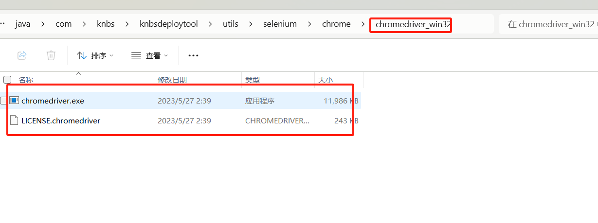

# selenium

[官网](https://www.selenium.dev/zh-cn/documentation/webdriver/getting_started/)


## 配置浏览器驱动

### 下载

#### Edge

[官网说明](https://learn.microsoft.com/zh-cn/microsoft-edge/webdriver-chromium/?tabs=c-sharp)

地址

```sh
https://developer.microsoft.com/microsoft-edge/tools/webdriver/
```

#### chrome

```sh
https://chromedriver.storage.googleapis.com/index.html
```

下载后解压



### 配置环境变量

path:C:\Users\Mr.zhang\Downloads\chromedriver_win32
