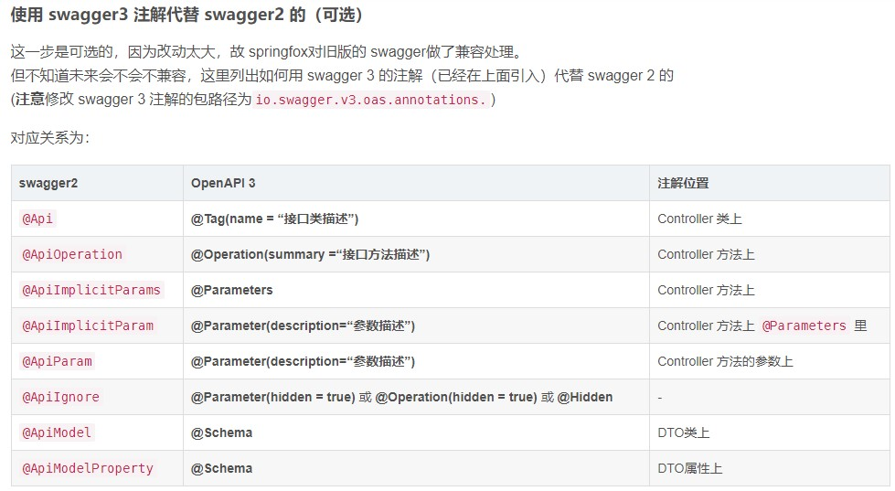

# Swagger

## 配置

[配置方法](/server/interfacedoc/knife4j-swagger/knife4j.md)

## controller

```java
@RestController
@RequestMapping("body")
@Tag(name = "body参数")
public class BodyController {

   @Operation(summary = "普通body请求")
   @PostMapping("/body")
   public ResponseEntity<FileResp> body(@RequestBody FileResp fileResp){
       return ResponseEntity.ok(fileResp);
   }

   @Operation(summary = "普通body请求+Param+Header+Path")
   @Parameters({
           @Parameter(name = "id",description = "文件id",in = ParameterIn.PATH),
           @Parameter(name = "token",description = "请求token",required = true,in = ParameterIn.HEADER),
           @Parameter(name = "name",description = "文件名称",required = true,in=ParameterIn.QUERY)
   })
   @PostMapping("/bodyParamHeaderPath/{id}")
   public ResponseEntity<FileResp> bodyParamHeaderPath(@PathVariable("id") String id,@RequestHeader("token") String token, @RequestParam("name")String name,@RequestBody FileResp fileResp){
       fileResp.setName(fileResp.getName()+",receiveName:"+name+",token:"+token+",pathID:"+id);
       return ResponseEntity.ok(fileResp);
   }
}

```

> controller.class

```java
@Api(value="EdapXXXXXX",tags="EdapXXXXXX")
```

> contoller.method

```java
@ApiOperationSupport(order=3) //接口排序
@ApiOperation(value="获取XXXXXX(final)",notes="/VisualShow/OrbitsGeo",hidden=false)
```

> contoller.model.class

```java
@ApiModel(value="DwsGwGdjhGeoDi",description="XXXXXX数据")
```

> contoller.model.class.filed

```java
@ApiModelProperty(value="XXXX编码",name="line_cd",example="3002",hidden=false,required=false)
```

> contoller.method.filed

```java
publicResultJson<T>uploadtMileage(@ApiParam(value="文件")@RequestPart("file")MultipartFilefile,
@ApiParam(value="文件ID")@RequestParam("fileid")Stringfileid,
@ApiParam(value="开始XX")@RequestParam("startmile")Stringstartmile,
@ApiParam(value="文件名称")@RequestParam("filename")Stringfilename,
@ApiParam(value="结束XXX")@RequestParam("endmile")Stringendmile,
@ApiParam(value="文件")@RequestParam("bucketName")StringbucketName
)throwsException
```

## model

```java

@ApiModel(value="AdsGwGdjhAmpDi",description="分析")
public class AdsGwGdjhAmpDi {

    @ApiModelProperty(hidden=true)
    private String last_mod_time;

    @ApiModelProperty(value="编码",name="line_cd")
    private String line_cd;
}
```

## 注解使用说明


