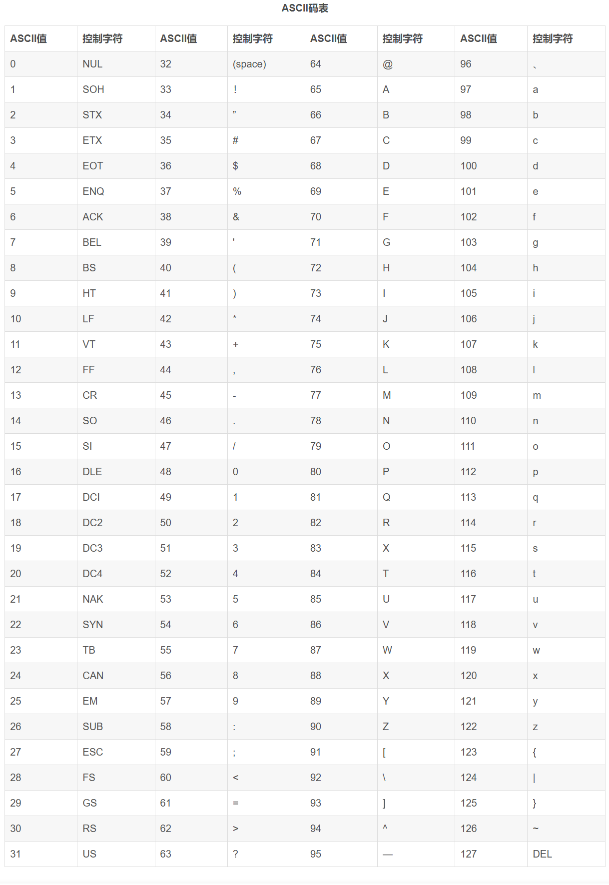

# Array

> ## char Character


> > ### String

> > > #### 类方法

| 方法    | 参数     | 说明             | 说明                   |
|-------|--------|----------------|----------------------|
| split | String | 分割函数，以某个字符进行分割 | 当以小数点进行分割时，需要使用转义字符， |

> > ### Char


> > ### Character 类方法

用于对单个字符进行操作。

Character 类在对象中包装一个基本类型 char 的值

| 方法                | 参数                     | 结果                                          | 声明                                            |
|-------------------|------------------------|---------------------------------------------|-----------------------------------------------|
| `isLetterOrDigit` | ch                     | true：`字母或数字`; 否则为false                      | public static boolean isLetterOrDigit(charch) |
| `isWhitespace`    | ch                     | true：`空白字符`; 否则为false                       | public static boolean isWhitespace(char ch)   |
| `toChars`         | codePoint - Unicode代码点 | 将指定字符（Unicode代码点）转换为存储在 char数组中的UTF-16表示形式。 | public static char[] toChars(int codePoint)   |

> > ### 字符与ASCII 转换

> > > #### 字符转ASCII

```java
System.out.println('A'-0); // 65
```

> > > #### ASCII 转字符

```java
System.out.println(Character.toChars(65)); // A
```

> ## ASCII


