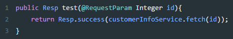
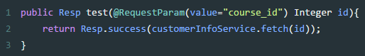
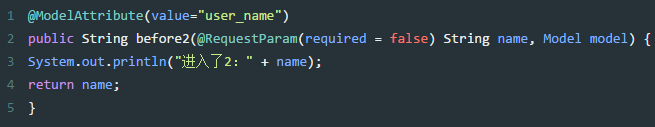
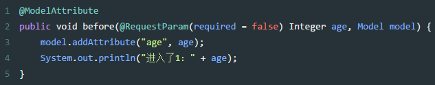
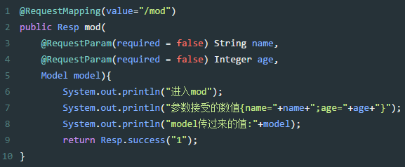
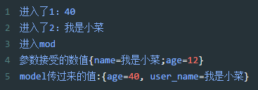
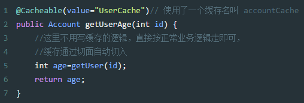
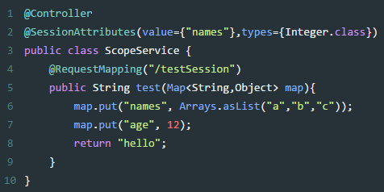

# base

## 获取resources 下的文件

`resources/file/`

```java
 ClassPathResource classPathResource = new ClassPathResource("file/canvas-2.png");
inputStream = classPathResource.getInputStream();
```

## 注解说明

### @Controller


`@Controller` 是 Spring MVC 框架中的一个注解，用于标识一个类作为 MVC 控制器。被 @Controller 注解的类通常负责处理用户的 HTTP 请求，并返回模型和视图对象，或者返回 JSON/XML 等数据格式的响应。

当 Spring 容器启动时，它会扫描所有的类，查找被 `@Controller` 注解的类，并将它们注册为 Spring MVC 的控制器。然后，Spring MVC 会根据配置的 URL 映射规则，将这些控制器与特定的 HTTP 请求 URL 关联起来。

下面是一个简单的 @Controller 示例：

```java
import org.springframework.stereotype.Controller;
import org.springframework.web.bind.annotation.GetMapping;
import org.springframework.web.bind.annotation.ResponseBody;

@Controller
public class MyController {

    @GetMapping("/hello")
    @ResponseBody
    public String sayHello() {
        return "Hello, World!";
    }
}

```


在上面的示例中，MyController 类被 `@Controller` 注解标识为一个控制器。`@GetMapping("/hello") `注解指定了当用户访问 `/hello` URL 时，应该调用 `sayHello()` 方法。`@ResponseBody` 注解表示方法的返回值应该直接作为 HTTP 响应体返回给客户端。


### @RestController

Spring4之后加入的注解，原来在@Controller中返回json需要@ResponseBody来配合，如果直接用@RestController替代@Controller就不需要再配置@ResponseBody，默认返回json格式。

### @Service

用于标注业务层组件，说白了就是加入你有一个用注解的方式把这个类注入到spring配置中

### @Autowired

用来装配bean，都可以写在字段上，或者方法上。

默认情况下必须要求依赖对象必须存在，如果要允许null值，可以设置它的required属性为false，例如：@Autowired(required=false)

### @RequestMapping

类定义处: 提供初步的请求映射信息，相对于 WEB 应用的根目录。

方法处: 提供进一步的细分映射信息，相对于类定义处的 URL。

### @RequestParam

用于将请求参数区数据映射到功能处理方法的参数上

例如



这个id就是要接收从接口传递过来的参数id的值的，如果接口传递过来的参数名和你接收的不一致，也可以如下



其中course_id就是接口传递的参数，id就是映射course_id的参数名

### @ModelAttribute

使用地方有三种：

1、标记在方法上。

标记在方法上，会在每一个@RequestMapping标注的方法前执行，如果有返回值，则自动将该返回值加入到ModelMap中。

(1) 在有返回的方法上:

当ModelAttribute设置了value，方法返回的值会以这个value为key，以参数接受到的值作为value，存入到Model中，如下面的方法执行之后，最终相当于 model.addAttribute("user_name", name);假如 @ModelAttribute没有自定义value，则相当于

model.addAttribute("name", name);



(2) 在没返回的方法上：

需要手动model.add方法



我们在当前类下建一个请求方法：



在浏览器中输入访问地址并且加上参数：

`http://localhost:8081/api/test/mod?name=我是小菜&age=12`

最终输出如下：



2、标记在方法的参数上。

标记在方法的参数上，会将客户端传递过来的参数按名称注入到指定对象中，并且会将这个对象自动加入ModelMap中，便于View层使用.我们在上面的类中加入一个方法如下


在浏览器中输入访问地址并且加上参数：

`http://localhost:8081/api/test/mod2?name=我是小菜&age=12`

最终输出：


从结果就能看出，用在方法参数中的@ModelAttribute注解，实际上是一种接受参数并且自动放入Model对象中，便于使用。

### @Cacheable

用来标记缓存查询。可用用于方法或者类中，当标记在一个方法上时表示该方法是支持缓存的，当标记在一个类上时则表示该类所有的方法都是支持缓存的。

参数列表


比如@Cacheable(value="UserCache") 标识的是当调用了标记了这个注解的方法时，逻辑默认加上从缓存中获取结果的逻辑，如果缓存中没有数据，则执行用户编写查询逻辑，查询成功之后，同时将结果放入缓存中。

但凡说到缓存，都是key-value的形式的，因此key就是方法中的参数（id），value就是查询的结果，而命名空间UserCache是在spring*.xml中定义.



### @CacheEvict

用来标记要清空缓存的方法，当这个方法被调用后，即会清空缓存。@CacheEvict(value=”UserCache”)

参数列表


### @Resource

@Resource的作用相当于@Autowired

只不过@Autowired按byType自动注入，

而@Resource默认按 byName自动注入罢了。

@Resource有两个属性是比较重要的，分是name和type，Spring将@Resource注解的name属性解析为bean的名字，而type属性则解析为bean的类型。所以如果使用name属性，则使用byName的自动注入策略，而使用type属性时则使用byType自动注入策略。如果既不指定name也不指定type属性，这时将通过反射机制使用byName自动注入策略。

@Resource装配顺序:

1、如果同时指定了name和type，则从Spring上下文中找到唯一匹配的bean进行装配，找不到则抛出异常

2、如果指定了name，则从上下文中查找名称（id）匹配的bean进行装配，找不到则抛出异常

3、如果指定了type，则从上下文中找到类型匹配的唯一bean进行装配，找不到或者找到多个，都会抛出异常

4、如果既没有指定name，又没有指定type，则自动按照byName方式进行装配；如果没有匹配，则回退为一个原始类型进行匹配，如果匹配则自动装配；

### @PostConstruct

用来标记是在项目启动的时候执行这个方法。用来修饰一个非静态的void()方法

也就是spring容器启动时就执行，多用于一些全局配置、数据字典之类的加载

被@PostConstruct修饰的方法会在服务器加载Servlet的时候运行，并且只会被服务器执行一次。PostConstruct在构造函数之后执行,init()方法之前执行。PreDestroy（）方法在destroy()方法执行执行之后执

### @PreDestroy

被@PreDestroy修饰的方法会在服务器卸载Servlet的时候运行，并且只会被服务器调用一次，类似于Servlet的destroy()方法。被@PreDestroy修饰的方法会在destroy()方法之后运行，在Servlet被彻底卸载之前

### @Repository

用于标注数据访问组件，即DAO组件

### @Component

泛指组件，当组件不好归类的时候，我们可以使用这个注解进行标注

### @Scope

用来配置 spring bean 的作用域，它标识 bean 的作用域。

默认值是单例

1、singleton:单例模式,全局有且仅有一个实例

2、prototype:原型模式,每次获取Bean的时候会有一个新的实例

3、request:request表示该针对每一次HTTP请求都会产生一个新的bean，同时该bean仅在当前HTTP request内有效

4、session:session作用域表示该针对每一次HTTP请求都会产生一个新的bean，同时该bean仅在当前HTTP session内有效

5、global session:只在portal应用中有用，给每一个 global http session 新建一个Bean实例。

### @SessionAttributes

默认情况下Spring MVC将模型中的数据存储到request域中。当一个请求结束后，数据就失效了。如果要跨页面使用。那么需要使用到session。而@SessionAttributes注解就可以使得模型中的数据存储一份到session域中

参数：

1、names：这是一个字符串数组。里面应写需要存储到session中数据的名称。

2、types：根据指定参数的类型，将模型中对应类型的参数存储到session中

3、value：和names是一样的。



### @Required

适用于bean属性setter方法，并表示受影响的bean属性必须在XML配置文件在配置时进行填充。否则，容器会抛出一个BeanInitializationException异常。

### @Qualifier

当你创建多个具有相同类型的 bean 时，并且想要用一个属性只为它们其中的一个进行装配，在这种情况下，你可以使用 @Qualifier 注释和 @Autowired 注释通过指定哪一个真正的 bean 将会被装配来消除混乱。

### @DependsOn 

`@DependsOn` 是 Spring 框架提供的一个注解，用于指定某个 bean 在初始化之前必须先初始化另一个 bean。这个注解可以确保依赖关系的正确处理，特别是在 bean 的自动装配和初始化顺序很重要时。

> 使用场景

当一个 bean 依赖于另一个 bean 的初始化状态时。
当需要控制 bean 的初始化顺序，以避免因依赖未初始化而导致的错误。

> 示例

假设有两个 bean，BeanA 和 BeanB，其中 BeanA 依赖于 BeanB 的初始化完成：

```java
import org.springframework.context.annotation.Bean;
import org.springframework.context.annotation.Configuration;
import org.springframework.context.annotation.DependsOn;

@Configuration
public class AppConfig {

    @Bean
    public BeanB beanB() {
        return new BeanB();
    }

    @Bean
    @DependsOn("beanB") // 确保 beanB 在 beanA 之前初始化
    public BeanA beanA() {
        return new BeanA(beanB());
    }
}

```


> 注意事项


1. `@DependsOn` 主要用于解决初始化顺序的问题，而不是解决 bean 之间的依赖关系。对于依赖关系，应该使用构造函数注入或 `@Autowired` 注解。
2. 过度使用 `@DependsOn` 可能会导致配置复杂化，应该谨慎使用。

### 自动配置


#### @ConditionalOnClass

@ConditionalOnClass 是 Spring Boot 提供的一个条件注解，用于在类路径中存在指定类时才启用某个配置。这个注解通常用在自动配置类上，以确保只有在相关依赖存在时，自动配置才会生效。
例如，如果你有一个自动配置类，它依赖于某个特定的数据库连接池实现（比如 HikariCP），你可以使用 @ConditionalOnClass 来确保只有当 HikariCP 的类存在于类路径中时，这个自动配置类才会被加载。
下面是一个简单的例子，展示了如何使用 @ConditionalOnClass 注解：

```java
import org.springframework.boot.autoconfigure.condition.ConditionalOnClass;
import org.springframework.context.annotation.Configuration;

@Configuration
// 只有当类路径中存在 HikariDataSource 类时，这个配置类才会被加载
@ConditionalOnClass(name = "com.zaxxer.hikari.HikariDataSource")
public class MyDataSourceConfiguration {
    // 配置代码...
}
```

#### @ConditionalOnProperty

@ConditionalOnProperty 是 Spring Boot 提供的另一个条件注解，它用于根据配置文件中的属性值来决定是否启用某个配置。这个注解非常有用，因为它允许开发者通过外部配置来控制自动配置的行为。

@ConditionalOnProperty 注解可以接受以下几个参数：
name: 属性名称，用于在配置文件中查找。
havingValue: 期望的属性值，只有当配置文件中的属性值与这个值相匹配时，条件才会成立。
prefix: 属性名称的前缀，可以与 name 结合使用，以简化属性名称的书写。
matchIfMissing: 当配置文件中没有指定的属性时，是否默认匹配。默认为 false。

下面是一个使用 @ConditionalOnProperty 注解的例子：

```java
import org.springframework.boot.autoconfigure.condition.ConditionalOnProperty;
import org.springframework.context.annotation.Configuration;

@Configuration
// 只有当配置文件中存在 my.service.enabled 属性，并且其值为 true 时，这个配置类才会被加载
@ConditionalOnProperty(name = "my.service.enabled", havingValue = "true")
public class MyServiceConfiguration {
    // 配置代码...
}

```

#### @Import

@Import 是 Java 配置中的一个注解，它允许你导入其他配置类，从而可以在当前配置类中使用那些被导入配置类中定义的 bean。这个注解可以用来组合多个配置类，使得配置更加模块化和可重用。


这样做的目的是为了集中管理 Camunda BPM 的所有自动配置，使得配置更加清晰和模块化


@Import 注解可以接受以下几种参数：
类类型：你可以直接指定要导入的配置类的类型。
ImportSelector：这是一个接口，你可以实现它来动态地决定哪些配置类应该被导入。
ImportBeanDefinitionRegistrar：这是一个接口，你可以实现它来注册 bean 定义。

下面是一个使用 @Import 注解的例子：

```java
import org.springframework.context.annotation.Configuration;
import org.springframework.context.annotation.Import;

@Configuration
// 导入其他配置类
@Import({OtherConfiguration.class, AnotherConfiguration.class})
public class MainConfiguration {
    // 配置代码...
}

```

#### @ConditionalOnMissingBean

`@ConditionalOnMissingBean` 是 Spring Boot 提供的一个条件注解，用于在自动配置过程中判断某个类型的 bean 是否已经存在。如果不存在，则当前配置类中的相应 bean 定义会被注册到 Spring 容器中；如果已经存在，则跳过当前配置类中的 bean 定义。

这个注解非常有用，因为它允许开发者自定义 bean 的定义，同时仍然能够利用 Spring Boot 的自动配置功能。通过使用 `@ConditionalOnMissingBean`，可以确保自动配置不会覆盖用户自定义的 bean 定义。

`@ConditionalOnMissingBean` 注解可以接受以下几个参数：

value 或 type：指定要检查的 bean 的类型。

name：指定要检查的 bean 的名称。

annotation：指定要检查的 bean 是否具有特定的注解。

下面是一个使用 @ConditionalOnMissingBean 注解的例子：


```java
import org.springframework.boot.autoconfigure.condition.ConditionalOnMissingBean;
import org.springframework.context.annotation.Bean;
import org.springframework.context.annotation.Configuration;

@Configuration
public class MyConfiguration {

    @Bean
    @ConditionalOnMissingBean(MyService.class) // 只有当 MyService 类型的 bean 不存在时，才会注册 myServiceBean
    public MyService myServiceBean() {
        return new MyServiceImpl();
    }
}

```


## 接口

### ApplicationContextAware

`ApplicationContextAware`是 Spring 框架中的一个接口，它允许实现类获得对 ApplicationContext 的引用。ApplicationContext 是 Spring 的核心接口之一，代表 Spring 容器，负责管理 bean 的生命周期和依赖注入。

当一个类实现了 ApplicationContextAware 接口，Spring 容器会在创建这个类的实例时自动调用它的 setApplicationContext 方法，并将当前的 ApplicationContext 实例作为参数传入。这样，实现类就可以在运行时访问 Spring 容器，从而可以获取容器中的其他 bean 或者发布事件等。

下面是一个简单的例子，展示了如何实现 ApplicationContextAware 接口：

```java
import org.springframework.context.ApplicationContext;
import org.springframework.context.ApplicationContextAware;
import org.springframework.stereotype.Component;

@Component
public class MyApplicationContextAware implements ApplicationContextAware {

    private ApplicationContext applicationContext;

    @Override
    public void setApplicationContext(ApplicationContext applicationContext) {
        this.applicationContext = applicationContext;
    }

    // 你可以使用 applicationContext 来获取其他 bean 或者执行其他操作
}

```


通常情况下，直接实现 ApplicationContextAware 接口并不是最佳实践，因为它会增加代码与 Spring 框架的耦合度。更推荐的做法是使用依赖注入（DI）来获取所需的 bean，或者使用 @Autowired 注解直接注入 ApplicationContext。这种方式更加符合 Spring 的编程模型，也更容易进行单元测试。

例如：

```java
import org.springframework.beans.factory.annotation.Autowired;
import org.springframework.context.ApplicationContext;
import org.springframework.stereotype.Component;

@Component
public class MyComponent {

    private final ApplicationContext applicationContext;

    @Autowired
    public MyComponent(ApplicationContext applicationContext) {
        this.applicationContext = applicationContext;
    }

    // 使用 applicationContext...
}

```

