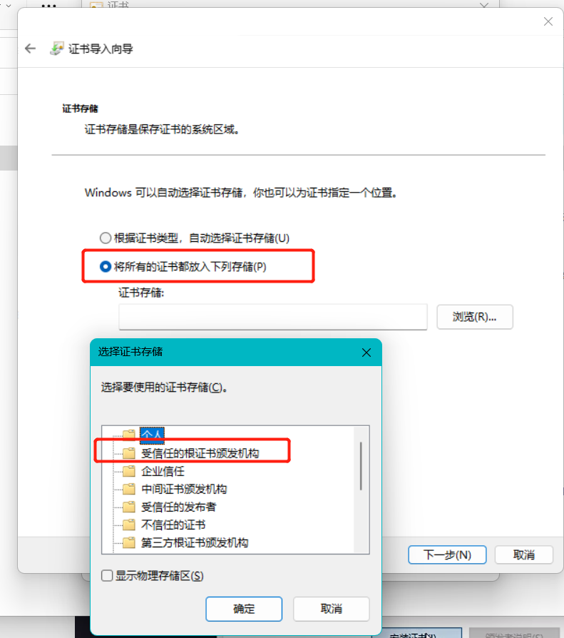

# Nginx
[官网](https://nginx.org/en/download.html)

## 安装依赖
	
>1. GCC  

GNU编译器集合（GCC可以使用默认包管理器的仓库（repositories）来安装，包管理器的选择依赖于你使用的Linux发布版本，包管理器有不同的实现：yum是基于Red Hat的发布版本；apt用于Debian和Ubuntu；yast用于SuSE Linux等等。）
```
yum install gcc
```
>2. PCRE库

（Nginx编译需要PCRE（Perl Compatible Regular Expression），因为Nginx的Rewrite模块和HTTP核心模块会使用到PCRE正则表达式语法。这里需要安装两个安装包pcre和pcre-devel。第一个安装包提供编译版本的库，而第二个提供开发阶段的头文件和编译项目的源代码，这正是我们需要的理由。）
```
yum install pcre pcre-devel
```
>3. zlib库

（zlib库提供了开发人员的压缩算法，在Nginx的各种模块中需要使用gzip压缩。如同安装PCRE一样，同样需要安装库和它的源代码：zlib和zlib-devel。）
```
yum install zlib zlib-devel
```
>4. OpenSSL库

（在Nginx中，如果服务器提供安全网页时则会用到OpenSSL库，我们需要安装库文件和它的开发安装包（openssl和openssl-devel）。）
```
yum install openssl openssl-devel
```
## 安装

```
wget http://nginx.org/download/nginx-1.20.1.tar.gz
```
```
tar -xvf nginx-1.20.1.tar.gz
```
```
cd nginx-1.20.1
```
```
./configure   （后面可添加参数，更改安装路径等信息）
```
```
make
```
```
make install
```

## 命令
指定配置文件启动：nginx -c 配置文件路径

重启：nginx -s reload -c 配置文件

停止: nginx -s stop 


## 安装ssl模块

安装改模块后，可配置https访问

>1. 准备

备份nginx/sbin/nginx文件，停止nginx程序
```
ps -ef|grep nginx
kill -9 pid1 pid2
```

>2. 下载openssl

```
wget https://www.openssl.org/source/openssl-1.1.1l.tar.gz
```
```
tar zxfv openssl-1.1.1l.tar.gz
```
>4. 官网下载nginx版本

```
wget https://nginx.org/download/nginx-1.19.9.tar.gz
```
```
tar -zxvf nginx-1.19.9.tar.gz
```

>5. 编译

```
cd nginx-1.19.9
```
**注意，执行nginx 编译命令（./configure）前，若是nginx升级，可以新建一个安装目录，并配置给： --prefix 这样安装的时候，就不会影响已安装的程序**
```
mkdir -p /usr1/maywide/bin/nginx_1_22
```
```
./configure --prefix=/usr1/maywide/bin/nginx_1_22/nginx  --with-openssl=/usr1/maywide/bin/nginx_1_22/openssl-1.1.1s  --with-http_ssl_module --with-http_dav_module --with-http_mp4_module --with-http_flv_module --with-http_realip_module --with-http_addition_module --with-http_stub_status_module --with-http_sub_module --with-http_random_index_module --with-http_degradation_module --with-http_secure_link_module --with-http_gzip_static_module   --with-debug --with-file-aio --with-mail --with-mail_ssl_module --with-stream --with-ld-opt="-Wl,-E"
```

```
make && make install
```

>6. 查看版本

生成了新文件/usr1/maywide/tkh/install-web/bin/nginx/，查看nginx版本号，升级成功
```
nginx -V
```

>7. 替换可执行文件

文件通用，可将此版本可执行文件（nginx/sbin 下的nginx）替换到其他项目（原有nginx/sbin 下），并赋予755权限
```
chmod +x nginx
```
然后重启nginx即可

## nginx.config 配置（包含ssl配置）

>1. 示例一
```
	server {
	#	listen 443 ssl;
        listen       8030 ssl ;
        server_name  192.168.81.215;
		ssl_certificate  ssl/tkhapplication.pem;
		ssl_certificate_key ssl/tkhapplication.key;
		ssl_session_timeout 5m;
		ssl_ciphers ECDHE-RSA-AES128-GCM-SHA256:ECDHE:ECDH:AES:HIGH:!NULL:!aNULL:!MD5:!ADH:!RC4;  
		ssl_protocols TLSv1 TLSv1.1 TLSv1.2;
		ssl_prefer_server_ciphers on; 
		# 记录日志
          access_log /usr1/nginxssl/nginx/logs/access_base.log daily_log;
		
		location ^~ /Auth/{
            rewrite ^/Auth/(.+) /$1 break;
			proxy_set_header Host $host;
		    proxy_set_header X-Real-Ip $remote_addr;
		    proxy_set_header X-Real-Port $remote_port;
		    proxy_set_header X-Forwarded-For $proxy_add_x_forwarded_for;
		    proxy_pass http://GATEWAY;
	   }  
		
        location / {
            root   /usr1/web;
            try_files $uri $uri/ /index.html
            index  index.html index.htm;
            add_header 'Access-Control-Allow-Origin' '*';
        }

        #error_page  404              /404.html;

        # redirect server error pages to the static page /50x.html
        #
        error_page   500 502 503 504  /50x.html;
        location = /50x.html {
            root   html;
        }
    }
```
>2. 示例二
```
	server {
        listen       8060 ssl;
		server_name  192.168.81.215;
        ssl_certificate  ssl/tkhapplication.pem;
		ssl_certificate_key ssl/tkhapplication.key;
		ssl_session_timeout 5m;
		ssl_ciphers ECDHE-RSA-AES128-GCM-SHA256:ECDHE:ECDH:AES:HIGH:!NULL:!aNULL:!MD5:!ADH:!RC4;
		ssl_protocols TLSv1 TLSv1.1 TLSv1.2;
		ssl_prefer_server_ciphers on;

		# 记录日志
        access_log /usr1/nginxssl/nginx/logs/access_base.log daily_log;

		
		location ^~ /tkh/Auth/ {
            rewrite ^/tkh/(.+) /$1 break;
			proxy_set_header Host $host;
		    proxy_set_header X-Real-Ip $remote_addr;
		    proxy_set_header X-Real-Port $remote_port;
		    proxy_set_header X-Forwarded-For $proxy_add_x_forwarded_for;
		    proxy_pass http://192.168.81.216:8775;
	    }  
		location ^~ /tkh/BaseParams/ {
 	 		rewrite ^/tkh/(.+) /$1 break;
            proxy_set_header Host $host;
			proxy_set_header X-Real-Ip $remote_addr;
			proxy_set_header X-Real-Port $remote_port;
			proxy_set_header X-Forwarded-For $proxy_add_x_forwarded_for;
			proxy_pass http://192.168.81.216:8778;
		}
```
>3. 示例三
```
http {

    upstream NODEINFO {
        server 172.16.101.20:8763;
        ip_hash;
    }
    upstream INFO {
        server 172.16.101.11:7800;
        ip_hash;
    }
	………………
	server {
      listen       8762;
      server_name  localhost;
      access_log /usr1/log/nginx/rmtrate.log daily_log;
     
     location /rmtrate/channelio/total/info {
          rewrite ^(.*) channelio/total/info break;
          proxy_set_header Host $host;
          proxy_set_header X-Real-Ip $remote_addr;
          proxy_set_header X-Real-Port $remote_port;
          proxy_set_header X-Forwarded-For $proxy_add_x_forwarded_for;
          proxy_pass http://INFO;
      }
	location ^~ /rmtrate/NODE/ {
            rewrite ^/rmtrate/NODE/(.+) /$1 break;
	    proxy_set_header Host $host;
            proxy_set_header X-Real-Ip $remote_addr;
            proxy_set_header X-Real-Port $remote_port;
            proxy_set_header X-Forwarded-For $proxy_add_x_forwarded_for;
            proxy_pass http://NODEINFO;
      }
      
       location ^~ /rmtrate/LOCALGO/ {
            rewrite ^/rmtrate/LOCALGO/(.+) /$1 break;
	    proxy_set_header Host $host;
            proxy_set_header X-Real-Ip $remote_addr;
            proxy_set_header X-Real-Port $remote_port;
            proxy_set_header X-Forwarded-For $proxy_add_x_forwarded_for;
            proxy_pass http://INFO;
      }
     
      location /rmtrate/ {
            alias   /usr1/nioe-center/vue/rmtrate/;
            try_files $uri $uri/ /index.html
            index  index.html index.htm;
            add_header 'Access-Control-Allow-Origin' '*';
      }
      error_page   500 502 503 504  /50x.html;
      location = /50x.html {
            root   html;
      }
    }

}
```


## 安装遇到的问题

>1.	./configure: error: the HTTP rewrite module requires the PCRE library.
You can either disable the module by using --without-http_rewrite_module
option, or install the PCRE library into the system, or build the PCRE library
statically from the source with nginx by using --with-pcre=<path> option.

安装 pcre pcre-devel

```sh
yum -y install pcre pcre-devel
```

## openssl

> 将cer格式证书转pem格式：

```sh
openssl x509 -inform der -in server.cer -out server-pem.pem
```

提取私钥：p12格式文件中提取私钥

```sh
openssl pkcs12 -nocerts -nodes -in server.p12 -out server.key
```

需要依赖openssl

```sh
yum install -y openssl openssl-devel
```

```sh
[root@tlgakp1 rntibp]# openssl version
OpenSSL 1.0.2k-fips 26 Jan 2017
```

> 检查是否支持https_ssl_module:

```sh
[root@tlgakp1 nginx]# sbin/nginx -V
nginx version: nginx/1.18.0
built by gcc 4.8.5 20150623 (Red Hat 4.8.5-44) (GCC)
built with OpenSSL 1.0.2k-fips 26 Jan 2017
TLS SNI support enabled
configure arguments: --prefix=/usr/local/nginx –with-http_ssl_module --with-stream
```

`观察编译时是否带有“–with-http_ssl_module”`

没有需要重新编译安装

### 生成没有加密得私钥和公钥

#### 私钥

```sh
 openssl genrsa > nginx.key 2048 
 Generating RSA private key, 2048 bit long modulus
...............................................................................+++
...............+++
e is 65537 (0x10001)
[root@localhost openssl]# ll
total 4
-rw-r--r--. 1 root root 1679 May 17 16:56 nginx.key
```

#### 根据私钥生成公钥

```sh
openssl req -new -x509 -key nginx.key > nginx.pem

[root@localhost openssl]# ll
total 4
-rw-r--r--. 1 root root 1679 May 17 16:56 nginx.key
[root@localhost openssl]# openssl req -new -x509 -key nginx.key > nginx.pem
You are about to be asked to enter information that will be incorporated
into your certificate request.
What you are about to enter is what is called a Distinguished Name or a DN.
There are quite a few fields but you can leave some blank
For some fields there will be a default value,
If you enter '.', the field will be left blank.
-----
Country Name (2 letter code) [XX]:
State or Province Name (full name) []:
Locality Name (eg, city) [Default City]:
Organization Name (eg, company) [Default Company Ltd]:
Organizational Unit Name (eg, section) []:
Common Name (eg, your name or your server's hostname) []:
Email Address []:
[root@localhost openssl]# ll
total 8
-rw-r--r--. 1 root root 1679 May 17 16:56 nginx.key
-rw-r--r--. 1 root root 1220 May 17 17:22 nginx.pem
```

###  生成私钥和自签名的SSL证书：
生成加密私钥:
参数： genrsa：生成RSA私钥；-des3：des3算法；-out server.pass.key：生成的私钥文件名；2048：私钥长度

```sh
[root@localhost openssl]# openssl genrsa -des3 -out server.pass.key 2048 
Generating RSA private key, 2048 bit long modulus
.+++
.................................+++
e is 65537 (0x10001)
Enter pass phrase for server.pass.key:   #输入四位以上密码
Verifying - Enter pass phrase for server.pass.key:   #再次输入
```

去除私钥中的密码:

```sh
[root@localhost openssl]#  openssl rsa -in server.pass.key -out server.key
Enter pass phrase for server.pass.key:        #输入私钥的密码
writing RSA key
```

```sh
[root@localhost openssl]# ll ser*
-rw-r–r–. 1 root root 1679 May 17 17:26 server.key #无密码私钥
-rw-r–r–. 1 root root 1751 May 17 17:25 server.pass.key #有密码私钥
```

生成CSR（证书签名请求文件）：
```sh
[root@localhost openssl]#  openssl req -new -key server.key -out server.csr
You are about to be asked to enter information that will be incorporated
into your certificate request.
What you are about to enter is what is called a Distinguished Name or a DN.
There are quite a few fields but you can leave some blank
For some fields there will be a default value,
If you enter '.', the field will be left blank.
-----
Country Name (2 letter code) [XX]:
State or Province Name (full name) []:
Locality Name (eg, city) [Default City]:
Organization Name (eg, company) [Default Company Ltd]:
Organizational Unit Name (eg, section) []:
Common Name (eg, your name or your server's hostname) []:
Email Address []:

Please enter the following 'extra' attributes
to be sent with your certificate request
A challenge password []:              
An optional company name []:
```

`以上参数可不填，一直回车 也没有影响`

参数说明：

|参数|说明|
|-req| 生成证书签名请求   |
|-new| 新生成           |
|-key| 私钥文件               |
|-out| 生成的CSR文件             |

生成自签名的SSL证书：

```sh
[root@localhost openssl]# openssl x509 -req -days 1825 -in server.csr -signkey server.key -out server.crt
Signature ok
subject=/C=XX/L=Default City/O=Default Company Ltd
Getting Private key
```

参数说明：							
 -days 证书有效期

```sh
[root@localhost openssl]# ll ser*
-rw-r–r–. 1 root root 1103 May 17 17:32 server.crt #自签名SSL证书
-rw-r–r–. 1 root root 952 May 17 17:29 server.csr #签名文件
-rw-r–r–. 1 root root 1679 May 17 17:26 server.key #无密码私钥
-rw-r–r–. 1 root root 1751 May 17 17:25 server.pass.key #有密码私钥
```

Nginx配置
https://nginx.org/en/docs/http/ngx_http_ssl_module.html#ssl_certificate

```sh
server {
        listen       9943 ssl;     #https访问页面
        server_name  192.168.100.83;         #域名
        ssl_certificate cert/nginx.pem;			#pem格式证书 .pem .crt
        ssl_certificate_key cert/nginx.key;	#配置已签名的私钥
        ssl_protocols SSLv3 TLSv1;			# SSL协议
```
原文链接：https://blog.csdn.net/weixin_46031767/article/details/124824762

## mkcert ssl

搭建CA认证服务器

我们平时在本地开发时，有时会要求通过 HTTPS 请求来访问。一个通用的做法是用 OpenSSL 生成自签证书，然后对 Web 服务进行配置。但 OpenSSL 的命令比较繁琐，参数也比较复杂，用起来不够方便。于是我找到了一个替代方案：mkcert，和大家分享下。

项目介绍
mkcert[1] 是一个用于生成本地自签名 SSL 证书的开源工具，项目基于 Golang 开发，可跨平台使用，不需要配置，支持多域名以及自动信任 CA。

准备工作
我准备模拟一个局域网内访问 Web 服务的场景，因此开始前需要：

服务器：用于提供 Web 服务，安装 nginx 并开启 SSL，系统为 CentOS 7.8。
PC 端：一台 Win10 电脑，用于测试访问，与服务器处于同一局域网。
下载安装
首先，根据自己的系统，下载最新的二进制文件，这里我下载的版本为 v1.4.3：
```sh
[root@localhost ~]# wget -O mkcert https://github.com/FiloSottile/mkcert/releases/download/v1.4.3/mkcert-v1.4.3-linux-amd64 
```

为二进制文件添加可执行权限，并移动到 $PATH 中：

```sh
[root@localhost ~]# chmod +x mkcert [root@localhost ~]# mv mkcert /usr/local/bin/ 
```

检查 mkcert 的版本：

```sh
[root@localhost ~]# mkcert -version v1.4.3 
如果版本显示正常，说明安装无误。接下来，我们看看 mkcert 是如何创建证书的。
```

使用说明
mkcert 生成证书的命令很简单，格式如下：

mkcert domain1 [domain2 [...]] 
多个域名/IP用空格分隔，一个自签名的证书可以这样创建：

```sh
[root@localhost ~]# mkcert 192.168.128.134 example.com localhost 127.0.0.1 ::1
Note: the local CA is not installed in the system trust store.
Note: the local CA is not installed in the Firefox and/or Chrome/Chromium trust store.
Run "mkcert -install" for certificates to be trusted automatically 

Created a new certificate valid for the following names
 - "192.168.128.134"
 - "example.com"
 - "localhost"
 - "127.0.0.1"
 - "::1"

The certificate is at "./192.168.128.134+4.pem" and the key at "./192.168.128.134+4-key.pem"

It will expire on 7 September 2023
```

在这个证书中，192.168.128.134 是服务器的内网地址。命令执行后会生成两个文件：192.168.128.134+4-key.pem 和 192.168.128.134+4.pem，前者是私钥，后者是证书。

由于服务器上已经装了 nginx，也配置了 SSL，所以在命令中可以加入 -cert-file 和 -key-file 参数，将文件直接生成到对应的目录里：

```sh
[root@localhost ~]# mkcert -cert-file /etc/nginx/ssl/server.crt -key-file /etc/nginx/ssl/server.key 192.168.128.134 example.com localhost 127.0.0.1 ::1 
```

或

```sh
./mkcert-v1.4.4-linux-amd64 -cert-file ./nginx.pem -key-file ./nginx.key 172.28.28.166
```

启动 nginx 服务，然后从 PC 端访问 `https://ip:port` 查看效果：

此时，浏览器访问到了页面，但连接是不安全的。而我们在本地开发时，可能会对连接的安全性有要求，那有没有办法建立安全的连接呢？

正如介绍所言，mkcert 支持自动信任 CA，所以只要安装好 CA 证书就能解决这个问题。

回到服务器，执行以下命令将 mkcert 的认证机构安装到服务器上：

```sh
[root@localhost ~]# mkcert -install 
```

CA 证书的位置可以通过以下命令查看：

```sh
[root@localhost ~]# mkcert -CAROOT /root/.local/share/mkcert 
```

该目录中有两个文件：`rootCA-key.pem` 和 `rootCA.pem`。将 rootCA.pem 复制到 PC 上，并将其后缀改为 .crt。

双击 rootCA.crt，根据提示安装证书，选择默认，此处注意更改



重启浏览器再次访问，可以看到连接已经变为安全：

我们通过 mkcert 创建了自签名的 SSL 证书，并建立了安全的访问连接。与 OpenSSL 相比，mkcert 的使用更加简单，简化了在内网搭建 HTTPS 环境的复杂性。
