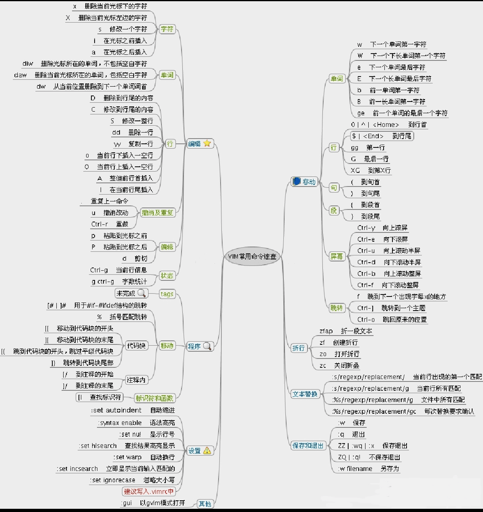

# Linux-cli

## 给用户赋文件夹权限

```
chown -R 用户名 文件夹名
```
登陆root(拥有文件夹权限)

**chown -R maywide elasticsearch-8.5.1**

---

## 创建新用户

>增加用户
```
useradd -m 用户名
```
**useradd -m sixwork**

>设置密码  
```
passwd 用户名
```
**passwd sixwork**

---

## 更改环境变量

> 适用当前窗口
 此方式只使用于当前会话
```
export NODE_HOME=/opt/node
export PATH=$NODE_HOME/bin:$PATH
```
或者 
```
export PATH=/opt/node/bin:$PATH
```
> 
> 适用所有窗口

1. 方案一
```
    Vi ~/.bashrc（打开隐藏文件  ll -a）
最后一句添加：export PATH=/opt/node/bin:$PATH
然后执行source ~/.bashrc
```
2. 方案二
```
1，vim /etc/profile
2，在文件末尾添加以下代码
export PATH=/usr/local/go/bin:$PATH 
3，使用source使配置文件立即生效
source /etc/profile 
```
>**/etc/profile**
>>此文件为系统的每个用户设置环境信息，当用户第一次登录时，该文件被执行。
并从 /etc/profile.d 目录的配置文件中收集 shell 的设置。
如果你有对 /etc/profile 有修改的话必须得 source 一下你的修改才会生效，此修改对每个用户都生效。
3. 方案三
   
**设置环境变量，最方便**

```
1，添加新的环境变量：/usr/local/go/bin
export PATH=/usr/local/go/bin:$PATH
2，使用环境变量生效
source /etc/profile
```

---

## 远程复制（SCP）

1.scp基本格式
```
scp local_file user@host:/dir
```

2.scp复制文件到指定端口
scp默认连接的远端主机22端口，如果ssh不是使用标准的22端口（以16022为例）则使用-P（P大写）指定：
```
scp -P 16022 local_file user@host:/dir
```
3.从远端主机将文件复制到另一台远端主机
scp不仅可以将文件从本机复制到远端机器，还可以将文件从远端机复制到本机，还可以将文件从一台远端机复制到另一台远端机：
```
scp user1@host1:file1 user2@host2:file
```
这也就是说当情况如：A/B/C三台主机，A和B、B和C网络相通但A和C网络不通，要求把文件从A复制到C上。

那么可行的操作是把文件从A复制到B，再把文件从B复制到C；还可行的情况是直接在B上把文件从A复制到C，在B上执行：
```
scp userA@hostA:fileA userC@hostC:fileC
```
---

## 文件夹、文件操作

Linux文件夹或文件创建、删除

> Linux删除文件夹命令

linux删除目录很简单，很多人还是习惯用rmdir，不过一旦目录非空，就陷入深深的苦恼之中，现在使用rm -rf命令即可。

直接rm就可以了，不过要加两个参数-rf 即：rm -rf 目录名字

删除目录、文件 rm(remove)

功能说明：删除文件或目录。

语　　法：
```
rm [-dfirv][--help][--version][文件或目录...]
```
补充说明：执行rm指令可删除文件或目录，如欲删除目录必须加上参数”-r”，否则预设仅会删除文件。


| 参数               | 说明                                               |
| ------------------ | -------------------------------------------------- |
| -d或–directory     | 直接把欲删除的目录的硬连接数据删成0，删除该目录。  |
| -f或–force         | 强制删除文件或目录。                               |
| -i或–interactive   | 删除既有文件或目录之前先询问用户。                 |
| -r或-R或–recursive | 递归处理，将指定目录下的所有文件及子目录一并处理。 |
| -v或–verbose       | 显示指令执行过程。                                 |


> 删除文件夹
```
rm -rf fileName
```
> 删除文件夹实例：
```
rm -rf /var/log/httpd/access
```
将会删除/var/log/httpd/access目录以及其下所有文件、文件夹
需要提醒的是：使用这个rm -rf的时候一定要格外小心，linux没有回收站的

> 删除文件
```
rm -f fileNamede>
```

> 添加文件夹

创建目录：
```
mkdir(make directories)  
```
功能说明：建立目录  
语　　法：
```
mkdir [-p][--help][--version][-m <目录属性>][目录名称]  
```
补充说明：mkdir可建立目录并同时设置目录的权限。

| 参数         | 说明                                                         |
| ------------ | ------------------------------------------------------------ |
| -m           | <目录属性>或–mode<目录属性> 建立目录时同时设置目录的权限。   |
| -p或–parents | 若所要建立目录的上层目录目前尚未建立，则会一并建立上层目录。 |

```
mkdir test
```

> 创建文件 touch

功能说明：改变文件或目录时间。

语　　法：

```
touch [-acfm][-d <日期时间>][-r <参考文件或目 录>][-t <日期时间>] [--help]　　 [--version][文件或目录...] 或 touch [-acfm][--help][--version][日期时 间][文件或目录...]
```
**例：touch test.txt （注：Linux下没有文件后缀名区分文件类型之说，系统文件类型只有可执行文件和不可执行文件）**

补充说明：使用touch指令可更改文件或目录的日期时间，包括存取时间和更改时间。

| 参数                                     | 说明                                                                                  |
| ---------------------------------------- | ------------------------------------------------------------------------------------- |
| -a或–time=atime或–time=access或–time=use | 只更改存取时间。                                                                      |
| -c或–no-create                           | 不建立任何文件。                                                                      |
| -d                                       | <时间日期> 使用指定的日期时间，而非现在的时间。                                       |
| -f                                       | 此参数将忽略不予处理，仅负责解决BSD版本touch指令的兼容性问题。                        |
| -m或–time=mtime或–time=modify            | 只更改变动时间。                                                                      |
| -r                                       | <参考文件或目录> 把指定文件或目录的日期时间，统统设成和参考文件或目录的日期时间相同。 |
| -t                                       | <日期时间> 使用指定的日期时间，而非现在的时间。                                       |

---

## 压缩与解压缩

### tar命令

> 压缩操作

```sh
tar -cvf /usr/local/auto_bak/test.tar /usr/local/test
```

**仅打包，不压缩**

```sh
tar -zcvf /usr/local/auto_bak/test.tar.gz /usr/local/test
```

**打包后，以gzip压缩 在参数f后面的压缩文件名是自己取的，习惯上用tar来做，**   
**如果加z参数，则以tar.gz 或tgz来代表gzip压缩过的tar file文件**

> 解压操作

```sh
tar -zxvf /usr/local/test.tar.gz
```

> tar 解压缩命令详解  

|      |                            |
| ---- | -------------------------- |
| -c:  | 建立压缩档案               |
| -x： | 解压                       |
| -t： | 查看内容                   |
| -r： | 向压缩归档文件末尾追加文件 |
| -u： | 更新原压缩包中的文件       |
**这五个是独立的命令，压缩解压都要用到其中一个，可以和别的命令连用但只能用其中一个。下面的参数是根据需要在压缩或解压档案时可选的。** 
|-z：|有gzip属性的  
|-j：|有bz2属性的  
|-Z：|有compress属性的  
|-v：|显示所有过程  
|-O：|将文件解开到标准输出  
**下面的参数-f是必须的**
|-f: |使用档案名字，切记，这个参数是最后一个参数，后面只能接档案名。  

> 示例

| 命令                     | 说明                                                                                      |
| ------------------------ | ----------------------------------------------------------------------------------------- |
| tar -cf all.tar *.jpg    | 这条命令是将所有.jpg的文件打成一个名为all.tar的包。-c是表示产生新的包，-f指定包的文件名。 |
| tar -rf all.tar *.gif    | 这条命令是将所有.gif的文件增加到all.tar的包里面去。-r是表示增加文件的意思。               |
| tar -uf all.tar logo.gif | 这条命令是更新原来tar包all.tar中logo.gif文件，-u是表示更新文件的意思。                    |
| tar -tf all.tar          | 这条命令是列出all.tar包中所有文件，-t是列出文件的意思                                     |
| tar -xf all.tar          | 这条命令是解出all.tar包中所有文件，-x是解开的意思                                         |

> 压缩

| 命令                       | 说明                                                                                                      |
| -------------------------- | --------------------------------------------------------------------------------------------------------- |
| tar –cvf jpg.tar *.jpg     | 将目录里所有jpg文件打包成tar.jpg                                                                          |
| tar –czf jpg.tar.gz *.jpg  | 将目录里所有jpg文件打包成jpg.tar后，并且将其用gzip压缩，生成一  个gzip压缩过的包，命名为jpg.tar.gz        |
| tar –cjf jpg.tar.bz2 *.jpg | 将目录里所有jpg文件打包成jpg.tar后，并且将其用bzip2压缩，生成一个bzip2压缩过的包，命名为jpg.tar.bz2       |
| tar –cZf jpg.tar.Z *.jpg   | 将目录里所有jpg文件打包成jpg.tar后，并且将其用compress压缩，生成一个umcompress压缩过的包，命名为jpg.tar.Z |
| rar a jpg.rar *.jpg        | rar格式的压缩，需要先下载rar for linux                                                                    |
| zip jpg.zip *.jpg          | zip格式的压缩，需要先下载zip for linux                                                                    |

> 解压

| 命令                   | 说明         |
| ---------------------- | ------------ |
| tar –xvf file.tar      | 解压 tar包   |
| tar -xzvf file.tar.gz  | 解压tar.gz   |
| tar -xjvf file.tar.bz2 | 解压 tar.bz2 |
| tar –xZvf file.tar.Z   | 解压tar.Z    |
| unrar e file.rar       | 解压rar      |
| unzip file.zip         | 解压zip      |

> 总结

| 命令                | 说明                          |
| ------------------- | ----------------------------- |
| *.tar               | 用 tar –xvf 解压              |
| *.gz                | 用 gzip -d或者gunzip 解压     |
| `*.tar.gz` 和 *.tgz | 用 tar –xzf 解压              |
| *.bz2               | 用 bzip2 -d或者用bunzip2 解压 |
| *.tar.bz2           | 用tar –xjf 解压               |
| *.Z                 | 用 uncompress 解压            |
| *.tar.Z             | 用tar –xZf 解压               |
| *.rar               | 用 unrar e解压                |
| *.zip               | 用 unzip 解压                 |

### zip\unzip命令

> 强制覆盖

```sh
unzip -o 文件
```

---

## vim操作



## find

### 语法

```sh
find   path   -option   [   -print ]   [ -exec   -ok   command ]   {} \;
```

参数说明 :

find 根据下列规则判断 path 和 expression，在命令列上第一个 - ( ) , ! 之前的部份为 path，之后的是 expression。如果 path 是空字串则使用目前路径，如果 expression 是空字串则使用 -print 为预设 expression。

expression 中可使用的选项有二三十个之多，在此只介绍最常用的部份。

| 参数                    | 说明                                                                                           |
| ----------------------- | ---------------------------------------------------------------------------------------------- |
| -mount, -xdev           | 只检查和指定目录在同一个文件系统下的文件，避免列出其它文件系统中的文件                         |
| -amin n                 | 在过去 n 分钟内被读取过                                                                        |
| -anewer file            | 比文件 file 更晚被读取过的文件                                                                 |
| -atime n                | 在过去 n 天内被读取过的文件                                                                    |
| -cmin n                 | 在过去 n 分钟内被修改过                                                                        |
| -cnewer file            | 比文件 file 更新的文件                                                                         |
| -ctime n                | 在过去 n 天内创建的文件                                                                        |
| -mtime n                | 在过去 n 天内修改过的文件                                                                      |
| -empty                  | 空的文件-gid n or -group name : gid 是 n 或是 group 名称是 name                                |
| -ipath p, -path p       | 路径名称符合 p 的文件，ipath 会忽略大小写                                                      |
| -name name, -iname name | 文件名称符合 name 的文件。iname 会忽略大小写                                                   |
| -size n                 | 文件大小 是 n 单位，b 代表 512 位元组的区块，c 表示字元数，k 表示 kilo bytes，w 是二个位元组。 |
| -type c                 | 文件类型是 c 的文件。                                                                          |
| d                       | 目录                                                                                           |
| c                       | 字型装置文件                                                                                   |
| b                       | 区块装置文件                                                                                   |
| p                       | 具名贮列                                                                                       |
| f                       | 一般文件                                                                                       |
| l                       | 符号连结                                                                                       |
| s                       | socket                                                                                         |
| -pid n                  | process id 是 n 的文件                                                                         |

### 运算符

你可以使用 ( ) 将运算式分隔，并使用下列运算。

```sh
exp1 -and exp2
! expr
-not expr
exp1 -or exp2
exp1, exp2
```

### 查找文件示例

将当前目录及其子目录下所有文件后缀为 .c 的文件列出来:

```sh
# find . -name "*.c"
```

将当前目录及其子目录中的所有文件列出：

```sh
# find . -type f
```

将当前目录及其子目录下所有最近 20 天内更新过的文件列出:

```sh
# find . -ctime  20
```

查找 /var/log 目录中更改时间在 7 日以前的普通文件，并在删除之前询问它们：

```sh
# find /var/log -type f -mtime +7 -ok rm {} \;
```

查找当前目录中文件属主具有读、写权限，并且文件所属组的用户和其他用户具有读权限的文件：

```sh
# find . -type f -perm 644 -exec ls -l {} \;
```

查找系统中所有文件长度为 0 的普通文件，并列出它们的完整路径：

```sh
# find / -type f -size 0 -exec ls -l {} \;
```

### 查询文件内容示例

递归子目录

```sh
find . -name "*.log" | xargs grep "46801634"
```

只查当前目录

```sh
find . -name "*.log" | xargs grep "42857564431" 
find . -name "*.jar" | xargs grep "configque-1.0-SNAPSHOT.jar" 
```

### 查找大文件

其实很多时候，你需要了解当前系统下有哪些大文件，比如文件大小超过100M或1G（阀值视具体情况而定）。那么如何把这些大文件搜索出来呢？例如我要搜索当前目录下，超过800M大小的文件

```sh
find . -type f -size +800M 
```

如上命令所示，我们仅仅能看到超过800M大小的文件的文件名称，但是对文件的信息（例如，文件大小、文件属性）一无所知，那么能否更详细显示一些文件属性或信息呢，当然可以，如下所示

```sh
find . -type f -size +800M  -print0 | xargs -0 ls -l
```

当我们只需要查找超过800M大小文件，并显示查找出来文件的具体大小，可以使用下面命令

```sh
find . -type f -size +800M  -print0 | xargs -0 du -h
```

如果你还需要对查找结果按照文件大小做一个排序，那么可以使用下面命令

```sh
find . -type f -size +800M  -print0 | xargs -0 du -h | sort -nr
```

2: 如何查找Linux下的大目录
譬如有时候磁盘空间告警了，而你平时又疏于管理、监控文件的增长，那么我需要快速的了解哪些目录变得比较大，那么此时我们可以借助du命令来帮我们解决这个问题。

```sh
du -h --max-depth=1
```

如果你想知道flash_recovery_area目录下面有哪些大文件夹，那么可以将参数max-depth=2 ，如果你想对搜索出来的结果进行排序，那么可以借助于sort命令。如下所示

```sh
du -h --max-depth=2 | sort -n
```

```sh
du -hm --max-depth=2 | sort -n
```

```sh
cd /
```

```sh
du -hm --max-depth=2 | sort -n
```

有时候搜索出来的结果太多了（譬如，我从根目录开始搜索），一直在刷屏，如果我只想查出最大的12个文件夹，怎么办呢？此时就要借助head命令来显示了

```sh
du -hm --max-depth=2 | sort -nr | head -12
```

## 防火墙开启/关闭

**root用户**

### 查询防火墙状态

```sh
firewall-cmd --query-port=8771/tcp
```

### 开

```sh
firewall-cmd --add-port=8771/tcp --permanent
```

### 关

```sh
firewall-cmd --remove-port=80/tcp --permanent
```

### 更改状态后要重启加载

```sh
firewall-cmd --reload
```

## 查看cpu

> 查看CPU详细信息

在Linux服务器上查看CPU详细信息：

```sh
cat /proc/cpuinfo
```

输出结果：

```sh
processor       : 0
vendor_id       : GenuineIntel
cpu family      : 6
model           : 62
model name      : Intel(R) Xeon(R) CPU E5-2650 v2 @ 2.60GHz
stepping        : 4
microcode       : 0x428
cpu MHz         : 1200.062
cache size      : 20480 KB
physical id     : 0
siblings        : 16
core id         : 0
cpu cores       : 8
apicid          : 0
initial apicid  : 0
fpu             : yes
fpu_exception   : yes
cpuid level     : 13
wp              : yes
flags           : fpu vme de pse tsc msr pae mce cx8 apic sep mtrr pge mca cmov pat pse36 clflush dts acpi mmx fxsr sse sse2 ss ht tm pbe syscall nx pdpe1gb rdtscp lm constant_tsc arch_perfmon pebs bts rep_good nopl xtopology nonstop_tsc aperfmperf eagerfpu pni pclmulqdq dtes64 monitor ds_cpl vmx smx est tm2 ssse3 cx16 xtpr pdcm pcid dca sse4_1 sse4_2 x2apic popcnt tsc_deadline_timer aes xsave avx f16c rdrand lahf_lm ida arat epb pln pts dtherm tpr_shadow vnmi flexpriority ept vpid fsgsbase smep erms xsaveopt
bogomips        : 5200.34
clflush size    : 64
cache_alignment : 64
address sizes   : 46 bits physical, 48 bits virtual
power management:
```

上面只截取了一部分信息，
完整的CPU信息请参考文末附录，
这个命令输出了太多的冗余信息不方便查看，
下面介绍的命令以该Linux输出的CPU信息为例,
可以很方便的知道当前系统CPU的特定信息。

### 基本概念

请参考以下文章了解CPU的一些基本概念：
物理CPU，物理CPU内核，逻辑CPU概念详解

### 查看物理CPU的个数

```sh
cat /proc/cpuinfo | grep "physical id" | sort | uniq | wc -l
```

输出结果：

2

表示Linux服务器上面实际安装了2个物理CPU芯片。

### 查看物理CPU内核的个数

```sh
cat /proc/cpuinfo | grep "cpu cores" | uniq
```

输出结果：

cpu cores : 8

表示1个物理CPU里面有8个物理内核。

### 查看所有逻辑CPU的个数

```sh
cat /proc/cpuinfo | grep "processor" | wc -l
```

输出结果：

32

表示Linux服务器一共有32个逻辑CPU。

### 查看每个物理CPU中逻辑CPU的个数

```sh
cat /proc/cpuinfo | grep 'siblings' | uniq
```

输出结果：

siblings : 16

表示每个物理CPU中有16个逻辑CPU，
一共有2个物理CPU，
所以总共有32个逻辑CPU，
和第5步中查看的结果一致。

### 查询CPU是否启用超线程

```sh
cat /proc/cpuinfo | grep -e "cpu cores" -e "siblings" | sort | uniq
```

输出结果：

cpu cores : 8
siblings : 16

看到cpu cores数量是siblings数量一半，说明启动了超线程。
如果cpu cores数量和siblings数量一致，则没有启用超线程。

### 输出项的含义

cpuinfo输出了详细的信息，
可以看到CPU具体型号等各种参数，
下面说明各个输出项的含义：

| 输出项          | 含义                                                                                                                      |
| --------------- | ------------------------------------------------------------------------------------------------------------------------- |
| processor       | 系统中逻辑处理核的编号。对于单核处理器，则课认为是其CPU编号，对于多核处理器则可以是物理核、或者使用超线程技术虚拟的逻辑核 |
| vendor_id       | CPU制造商                                                                                                                 |
| cpu family      | CPU产品系列代号                                                                                                           |
| model           | CPU属于其系列中的哪一代的代号                                                                                             |
| model name      | CPU属于的名字及其编号、标称主频                                                                                           |
| stepping        | CPU属于制作更新版本                                                                                                       |
| cpu MHz         | CPU的实际使用`主频`                                                                                                       |
| cache size      | CPU二级缓存大小                                                                                                           |
| physical id     | 单个CPU的标号                                                                                                             |
| siblings        | 单个CPU逻辑物理核数                                                                                                       |
| core id         | 当前物理核在其所处CPU中的编号，这个编号不一定连续                                                                         |
| cpu cores       | 该逻辑核所处CPU的物理核数                                                                                                 |
| apicid          | 用来区分不同逻辑核的编号，系统中每个逻辑核的此编号必然不同，此编号不一定连续                                              |
| fpu             | 是否具有浮点运算单元（Floating Point Unit）                                                                               |
| fpu_exception   | 是否支持浮点计算异常                                                                                                      |
| cpuid level     | 执行cpuid指令前，eax寄存器中的值，根据不同的值cpuid指令会返回不同的内容                                                   |
| wp              | 表明当前CPU是否在内核态支持对用户空间的写保护（Write Protection）                                                         |
| flags           | 当前CPU支持的功能                                                                                                         |
| bogomips        | 在系统内核启动时粗略测算的CPU速度（Million Instructions Per Second）                                                      |
| clflush size    | 每次刷新缓存的大小单位                                                                                                    |
| cache_alignment | 缓存地址对齐单位                                                                                                          |
| address sizes   | 可访问地址空间位数                                                                                                        |
链接：https://www.jianshu.com/p/a0ab0ccb8051

## 硬盘属性

### 查看是否固态硬盘

```sh
cat /sys/block/sda/queue/rotational
```

0 for SSD;1 for HDD

### 查看硬盘大小

```sh
df -h
```

### 查看内存大小

```sh
top
```

## top展示信息详解

Linux系统可以通过top命令查看系统的`CPU`、`内存`、`运行时间`、`交换分区`、`执行的线程`等信息。

通过top命令可以有效的发现系统的缺陷出在哪里。是内存不够、CPU处理能力不够、IO读写过高….

```sh
[root@foundation6 docker]# top

top - 21:31:26 up 15:16,  5 users,  load average: 0.61, 0.82, 0.75
Tasks: 240 total,   2 running, 238 sleeping,   0 stopped,   0 zombie
%Cpu(s): 13.7 us,  1.5 sy,  0.0 ni, 84.2 id,  0.6 wa,  0.0 hi,  0.0 si,  0.0 st
KiB Mem :  3775264 total,   250100 free,  2495300 used,  1029864 buff/cache
KiB Swap:  4064252 total,  2789544 free,  1274708 used.   527664 avail Mem 

  PID USER      PR  NI    VIRT    RES    SHR S  %CPU %MEM     TIME+ COMMAND    
16507 kiosk     20   0 1935284 201988  10816 R  46.8  5.4  68:11.92 plugin-con+
15773 kiosk     20   0 1784208 497692  40776 S   4.7 13.2  37:05.32 firefox    
  408 root      20   0   36940   4116   3920 S   3.0  0.1   4:51.67 systemd-jo+
 3789 kiosk     20   0  747664  14124   4696 S   2.0  0.4   2:49.76 gnome-term+
 2404 root      20   0  439488 106688  84580 S   1.7  2.8  16:08.35 Xorg       
 2662 kiosk      9 -11  700096   5232   3032 S   1.7  0.1   5:17.25 pulseaudio 
21632 kiosk     20   0  812940 167440  30100 S   1.7  4.4  20:15.48 wps        
 2688 kiosk     20   0 2111764 218776  18580 S   1.3  5.8  20:25.33 gnome-shell
  663 root      20   0  399976   3352   2984 S   1.0  0.1   0:46.92 rsyslogd   
 7349 qemu      20   0 1697464 956932    556 S   0.7 25.3   5:03.80 qemu-kvm   
 7803 qemu      20   0 1697460 708164    544 S   0.7 18.8   4:16.74 qemu-kvm   
   18 root      20   0       0      0      0 S   0.3  0.0   0:16.94 rcuos/0    
   19 root      20   0       0      0      0 S   0.3  0.0   0:18.43 rcuos/1    
   21 root      20   0       0      0      0 S   0.3  0.0   0:19.62 rcuos/3    
  671 root      20   0  207984    160    120 S   0.3  0.0   0:01.60 abrt-watch+
 5676 root      20   0       0      0      0 S   0.3  0.0   0:00.28 kworker/u1+
    1 root      20   0  189128   2900   1432 S   0.0  0.1   0:06.11 systemd    
```

### top命令的第一行

top - 21:31:26 up 15:16,  5 users,  load average: 0.61, 0.82, 0.75

依次对应：系统当前时间 up 系统到目前为止i运行的时间， 当前登陆系统的用户数量， load average后面的三个数字分别表示距离现在一分钟，五分钟，十五分钟的负载情况。
这行信息与命令uptime显示的信息相同
注意：load average数据是每隔5秒钟检查一次活跃的进程数，然后按特定算法计算出的数值。如果这个数除以逻辑CPU的数量，结果高于5的时候就表明系统在超负荷运转了。

### top命令的第二行

Tasks: 240 total,   2 running, 238 sleeping,   0 stopped,   0 zombie

依次对应：tasks表示任务（进程），240 total则表示现在有240个进程，其中处于运行中的有2个，238个在休眠（挂起），stopped状态即停止的进程数为0，zombie状态即僵尸的进程数为0个。

### top命令的第三行，cpu状态

%Cpu(s): 13.7 us,  1.5 sy,  0.0 ni, 84.2 id,  0.6 wa,  0.0 hi,  0.0 si,  0.0 st

依次对应：
us:user 用户空间占用cpu的百分比
sy:system 内核空间占用cpu的百分比
ni:niced 改变过优先级的进程占用cpu的百分比
空闲cpu百分比
wa:IO wait IO等待占用cpu的百分比
hi:Hardware IRQ 硬中断 占用cpu的百分比
si:software 软中断 占用cpu的百分比
st:被hypervisor偷去的时间

### top命令第四行，内存状态

KiB Mem :  3775264 total,   250100 free,  2495300 used,  1029864 buff/cache

依次对应：物理内存总量（3.7G),空闲内存总量（2.5G),使用中的内存总量（2.4G),缓冲内存量
第四行中使用中的内存总量（used）指的是现在系统内核控制的内存数，空闲内存总量（free）是内核还未纳入其管控范围的数量。纳入内核管理的内存不见得都在使用中，
还包括过去使用过的现在可以被重复利用的内存，内核并不把这些可被重新使用的内存交还到free中去，因此在linux上free内存会越来越少，但不用为此担心

### top命令第五行，swap交换分区

KiB Swap:  4064252 total,  2789544 free,  1274708 used.   527664 avail Mem 

依次对应：交换区总量（4G），空闲交换区总量（2.7G),使用的交换区总量（1.2G），可用交换取总量

对于内存监控，在top里我们要时刻监控第五行swap交换分区的used，如果这个数值在不断的变化，说明内核在不断进行内存和swap的数据交换，这是真正的内存不够用了。

### top命令第六行是空行

### top命令第七行，各进程的监控

  PID USER      PR  NI    VIRT    RES    SHR S  %CPU %MEM     TIME+ COMMAND    

依次对应：
PID — 进程id
USER — 进程所有者
PR — 进程优先级
NI — nice值。负值表示高优先级，正值表示低优先级
VIRT — 进程使用的虚拟内存总量，单位kb。VIRT=SWAP+RES
RES — 进程使用的、未被换出的物理内存大小，单位kb。RES=CODE+DATA
SHR — 共享内存大小，单位kb
S — 进程状态。D=不可中断的睡眠状态 R=运行 S=睡眠 T=跟踪/停止 Z=僵尸进程
%CPU — 上次更新到现在的CPU时间占用百分比
%MEM — 进程使用的物理内存百分比
TIME+ — 进程使用的CPU时间总计，单位1/100秒
COMMAND — 进程名称（命令名/命令行）

## top 交互命令详解

### ‘h’ 帮助

top命令进入视图后，键入h会显示如下界面，显示交互命令的帮助菜单

### 敲ENTER或者 SPACE键: 刷新显示

### A’: 切换交替显示模式

top命令视图下，键入‘A‘显示如下：

显示4个窗口：Def （默认字段组）
Job （任务字段组）
Mem （内存字段组）
Usr （用户字段组）
四组字段共有一个独立的可配置的概括区域和它自己的可配置任务区域。4个窗口中只有一个窗口是当前窗口。当前窗口的名称显示在左上方。（注：只有当前窗口才会接受你键盘交互命令）
我们可以用’a’和’w’在4个 窗口间切换。’a’移到后一个窗口，’w’移到前一个窗口。用’g’命令你可以输入一个数字来选择当前窗口。
在键入‘A‘后在键入‘a‘的显示如下：

### ‘B’: 触发粗体显示

一些重要信息会以加粗字体显示。这个命令可以切换粗体显示

### ‘d’ 或‘s’: 设置显示的刷新间隔

当键下’d’或’s’时，你将被提示输入一个值（以秒为单位），它会以设置的值作为刷新间隔。如果你这里输入了6.0，top将会每秒刷新

### ‘l’、‘t’、‘m’: 切换负载、任务、内存信息的显示

### ‘f’: 字段管理

用于选择你想要显示的字段。用’*’标记的是已选择的。

上下光标键在字段内导航，左光标键可以选择字段，回车或右光标键确认。

按’<’移动已排序的字段到左边，’>’则移动到右边。

### ‘R’: 反向排序

### ‘c’: 触发命令

切换是否显示进程启动时的完整路径和程序名。

键入‘c’后显示：

### ‘i’: 空闲任务

切换显示空闲任务

原文链接：https://blog.csdn.net/csdn066/article/details/77171018

## 查询端口是否被占用

```sh
netstat -anp|grep 80
```

### 杀掉被占用的端口

```sh
kill -9 pid
```

### 根据指定pid查看详细进程信息

```sh
ps -p pid
```

#### 查看更详细内容

> 方式一

```sh
ps -ef | grep 进程id
```

| 用户    | 进程id | 父进程ID |     |                   |           |
| ------- | ------ | -------- | --- | ----------------- | --------- |
| zhanglp | 80983  | 66046    | 1   | 20:38 ?  00:00:01 | Verdaccio |

> 方式二

```sh
ps -p xxx -f
```

## 根据pid查看端口

### 根据进程pid查端口

```sh
lsof -i | grep pid
```

### 根据端口port查进程（某次面试还考过）：

```sh
lsof  -i:port     
```

### 根据进程pid查端口：

```sh
netstat -nap | grep pid
```

### 根据端口port查进程

```sh
netstat -nap | grep port
```

## linux执行包含main方法的java文件

使用eclipse导出为jar file，

java -jar ccc.jar

## 问题

>更改环境变量后 ll，ls命令失效

ftp进入/root/ 重新设置 .bashrc 文件

```sh
1. export PATH=/usr/local/git/bin:/usr/local/sbin:/usr/local/bin:/usr/sbin:/usr/bin:/root/bin
2. rsource ~/.bashc
ok
```
