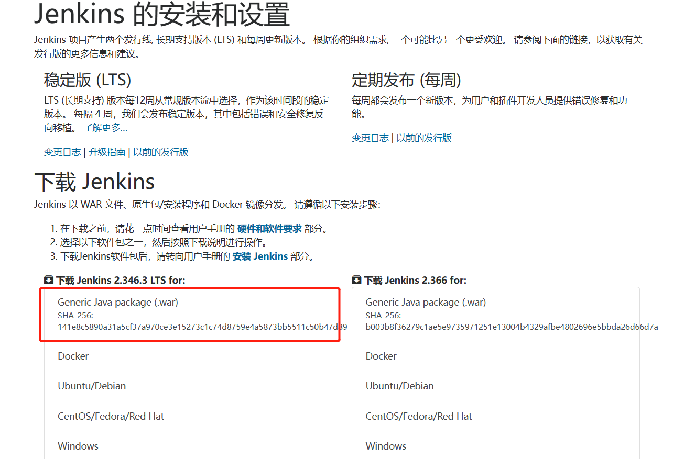

# jekins

[jekins官网](https://www.jenkins.io/zh/)

## linux安装
>1. [下载war包](https://www.jenkins.io/zh/download/)
Generic java package(.war)
```bash
wget http://mirrors.jenkins.io/war-stable/2.346.3/jenkins.war
```

>2. 启动
```sh
脚本：
#/bin/bash
echo "starting jenkins……"
nohup java -jar ./jenkins.war  --httpPort=8081 >>jenkins.log   &
echo "started jenkins"
ps -ef|grep jenkins
```
>3. 访问
   http://ip:8081 等待自安装

>4. 查找自动生成的密码（日志文件中）输入后等待启动
---
## 插件安装
>设置路径

Manage Jenkins --> Manage Plugins

>插件名称

远程发布：publish over ssh

---
## 问题处理
>1. gitea 配置web钩子不生效
   
解决：jekins安全配置（configureSecurity）配置授权策略：匿名用户增加配置
    

---
## 导入导出
> 导出 

```sh
java -jar jenkins-cli.jar -s 【jenkins访问路径，即登录jenkins后的路径】 -auth 【jenkins登录账号】:【jenkins登录密码】 get-job 【job名称】> 【job名称】.xml

eg: java -jar jenkins-cli.jar -s http://localhost:8880/ -auth zhanglp:zhangLIpeng021? get-job TKH-BAS > TKH-BAS.xml
```

> 导入

```sh
java -jar jenkins-cli.jar -s http://localhost:8880/ -auth zhanglp:zhangLIpeng021?  TKH-BAS <  TKH-BAS.xml
```

## 配置

config.xml

安装目录下：.jenkins

```xml
  <workspaceDir>${JENKINS_HOME}/workspace/${ITEM_FULL_NAME}</workspaceDir>
  <buildsDir>${ITEM_ROOTDIR}/builds</buildsDir>
    <jdks>
    <jdk>
      <name>jdk_1.8.0.161</name>
      <home>C:\Program Files\JAVA\jdk1.8.0_161</home>
      <properties/>
    </jdk>
  </jdks>
```
  <workspaceDir>D:/software/jekins/workspace/${ITEM_FULL_NAME}</workspaceDir>
  <buildsDir>D:/software/jekins/jobs/${ITEM_FULLNAME}/builds</buildsDir>

  
JENKINS_HOME、ITEM_ROOTDIR、ITEM_FULLNAME
JENKINS_HOME：表示jenkins的jobs目录，就是jobs的主目录
ITEM_FULLNAME：表示jobs的名字
ITEM_ROOTDIR：表示jenkins的主目录下的jobs下的jobs名字，可以表示为${JENKINS_HOME}/jobs/${ITEM_FULLNAME}
