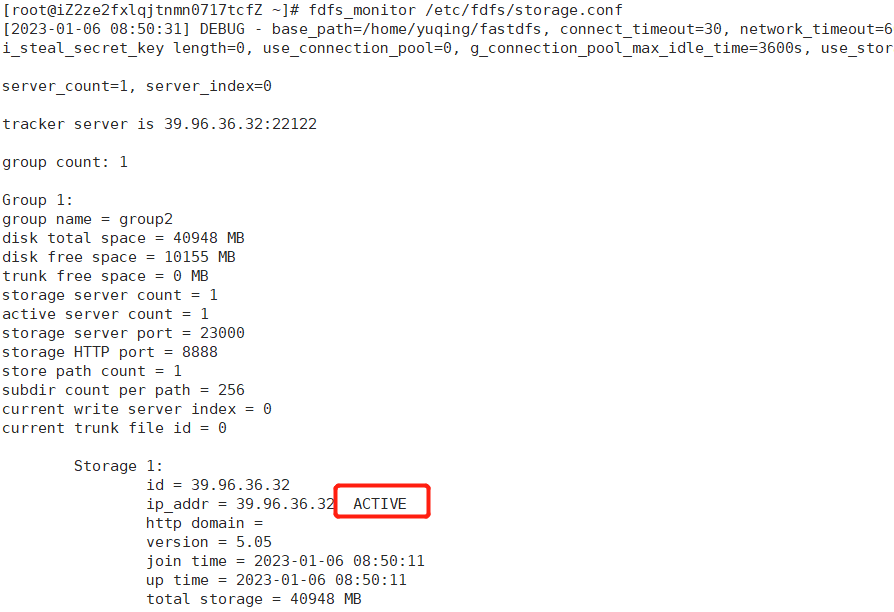
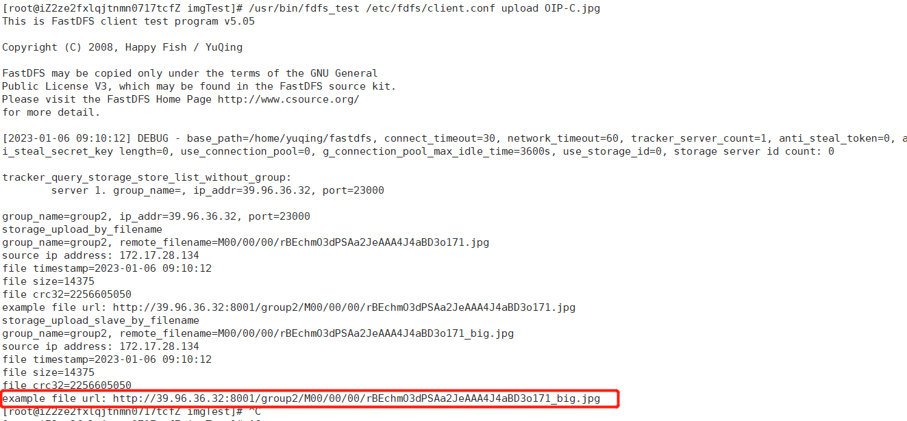

# Linux

## 给用户赋文件夹权限

```
chown -R 用户名 文件夹名
```
登陆root(拥有文件夹权限)

**chown -R maywide elasticsearch-8.5.1**

---

## 创建新用户

>增加用户
```
useradd -m 用户名
```
**useradd -m sixwork**

>设置密码  
```
passwd 用户名
```
**passwd sixwork**

---

## 更改环境变量

> 适用当前窗口
 此方式只使用于当前会话
```
export NODE_HOME=/opt/node
export PATH=$NODE_HOME/bin:$PATH
```
或者 
```
export PATH=/opt/node/bin:$PATH
```
> 
> 适用所有窗口

1. 方案一
```
    Vi ~/.bashrc（打开隐藏文件  ll -a）
最后一句添加：export PATH=/opt/node/bin:$PATH
然后执行source ~/.bashrc
```
2. 方案二
```
1，vim /etc/profile
2，在文件末尾添加以下代码
export PATH=/usr/local/go/bin:$PATH 
3，使用source使配置文件立即生效
source /etc/profile 
```
>**/etc/profile**
>>此文件为系统的每个用户设置环境信息，当用户第一次登录时，该文件被执行。
并从 /etc/profile.d 目录的配置文件中收集 shell 的设置。
如果你有对 /etc/profile 有修改的话必须得 source 一下你的修改才会生效，此修改对每个用户都生效。
3. 方案三
   
**设置环境变量，最方便**

```
1，添加新的环境变量：/usr/local/go/bin
export PATH=/usr/local/go/bin:$PATH
2，使用环境变量生效
source /etc/profile
```

---

## 远程复制（SCP）

1.scp基本格式
```
scp local_file user@host:/dir
```

2.scp复制文件到指定端口
scp默认连接的远端主机22端口，如果ssh不是使用标准的22端口（以16022为例）则使用-P（P大写）指定：
```
scp -P 16022 local_file user@host:/dir
```
3.从远端主机将文件复制到另一台远端主机
scp不仅可以将文件从本机复制到远端机器，还可以将文件从远端机复制到本机，还可以将文件从一台远端机复制到另一台远端机：
```
scp user1@host1:file1 user2@host2:file
```
这也就是说当情况如：A/B/C三台主机，A和B、B和C网络相通但A和C网络不通，要求把文件从A复制到C上。

那么可行的操作是把文件从A复制到B，再把文件从B复制到C；还可行的情况是直接在B上把文件从A复制到C，在B上执行：
```
scp userA@hostA:fileA userC@hostC:fileC
```
---

## 文件夹、文件操作

Linux文件夹或文件创建、删除

> Linux删除文件夹命令

linux删除目录很简单，很多人还是习惯用rmdir，不过一旦目录非空，就陷入深深的苦恼之中，现在使用rm -rf命令即可。

直接rm就可以了，不过要加两个参数-rf 即：rm -rf 目录名字

删除目录、文件 rm(remove)

功能说明：删除文件或目录。

语　　法：
```
rm [-dfirv][--help][--version][文件或目录...]
```
补充说明：执行rm指令可删除文件或目录，如欲删除目录必须加上参数”-r”，否则预设仅会删除文件。


|参数|说明|
|---|---|
|-d或–directory| 　直接把欲删除的目录的硬连接数据删成0，删除该目录。
|-f或–force |　强制删除文件或目录。
|-i或–interactive| 　删除既有文件或目录之前先询问用户。
|-r或-R或–recursive |　递归处理，将指定目录下的所有文件及子目录一并处理。
|-v或–verbose| 　显示指令执行过程。


> 删除文件夹
```
rm -rf fileName
```
> 删除文件夹实例：
```
rm -rf /var/log/httpd/access
```
将会删除/var/log/httpd/access目录以及其下所有文件、文件夹
需要提醒的是：使用这个rm -rf的时候一定要格外小心，linux没有回收站的

> 删除文件
```
rm -f fileNamede>
```

> 添加文件夹

创建目录：
```
mkdir(make directories)  
```
功能说明：建立目录  
语　　法：
```
mkdir [-p][--help][--version][-m <目录属性>][目录名称]  
```
补充说明：mkdir可建立目录并同时设置目录的权限。

|参数|说明|
|---|---|
|-m|<目录属性>或–mode<目录属性> 建立目录时同时设置目录的权限。
|-p或–parents| 若所要建立目录的上层目录目前尚未建立，则会一并建立上层目录。

```
mkdir test
```

> 创建文件 touch

功能说明：改变文件或目录时间。

语　　法：
```
touch [-acfm][-d <日期时间>][-r <参考文件或目 录>][-t <日期时间>] [--help]　　 [--version][文件或目录...] 或 touch [-acfm][--help][--version][日期时 间][文件或目录...]
```
**例：touch test.txt （注：Linux下没有文件后缀名区分文件类型之说，系统文件类型只有可执行文件和不可执行文件）**

补充说明：使用touch指令可更改文件或目录的日期时间，包括存取时间和更改时间。

|参数|说明|
|---|---|
|-a或–time=atime或–time=access或–time=use| 　只更改存取时间。
|-c或–no-create |　不建立任何文件。
|-d|<时间日期> 使用指定的日期时间，而非现在的时间。
|-f| 　此参数将忽略不予处理，仅负责解决BSD版本touch指令的兼容性问题。
|-m或–time=mtime或–time=modify| 　只更改变动时间。
|-r|<参考文件或目录> 把指定文件或目录的日期时间，统统设成和参考文件或目录的日期时间相同。
|-t|<日期时间> 使用指定的日期时间，而非现在的时间。


---

## 压缩与解压缩
 
 **tar命令**

> 压缩操作
```
tar -cvf /usr/local/auto_bak/test.tar /usr/local/test
```
**仅打包，不压缩**
```
tar -zcvf /usr/local/auto_bak/test.tar.gz /usr/local/test
```
**打包后，以gzip压缩 在参数f后面的压缩文件名是自己取的，习惯上用tar来做，**   
**如果加z参数，则以tar.gz 或tgz来代表gzip压缩过的tar file文件**

> 解压操作
```
tar -zxvf /usr/local/test.tar.gz
```

> tar 解压缩命令详解  

|||
|---|---|
|-c:| 建立压缩档案  |
|-x：|解压  |
|-t：|查看内容  |
|-r：|向压缩归档文件末尾追加文件  
|-u：|更新原压缩包中的文件  
**这五个是独立的命令，压缩解压都要用到其中一个，可以和别的命令连用但只能用其中一个。下面的参数是根据需要在压缩或解压档案时可选的。** 
|-z：|有gzip属性的  
|-j：|有bz2属性的  
|-Z：|有compress属性的  
|-v：|显示所有过程  
|-O：|将文件解开到标准输出  
**下面的参数-f是必须的**
|-f: |使用档案名字，切记，这个参数是最后一个参数，后面只能接档案名。  

> 示例

|命令|说明|
|---|---|
|tar -cf all.tar *.jpg |这条命令是将所有.jpg的文件打成一个名为all.tar的包。-c是表示产生新的包，-f指定包的文件名。|
|tar -rf all.tar *.gif |这条命令是将所有.gif的文件增加到all.tar的包里面去。-r是表示增加文件的意思。|
| tar -uf all.tar logo.gif |这条命令是更新原来tar包all.tar中logo.gif文件，-u是表示更新文件的意思。|
|tar -tf all.tar |这条命令是列出all.tar包中所有文件，-t是列出文件的意思|
|tar -xf all.tar |这条命令是解出all.tar包中所有文件，-x是解开的意思|

> 压缩

|命令|说明|
|---|---|
|tar –cvf jpg.tar *.jpg |将目录里所有jpg文件打包成tar.jpg|
|tar –czf jpg.tar.gz *.jpg   |将目录里所有jpg文件打包成jpg.tar后，并且将其用gzip压缩，生成一  个gzip压缩过的包，命名为jpg.tar.gz|
|tar –cjf jpg.tar.bz2 *.jpg |将目录里所有jpg文件打包成jpg.tar后，并且将其用bzip2压缩，生成一个bzip2压缩过的包，命名为jpg.tar.bz2|
|tar –cZf jpg.tar.Z *.jpg   |将目录里所有jpg文件打包成jpg.tar后，并且将其用compress压缩，生成一个umcompress压缩过的包，命名为jpg.tar.Z|
|rar a jpg.rar *.jpg |rar格式的压缩，需要先下载rar for linux|
|zip jpg.zip *.jpg |zip格式的压缩，需要先下载zip for linux|

> 解压

|命令|说明|
|---|---|
|tar –xvf file.tar |解压 tar包|
|tar -xzvf file.tar.gz |解压tar.gz|
|tar -xjvf file.tar.bz2   |解压 tar.bz2|
|tar –xZvf file.tar.Z   |解压tar.Z|
|unrar e file.rar |解压rar|
|unzip file.zip |解压zip|

> 总结

|命令|说明|
|---|---|
|*.tar| 用 tar –xvf 解压|
|*.gz| 用 gzip -d或者gunzip 解压|
|*.tar.gz和 *.tgz| 用 tar –xzf 解压|
|*.bz2| 用 bzip2 -d或者用bunzip2 解压|
|*.tar.bz2|用tar –xjf 解压|
|*.Z |用 uncompress 解压|
|*.tar.Z| 用tar –xZf 解压|
|*.rar |用 unrar e解压|
|*.zip |用 unzip 解压|


---


## 安装fdfs

> 下载压缩包
```bash
wget https://github.com/happyfish100/libfastcommon/archive/V1.0.7.tar.gz
wget http://jaist.dl.sourceforge.net/project/fastdfs/FastDFS%20Nginx%20Module%20Source%20Code/fastdfs-nginx-module_v1.16.tar.gz
wget https://github.com/happyfish100/fastdfs/archive/V5.05.tar.gz
wget http://nginx.org/download/nginx-1.12.1.tar.gz
```

> 安装gcc
1. 检查gcc是否已安装
```
gcc -v
或
gcc -version
```
2. 安装gcc
```
yum -y install gcc gcc-c++ autoconf pcre pcre-devel make automake
yum -y install wget httpd-tools vim
```

> 更改下载文件名 
```
mv V5.05.tar.gz  fastdfs-V5.05.tar.gz
mv V1.0.7.tar.gz  libfastcommon-V1.0.7.tar.gz
```

> 安装 libfastcommon

1. 解压编译
```
tar -xvf libfastcommon-V1.0.7.tar.gz
cd libfastcommon-1.0.7/
./make.sh 
./make.sh install
>> mkdir -p /usr/lib64
>>install -m 755 libfastcommon.so /usr/lib64
>>mkdir -p /usr/include/fastcommon
>>install -m 644 common_define.h hash.h chain.h logger.h base64.h shared_func.h pthread_func.h ini_file_reader.h _os_bits.h sockopt.h sched_thread.h http_func.h md5.h local_ip_func.h avl_tree.h ioevent.h ioevent_loop.h fast_task_queue.h fast_timer.h process_ctrl.h fast_mblock.h connection_pool.h /usr/include/fastcommon
```

2. 获取so
```
cd /src
ls libfastc*
```
3. 复制到 /usr/lib
```
cp libfastcommon.so /usr/lib
```

> 安装FastDFS

1. 解压并编译

```
tar -xvf fastdfs-V5.05.tar.gz
cd fastdfs-5.05
./make.sh
./make.sh install
```

2. 安装成功后将目录conf内的文件拷贝到/etc/fdfs目录下：
```
mkdir -p /etc/fdfs
cp ./conf/* /etc/fdfs/
```

> 安装tracker

1. 创建日志文件：
```
 mkdir -p /home/yuqing/fastdfs
```
2. 更改配置文件
```
view /etc/fdfs/tracker.conf
```
**端口可不更改**  
3. 进入/etc/fdfs目录，修改tracker.conf文件。如果不存在，就拷贝tracker.conf.sample文件为tracker.conf，然后再修改：
```
 base_path=/home/yuqing/fastdfs 根据需要更改，此处不更改，更改后的文件路径如果不存在需要提前创建 （注解：日志文件）
 http.server_port=8080 >>> http.server_port=8091 （注解：端口，8091是方便默认）
 store_group=group1 >>> store_group=group2（注解：组名）
```

 

1. 启动tracker，并查看是启动成功(出现如下提示，表示启动成功)：restart重启
```
fdfs_trackerd /etc/fdfs/tracker.conf start
netstat -unltp | grep tracker
```

> 安装storage

**注意：storage 和tracker 安装文件在一起**  
1. 由于storage和tracker运行的都是fastDFS程序，每一台服务器都部署一台fasfDFS，一台服务器是tracker，一台是storage

修改storage.conf文件。如果不存在，就拷贝storage.conf.sample文件为storage.conf，然后再修改：

```
view /etc/fdfs/tracker.conf
```

```

#base_path=/home/yuqing/fastdfs >>> base_path=/home/logs/storage 
根据需要更改，此处不更改，更改后的文件路径如果不存在需要提前创建 （注解：日志文件）（日志路径）

#store_path0=/home/yuqing/fastdfs >>> store_path0=/home/data/storage 
根据需要更改，此处不更改，更改后的文件路径如果不存在需要提前创建 （注解：日志文件） （实际储存文件路径，可以配置多个）

tracker_server=192.168.209.121:22122 >>> tracker_server=39.96.36.32:22122 （连接tracker服务器地址）

group_name=group2 （必须和tracker的组名相同）

http.server_port=8091 （这个端口也要改）
```
 

1. 启动storage，并查看是否成功（出现如下提示，表示启动成功）：

```
fdfs_storaged /etc/fdfs/storage.conf start
```
**注意：启动storaged的时候，启动无响应：原因：如果是在云服务器上启动，因为storaged要访问tracker_server=服务器ip:22122，所以需要开放服务器访问权限**

**云服务器需要开放8888、8091 端口**
```
netstat -unltp | grep storage
```


3. 最后，查看tracker和storage是不是在通信：
```
fdfs_monitor /etc/fdfs/storage.conf
```
出现ACTIVE，表示二者均正常启动，至此就可以进行上传文件测试了。




> 测试图片上传

1. Tracker和storage都已经安装完成，使用命令测试文件上传：
FastDFS提供一个文件上传命令：usr/bin/fdfs_test 测试文件上传。测试上传需要连接tracker服务器，连接storage服务器。因此需要指定一个配置文件：client.conf配置文件，通过Client.conf连接tracker服务器。

2. 修改/etc/fdfs下client.conf

```
view client.conf
```
**云服务器需要开放23000 端口**
```
base_path=/home/logs/client 根据需要更改，此处不更改，更改后的文件路径如果不存在需要提前创建 （日志目录）
tracker_server=39.96.36.32:22122  （tracker端口）

http.tracker_server_port=8091(外网访问端口)
```

3. 测试命令
```
/usr/bin/fdfs_test /etc/fdfs/client.conf upload anti-steal.jpg
```
4. 成功

***
**记录下此路径，后面配置完nginx后，在浏览器访问**

> 配置nginx-fdfs模块（fastdfs-nginx-module）

1. 首先解压fastdfs-nginx-module_v1.16.tar.gz，修改/fastdfs-nginx-module/src/config文件。去掉所有的local（三个）
   

2. 拷贝usr/lib64目录下库文件libfdfsclient.so 
```
cp /usr/lib64/libfdfsclient.so /usr/lib 
```

1. 在nginx安装目录下执行如下命令：把module添加nginx中。通过设置安装参数方式添加模块。
```
cd nginx-1.20.1
./configure --add-module=/usr1/software/fdfs/fastdfs-nginx-module/src
```
**路径为：model绝对位置**

1. 重新安装编译
```
make && make install
```

1. 查看Nginx的模块
```
/usr/local/nginx/sbin/nginx -V
```

1. 复制 fastdfs-nginx-module 源码中的配置文件到/etc/fdfs 目录， 并修改
```
cd fastdfs-nginx-module/src
cp mod_fastdfs.conf /etc/fdfs/
```
进入/etc/fdfs/修改mod_fastdfs.conf如下配置，其他默认
```
view /etc/fdfs/mod_fastdfs.conf
```

```
    # 连接超时时间
    connect_timeout=10

    # Tracker Server
    tracker_server=39.96.36.32:22122

    # StorageServer 默认端口
    storage_server_port=23000

    group_name=group2

    # 如果文件ID的uri中包含/group**，则要设置为true
    url_have_group_name = true

    # Storage 配置的store_path0路径，必须和storage.conf中的一致
    #store_path0=/home/data/storage
    store_path0=/home/yuqing/fastdfs 无需更改

    # the base path to store log files
    base_path=/home/yuqing/fastdfs  #默认配置，根据实际情况更改
```


7. 配置Nginx.conf

在8091端口下添加fastdfs-nginx模块
```
#user  nobody;
………………
http {
    include       mime.types;
    default_type  application/octet-stream;

    #log_format  main  '$remote_addr - $remote_user [$time_local] "$request" '
    #                  '$status $body_bytes_sent "$http_referer" '
    #                  '"$http_user_agent" "$http_x_forwarded_for"';

    #access_log  logs/access.log  main;

    sendfile        on;
    #tcp_nopush     on;

    #keepalive_timeout  0;
    keepalive_timeout  65;

    #gzip  on;

    server {
        listen       8091;
        server_name  39.96.36.32;

        #charset koi8-r;

        #access_log  logs/host.access.log  main;

        location ~/group([0-9])/M00 {
           ngx_fastdfs_module;
        }

         location / {
            root   html;
            index  index.html index.htm;
        }

        error_page  404              /404.html;

        # redirect server error pages to the static page /50x.html
        #
        error_page   500 502 503 504  /50x.html;
        location = /50x.html {
            root   html;
        }

        # proxy the PHP scripts to Apache listening on 127.0.0.1:80
        #
        #location ~ \.php$ {
        #    proxy_pass   http://127.0.0.1;
        #}

        # pass the PHP scripts to FastCGI server listening on 127.0.0.1:9000
        #
        #location ~ \.php$ {
        #    root           html;
        #    fastcgi_pass   127.0.0.1:9000;
        #    fastcgi_index  index.php;
        #    fastcgi_param  SCRIPT_FILENAME  /scripts$fastcgi_script_name;
        #    include        fastcgi_params;
        #}

        # deny access to .htaccess files, if Apache's document root
        # concurs with nginx's one
        #
        #location ~ /\.ht {
        #    deny  all;
        #}
    }

```
**listen 8091 端口值是要与 /etc/fdfs/storage.conf 中的 http.server_port=8091 (前面改成8091了)相对应。如果改成其它端口，则需要统一，同时在防火墙中打开该端口。**  

**location 的配置，如果有多个group则配置location ~/group([0-9])/M00 ，没有则不用配group。**

****


8. 在文件存储目录下创建软连接，将其链接到实际存放数据的目录，注意这个文件存储的位置后面多个data目录是系统自动生成的
```
cd /home/yuqing/fastdfs
ln -s /home/yuqing/fastdfs/data/ /home/yuqing/fastdfs/data/M00
```

9. 启动nginx

cd /usr/local/nginx/sbin/nginx
./nginx -c /usr/local/nginx/conf/nginx.conf

**如果是重启nginx：./nginx -s reload -c /usr/local/nginx/conf/nginx.conf**


> 测试 
访问上面测试上传时的路径，能访问则ok。

> 注意

1. 开放端口 22122 23000 8888 8091
2. 创建软连接
3. 重启nginx 


## 问题
>更改环境变量后 ll，ls命令失效

ftp进入/root/ 重新设置 .bashrc 文件
```
1. export PATH=/usr/local/git/bin:/usr/local/sbin:/usr/local/bin:/usr/sbin:/usr/bin:/root/bin
2. rsource ~/.bashc
ok
```


