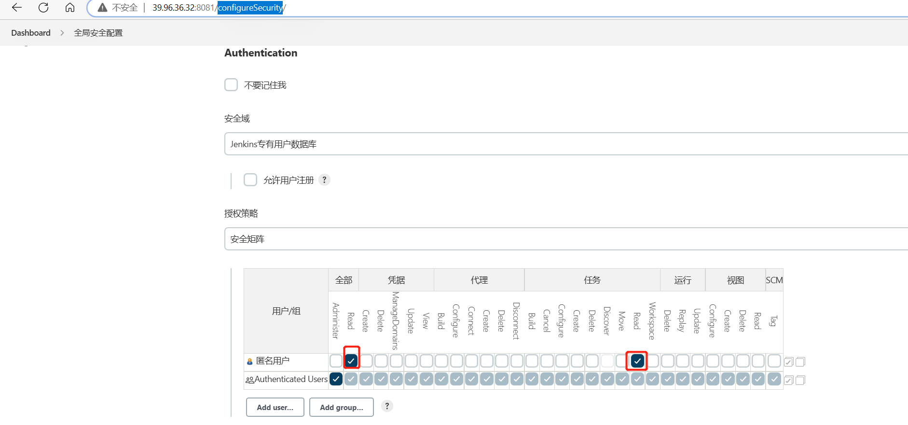

[//]: # (comment...)
[//]: <> (comment...)
[comment]: # (comment...)
[comment]: <> (comment...)


?> notes:

`23424`

html
```html
<html>
  <head>

    <link rel="stylesheet" href="//cdn.jsdelivr.net/npm/docsify@4.11.4/themes/vue.css"/>
  <style></style>
  </head>
  <body>
    <script src="//cdn.jsdelivr.net/npm/docsify@4.11.4"></script>
  </body>
</html>
```
python
```python
cd docs && python -m SimpleHTTPServer 3000
def
for
print
py aaa.py
```
python
```py
cd docs && python -m http.server 3000
```
bash
```bash
# docsify serve docs
sh aaa.sh

```
java
```java
public static void main(String[] argz){
  private
  int Integer boolean Boolean double Double float Float 


}
```
json
```json
{"a":"11"}
```


sql
```sql
select from update insert truncate
declare begin end loop  end loop
create tracate delete drop index 
```

图片

 


<br/>

### &#x1F536; Header

# H1

## H2

### H3

#### H4

##### H5

###### H6

<br/>

### &#x1F536; Emphasis

**bold**

__bold__

*italic*

_italic_

~~Strikethrough~~

<br/>

### &#x1F536; Typographic

`code`

'single quotes'

"double quotes"

(c) (r) (tm) (p) +-

<br/>

### &#x1F536; Emoji

:four_leaf_clover: :cactus: :deciduous_tree:

:hibiscus: :fallen_leaf: :blossom:

:tulip: :sunflower: :leaves:

:evergreen_tree: :maple_leaf: :ear_of_rice:

<br/>

### &#x1F536;  Colored Symbol

BLUE BOOK &#x1F4D8;

GREEN BOOK &#x1F4D7;

ORANGE BOOK &#x1F4D9;

BLUE CIRCLE &#x1F535;

BLUE DIAMOND &#x1F537;

UP-POINTING RED TRIANGLE &#x1F53A;

DOWN-POINTING RED TRIANGLE &#x1F53B;

UP-POINTING SMALL RED TRIANGLE &#x1F53C;

DOWN-POINTING SMALL RED TRIANGLE &#x1F53D;

<br/>

### &#x1F536; Blockquotes

> Nested blockquotes
>> A

>>> B

>>>> C

<br/>

### &#x1F536; List

Unordered

+ Start a line with `+`, `-`, or `*`

+ Sub-lists 1:

  - A

    * B

    + C

    - D

Ordered

 1. A

 2. B

 3. C

<br/>

### &#x1F536; Code

Inline `code`

Indented code

    // Comment

    line 1
    line 2
    line 3

Block code

```
Sample text...
```

Syntax highlighting

```
var foo = function (bar) {
  return bar++;
};

console.log(foo(x));
```

<br/>

### &#x1F536; Subscript

- 2^th^

<br/>

### &#x1F536; Superscript

- H~2~O

<br/>

### &#x1F536; \<ins>

++Inserted text++

<br/>

### &#x1F536; \<mark>

==Marked text==

<br/>

### &#x1F536; Abbreviation

Abbr example...

*[Abbr]: abbreviation is a shortened form of a word or phrase

<br/>

### &#x1F536; Definition

_Normal style:_

Item 1
 -  A

    B
    : C

    : D

Item 2

: A

: B

_Compact style:_

Item 1

 ~ A

 ~ B

 ~ C

Item 2

 ~ A

 ~ B

 ~ C

<br/>

### &#x1F536; Footnote

Footnote ...[^1]

Footnote ...[^2]

[^1]: Footnote #1

[^2]: Footnote #2
