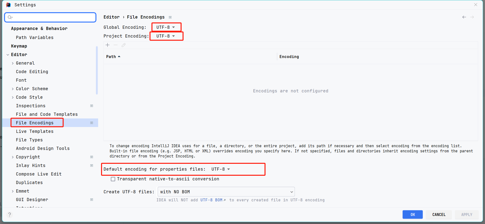
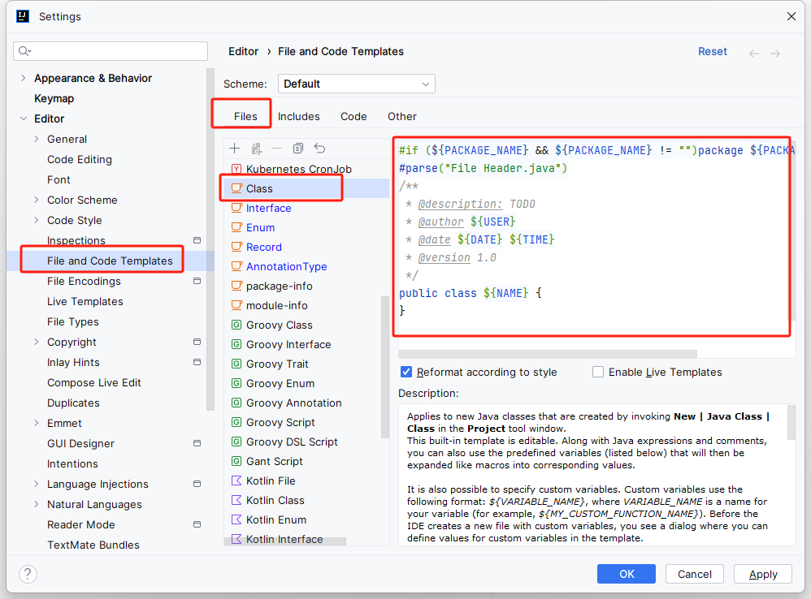

# Interllij idea 

## 配置

### 设置项目 编码格式

> 设置编码格式



## 插件

> maven 依赖关系插件

```
maven helper
```

## 自动引入包、去掉未使用的包

> settings→Editor→General→Auto Import

选中`Optimize imports on the fly`和`Add unambiguous imports on the fly`

?> Optimize imports on the fly：自动去掉一些没有用到的包

?> Add unambiguous imports on the fly： 自动帮我们优化导入的包


## 配置注释模板

setting->Editor->File and Code Templates

右侧选择Files->class

配置模板如下：

```java
#if (${PACKAGE_NAME} && ${PACKAGE_NAME} != "")package ${PACKAGE_NAME};#end
#parse("File Header.java")
/**
 * @description: TODO 
 * @author ${USER}
 * @date ${DATE} ${TIME}
 * @version 1.0
 */
public class ${NAME} {
}
```




## jrebel 插件

--新
激活服务包所有版本，下载与idea版本对应包
https://plugins.jetbrains.com/plugin/4441-jrebel-and-xrebel/versions/stable

下载后，会弹出安装方式，照着安装

激活方式：
url: http://39.96.36.32:8888/59e32f80-6e74-4fac-99ce-7df7a2658e3e
email:aaa@163.com


--- 旧
[document](https://manuals.jrebel.com/jrebel/ide/intellij.html)

[下载激活服务包](https://github.com/ilanyu/ReverseProxy/releases)

[生成guid](https://www.guidgen.com/)

激活配置


配置热加载服务


快捷方式：立即触发

```sh
ctrl+shift+F9
```

## mybatis tool

`Free MyBatis Tool` is a plugin that enhances idea support for mybatis.

**快速从代码跳转到mapper及从mapper返回代码**


## 下载源码

```sh
 mvn dependency:resolve -Dclassifier=sources
```
