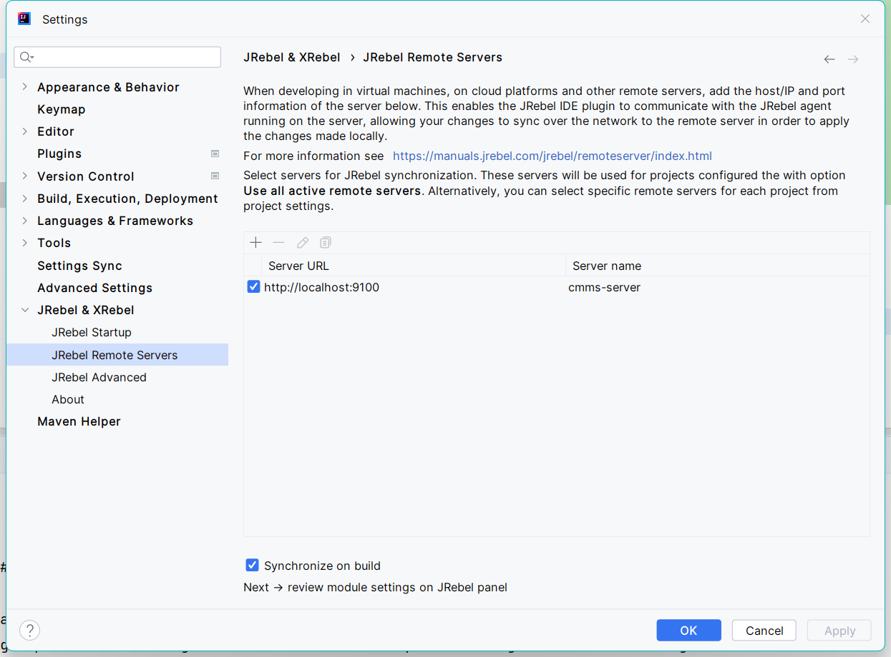

# Interllij idea 

## 插件

> maven 依赖关系插件

```
maven helper
```

## 自动引入包、去掉未使用的包

> settings→Editor→General→Auto Import

选中`Optimize imports on the fly`和`Add unambiguous imports on the fly`

?> Optimize imports on the fly：自动去掉一些没有用到的包

?> Add unambiguous imports on the fly： 自动帮我们优化导入的包


## jrebel 插件

[document](https://manuals.jrebel.com/jrebel/ide/intellij.html)

[下载激活服务包](https://github.com/ilanyu/ReverseProxy/releases)

[生成guid](https://www.guidgen.com/)

激活配置

配置热加载服务




快捷方式：立即触发

```sh
ctrl+shift+F9
```
