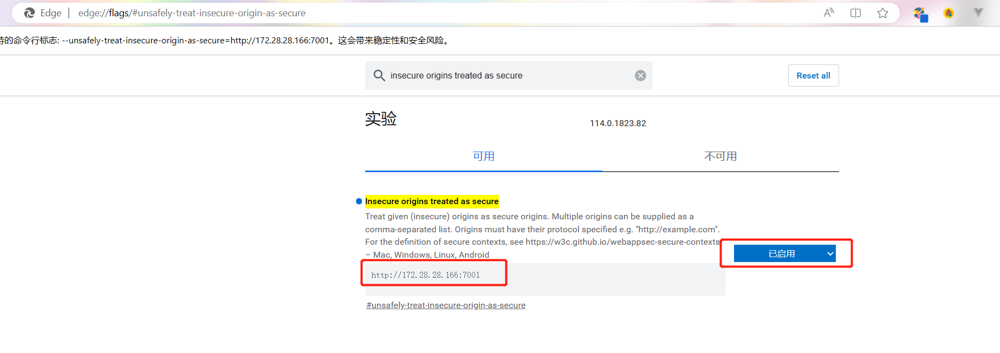

# javascript

## 浏览器使用摄像头

```html
  <video id="video" width="400px" height="300px" ></video>
  <canvas id="imgBase64" width="400px" height="300px"></canvas>
```

### 打开摄像头

```javascript
let authMediaStream = null
navigator.mediaDevices.getUserMedia(constraints)
        .then(mediaStream => {
          // 成功返回promise对象，接收一个mediaStream参数与video标签进行对接
          authMediaStream = document.getElementById('video').srcObject = mediaStream
          document.getElementById('video').play()
        })
```

### 拍照

```js
let imgCanvas = document.getElementById('imgBase64')
const videoEle = document.getElementById('video')
let  ctx = imgCanvas.getContext('2d')
let width = 400
let height = 300
let videoWidth = 400
let videoHeight = 300
ctx.drawImage(videoEle, 0, 0, videoWidth,videoHeight, 0, 0, width, height)
    //   获取拍照的 base64 
let imgBase64 = imgCanvas.toDataURL('image/jpeg', 1)

```

?> `drawImage` [用法](https://developer.mozilla.org/zh-CN/docs/Web/API/CanvasRenderingContext2D/drawImage)

?> `toDataURL` [用法](https://developer.mozilla.org/zh-CN/docs/Web/API/HTMLCanvasElement/toDataURL)

### 关闭摄像头

```js
if (document.getElementById('video')) {
document.getElementById('video').srcObject = null
}
authMediaStream && authMediaStream.getTracks().forEach(track => {
track.stop()
})
```

### 浏览器使用摄像头权限问题

!> 本地测试没有问题，部署后，如果网站是 `http`,则无法获取摄像头使用权限

处理方式如下：

#### 改为 `https`

更改nginx部署方式 :

?> 需要申请证书 [openssl](/linux1/install/nginx?id=openssl)

?> 搭建证书认证服务器 [mkcert](/linux1/install/nginx?id=mkcert-ssl)

#### 更改浏览器配置

地址栏输入：

`chrome://flags/#unsafely-treat-insecure-origin-as-secure` `edge://flags/#unsafely-treat-insecure-origin-as-secure`

搜索：`insecure origins treated as secure` 选择`已启用` ，输入 `http://ip:port`

