# Uniapp android plugin

>  ## 教程

!> 主要步骤 参考此文档

[官网文档](https://nativesupport.dcloud.net.cn/NativePlugin/course/android.html)

>  ## 环境配置

### idea

配置android环境：安装 android support 插件

### gradle 

[gradle 配置](/server/build/gradle/gradle.md)

> ## 下载 uniapp 插件原生项目 

[地址](https://nativesupport.dcloud.net.cn/NativePlugin/course/android.html#%E5%AF%BC%E5%85%A5uni%E6%8F%92%E4%BB%B6%E5%8E%9F%E7%94%9F%E9%A1%B9%E7%9B%AE)

---

> ## 创建uniapp

### 创建证书

[生成证书](/server/language/java/java.md?id=keytool)

### 查看证书

记住证书 `SHA1` `MD5` `SHA256` 后面创建应用需要

```sh
.\keytool.exe -list -v -alias 别名  -storepass 密码  -keystore  证书文件
```

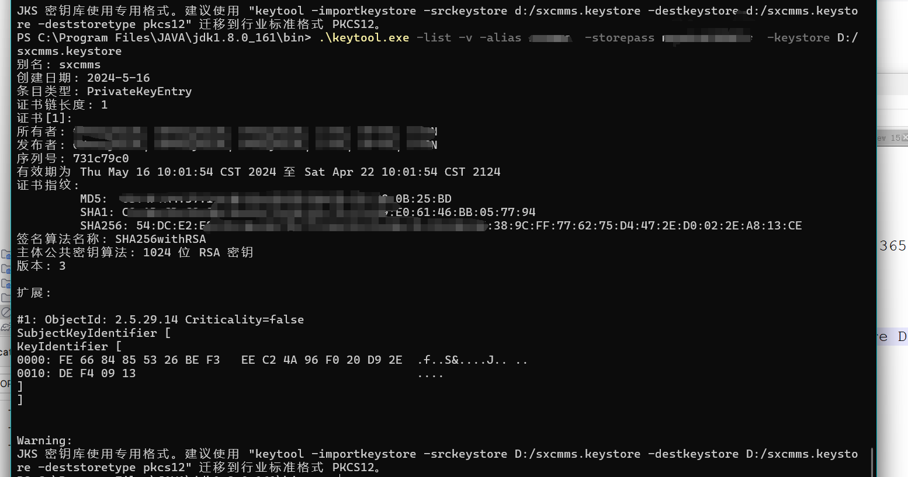

### 创建应用

```sh
https://dev.dcloud.net.cn/pages/app/list
```
[dcloud开发者中心](https://dev.dcloud.net.cn/pages/app/list)


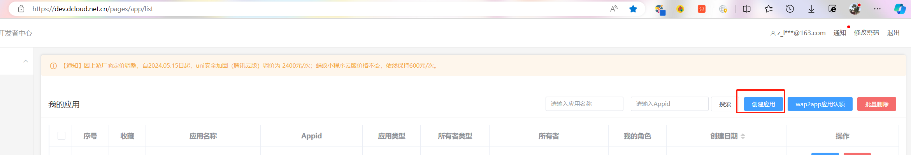
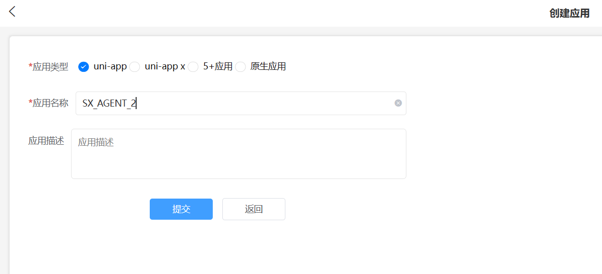

### 填写平台信息 

包名可自定义，对应的android项目 需要更改：
1, app/build.gradle:android.defaultConfig.applicationId
2, app/src/main/AndroidManifest.xml: package 内容

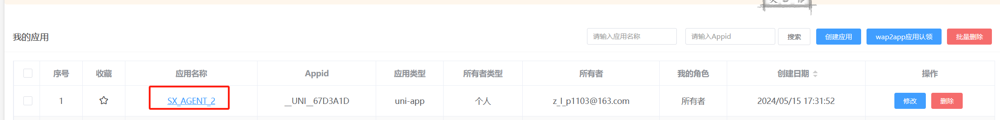
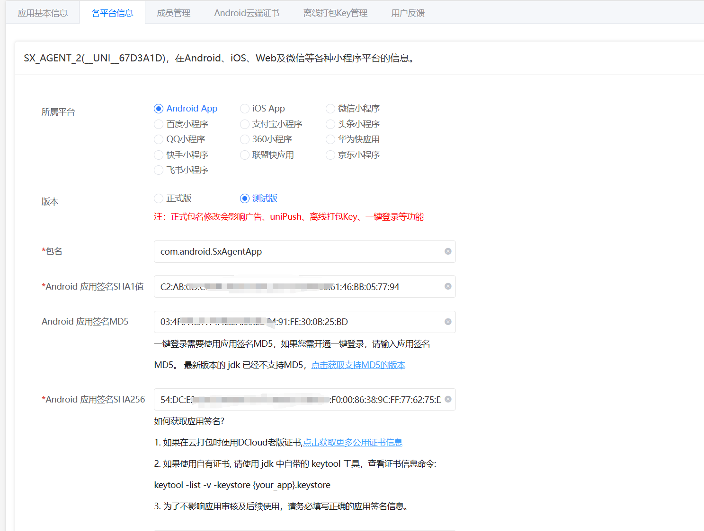

### 创建离线打包key

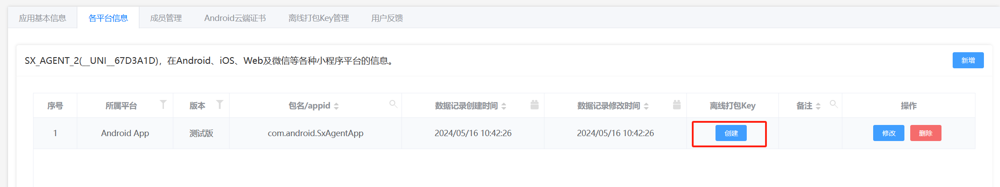
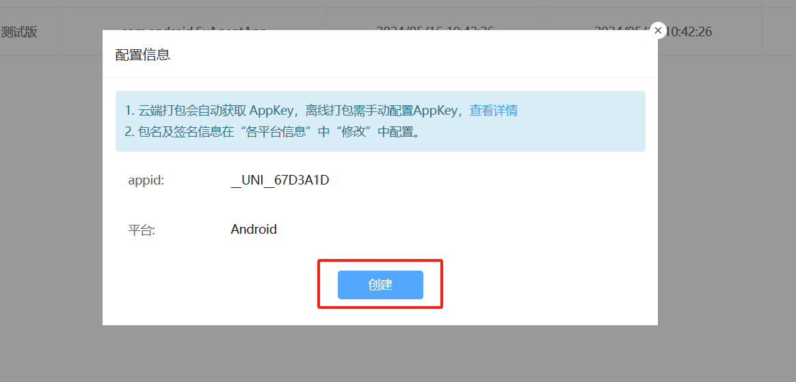
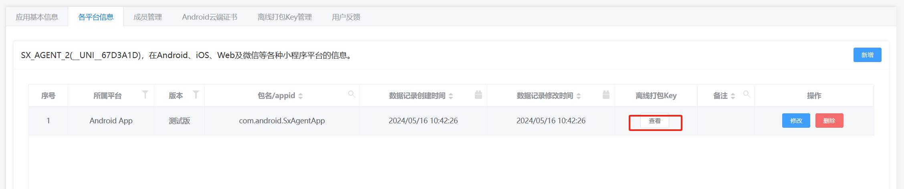
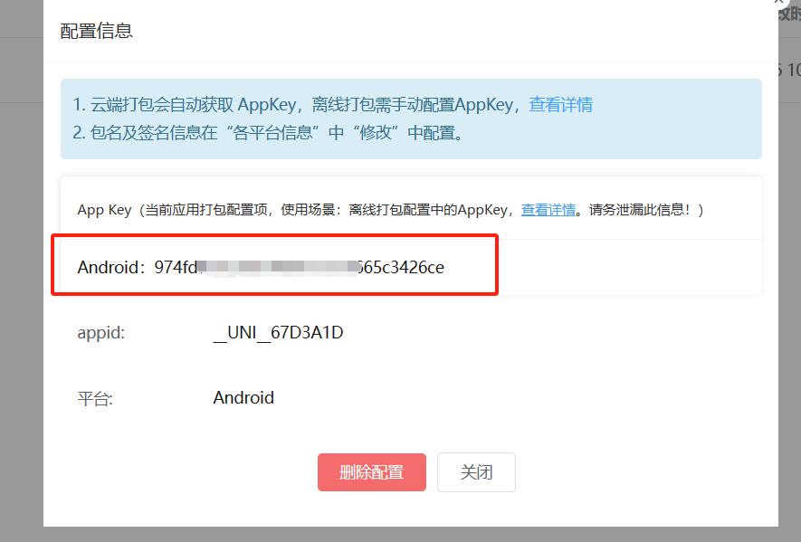

### 创建uniapp

更改appid

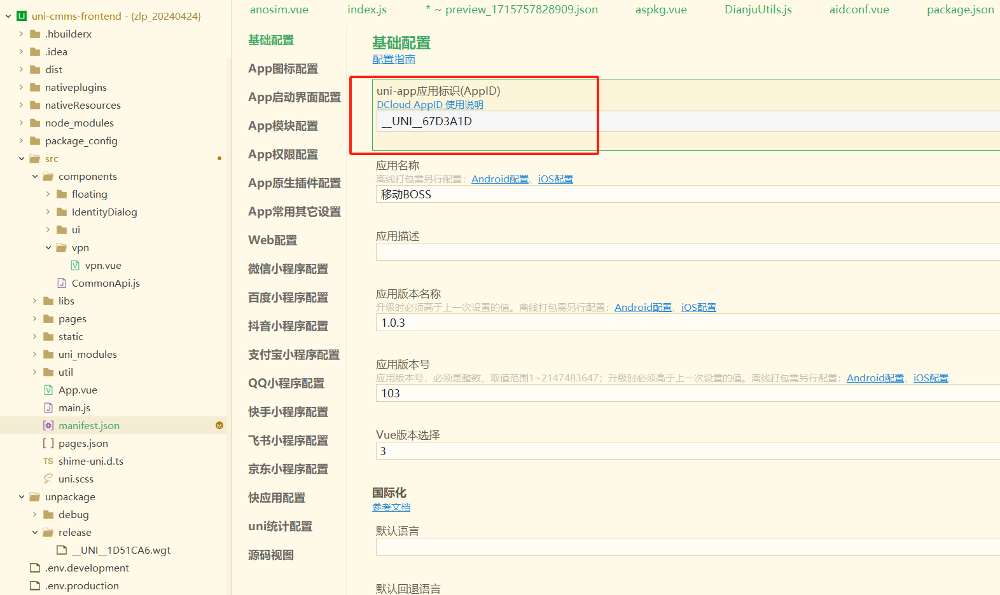

### 填写appkey

把我们刚才申请的appkey填写到 app/src/main/AndroidManifest.xml 中，因为开发的是安卓，所以appkey填安卓的


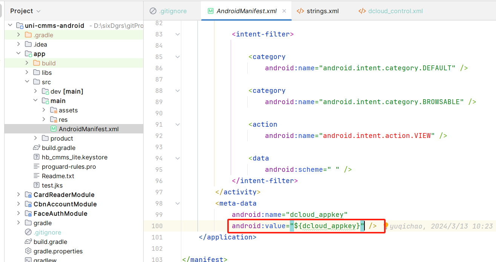

### 放置证书

把我们的签名证书放到app目录下，

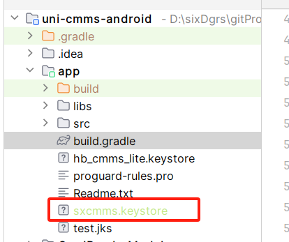

### 配置签名证书

在 app/build.gradle 的 signingConfigs 选项中

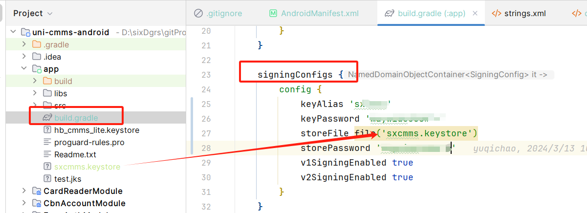
